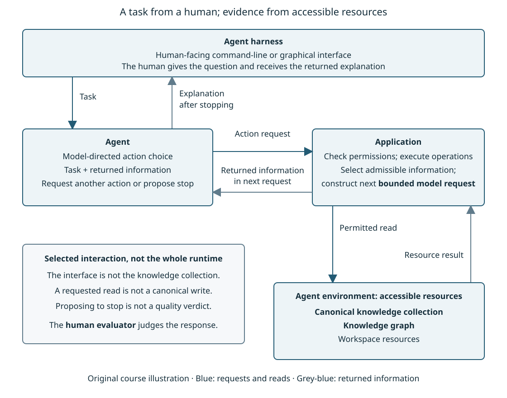
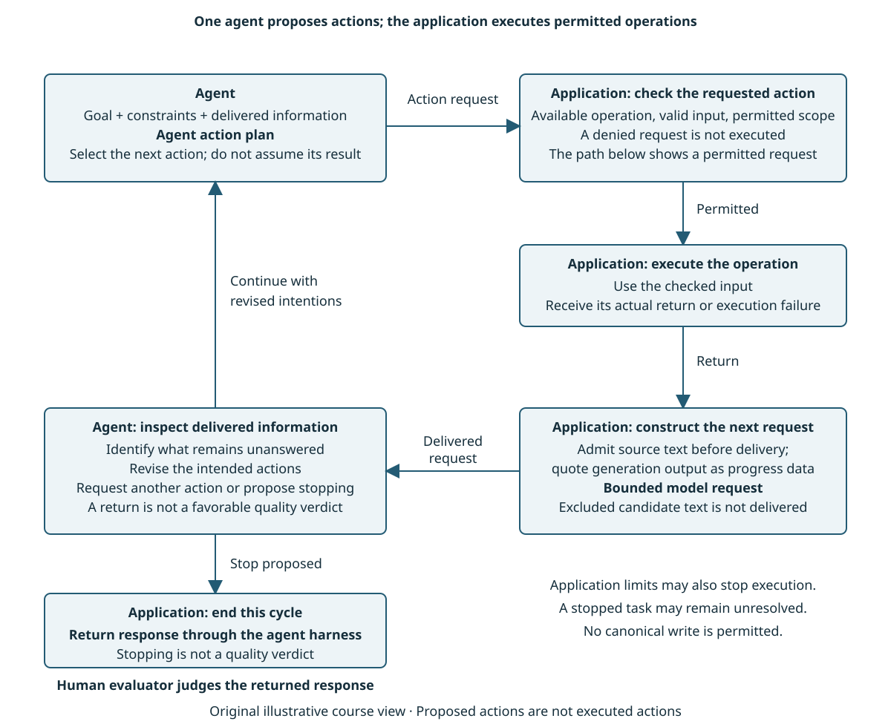
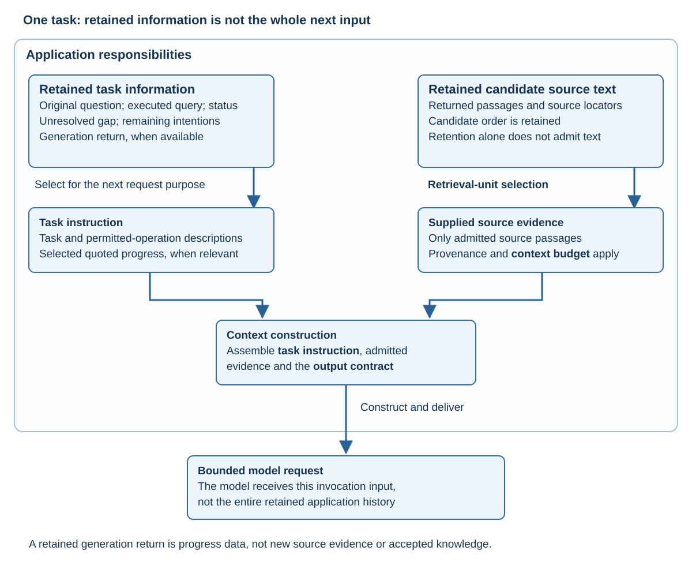
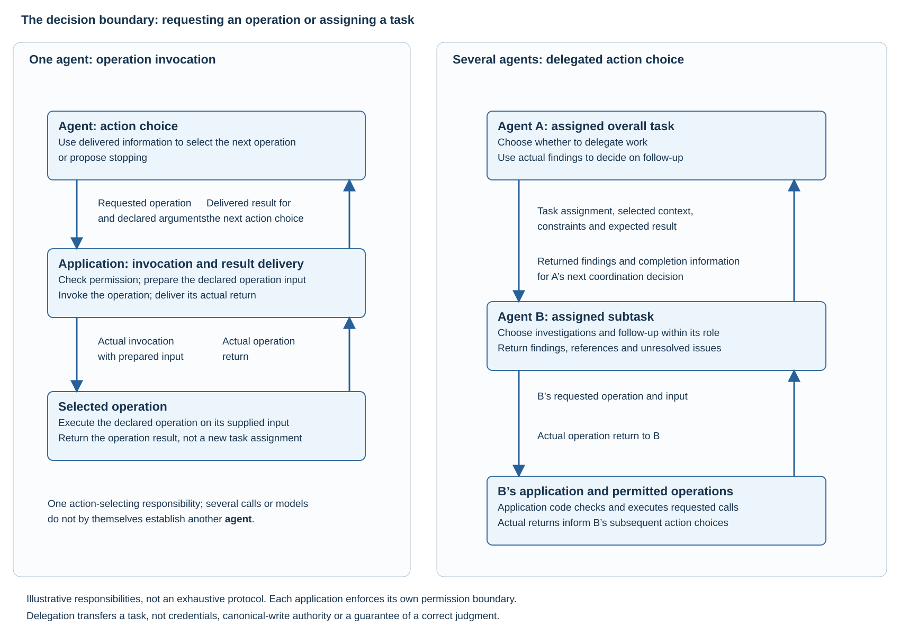
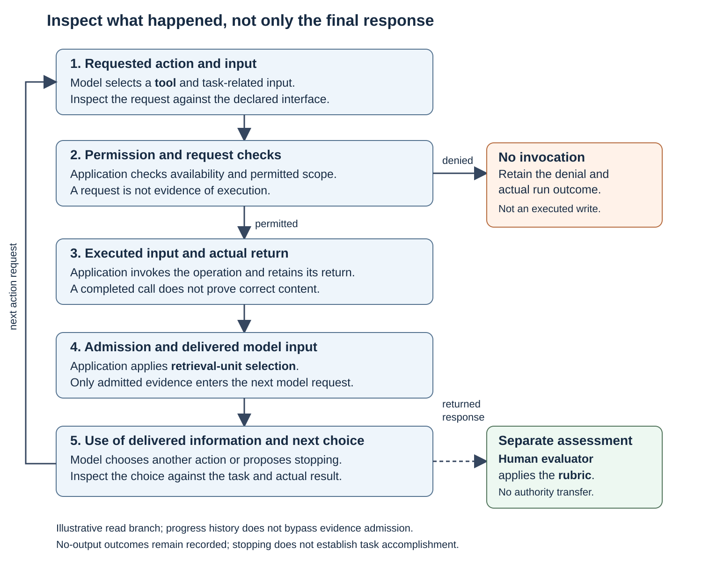

# Module 07: Agents and Multi-Agent Systems — Theory

Last updated: 2026-11-19

> **Status:** Ready for Students — approved for publication by the instructor on 2026-11-20

## 0. Engineering problem and learning outcomes

Module 06 established a question-answering path for explaining which concepts are prerequisites for a named target concept and how the prerequisite connections follow from the sources. The fixed path uses the existing **canonical knowledge collection** and **knowledge graph** to construct a **bounded model request**. The **model-backed prerequisite-explanation operation** returns a **generated prerequisite explanation** or **refusal**. Module 07 examines how a model can use the information returned by an operation to choose which permitted operation to request next.

**Key concepts for this opening.** Two established generation outcomes remain distinct:

- A **generated prerequisite explanation** is the model's attempted explanation of the named target's prerequisite connections, with **claim citations**. The output name does not establish that the explanation is correct or adequately supported.
- A **refusal** records that the **model-backed prerequisite-explanation operation** does not provide the explanation because the **supplied source evidence** cannot support the task without inventing a source fact, or because a selected **retrieval unit** carries an instruction that conflicts with the **task instruction**. An execution failure or silence is not automatically a **refusal**.

The **human evaluator** judges the returned response using the Module 06 **rubric**. That judgment concerns the response produced by the fixed path; it does not establish whether a later action will accomplish the user's task. Module 06 deliberately left unspecified how the system should select another permitted operation in response to what the preceding operation returned. This boundary concerns control over operations, not the absence of question answering.

Consider a question whose **supplied source evidence** identifies a prerequisite concept but does not explain why that concept is needed to understand the target. The next design question is which permitted operation could obtain the missing evidence. Repeating generation with an unchanged **bounded model request** does not by itself supply that missing evidence.

*AI Engineering*, Chapter 6, “Agent Overview,” illustrates how an observed information gap can change the next information request. Chapter 10, “Step 5. Add Agent Patterns,” describes using an initial response together with newly retrieved context in a subsequent model call.

Module 07 applies that relationship to the prerequisite-explanation task. The model requests an action; the application controls its execution under the declared permissions. Information returned to the model informs its next choice or proposal to stop.

The main running example develops one model-directed participant carrying out the task. A separate comparison examines when several interacting participants, each choosing actions for an assigned task, are justified. The example reuses the retrieval and request-construction mechanisms of Modules 04–06 rather than introducing another retrieval algorithm. The module also distinguishes information retained between actions from information selected for each **bounded model request**.

The authority boundary also remains unchanged. A returned explanation, a proposed next action or a judgment that the task is complete does not authorize a change to the **canonical knowledge collection**. Accepted changes still require the **authorized human reviewer** and the **authorized writer**.

### Learning outcomes

After studying this module, students can:

1. Explain different interpretations of an actor that observes its surroundings and acts on them; distinguish the course's model-directed convention from a predefined workflow and distinguish one such actor from several interacting actors.
2. Explain which operations a model may request, distinguish reading from writing, and separate an action request from permission to execute it.
3. Explain how a sequence of intended actions follows from the task's goal and constraints, and how returned information can require that sequence to change.
4. Distinguish retaining task information for later actions from selecting information for one **bounded model request**.
5. Trace action choice, application execution, returned information and continuation; justify when delegating tasks among several action-selecting participants is worth its coordination costs under the declared task, deployment and permission constraints.
6. Distinguish action-selection errors, permission denials, unauthorized execution, execution failures and response-quality failures, and interpret resource measurements under declared comparison conditions.

**Section conclusion.** The fixed path remains a means of answering the prerequisite question. The new design problem is how returned information should influence the next permitted action and the decision to stop. Section 1 introduces the actors that make those choices and explains their interaction with the resources on which they act.

## 1. **Agent**, **agent environment**, and the **agent loop**

A prerequisite question can remain unanswered after a relevant passage has been retrieved: that passage may name a prerequisite without explaining its role. Requesting another search requires a choice based on the information already returned. This section explains who makes that choice and how the requested action reaches the relevant resources. The running example develops a read-only cycle that obtains missing evidence, requests an explanation, and stops without changing accepted knowledge.

**Key concepts for this section.** The following concepts distinguish the participant making decisions, the resources it interacts with, and their repeated interaction:

- An **agent** is an entity that perceives its surroundings and acts on them. This broad formulation, used in *AI Engineering*, includes software and physical systems. In the LLM-based example here, the **agent** uses a model to select the next permitted action from the task and returned information; application code executes the requested operation. This selected convention is narrower than the broad formulation, not a definition of every historical **agent**.
- The **agent environment** consists of the surroundings and accessible resources with which an **agent** interacts. A game, a road system, or a collection of files can serve this role. Here it includes the accessible **canonical knowledge collection**, **knowledge graph**, and workspace resources. An observation is information obtained from those resources; an action is an operation directed at them. Read access does not imply permission to modify them.
- An **agent loop** is the repeated interaction in which an **agent** observes available information, selects an action, receives its execution result, and decides whether to continue. In the selected LLM-based arrangement, the model selects an action or proposes stopping; the application enforces permissions and stopping limits. The loop connects decisions to returned results rather than merely repeating model calls.
- A **multi-agent system** (**MAS**) consists of two or more interacting **agents**, each choosing actions within its assigned role and constraints. **MAS** is the English-derived abbreviation used in this course. Several calls to one model do not by themselves establish several **agents**; several **agents** may use the same underlying model.

The reused **agent harness** is the command-line or graphical interface through which a human interacts with the AI assistant, as introduced in Module 01. It is not another name for the **agent environment**. The interface through which a person gives a task and the resources on which the assistant acts have different roles, even when one application provides both.

### 1.1 Why the label does not determine the architecture

The technical concept of an **agent** predates LLM applications. Wooldridge and Jennings's *Intelligent Agents: Theory and Practice*, Section 1.a, discusses the absence of a universally accepted definition. Their weak notion of agency combines autonomy, social ability, reactivity, and pro-activeness: control over actions without direct intervention, communication with others, response to environmental change, and initiative toward a goal. Their stronger notion additionally uses human-oriented concepts such as beliefs and intentions to describe or implement the system. Neither account requires an LLM.

These requirements are more specific than the minimal perceive-and-act formulation. Different definitions can therefore classify the same software differently without describing a different program. A comparison must name the defining properties rather than assume that the word **agent** specifies them. Using a belief-oriented description does not establish consciousness or human-like understanding.

*AI Engineering*, Chapter 6, “Agent Overview,” uses the broad formulation and includes RAG systems among **agents** with retrieval capabilities. Anthropic's *Building effective agents*, “What are agents?”, explicitly distinguishes predefined workflows from systems in which an LLM dynamically directs the process and its use of available operations. The latter distinction is the operational convention selected for this module's LLM-based example.

The fixed Module 06 path remains a predefined sequence under that convention. It can retrieve evidence and generate an answer without selecting a different next operation from an observed information gap. Calling that path an **agent** under the book's broader usage does not establish that it implements the model-directed **agent loop** studied here. Conversely, the selected convention does not invalidate the book's usage or redefine every classical **agent**.

The practical question is where the next-operation decision resides. In a predefined workflow, application code fixes the operation sequence or branching rules. In the selected **agent loop**, the model interprets the task and returned information to request the next permitted operation. Code still determines which operations exist, checks requests, and executes them. A system can combine a predefined operation internally with model-directed selection of that operation externally.

The surrounding application is therefore necessary to interpret the model's choice. A generated request is not its own execution: the application provides resource access, executes a requested operation when permitted, and returns its result. Action selection need not use a separate planner service. Installing a framework, making an LLM call, or adding search does not demonstrate that feedback-dependent choice occurs.

### 1.2 Resources and human interaction have different roles

An **agent environment** depends on the task. A game-playing **agent** observes game state and selects permitted moves. A web-searching **agent** interacts with accessible web resources. A coding **agent** interacts with repository files and command results. Available operations limit which resources it can inspect or change; merely naming an environment grants no access to it.

For the knowledge-system example, the human enters the prerequisite question through the **agent harness**. The **agent** requests an information operation against accessible knowledge resources. The human supplies the task, whereas the resource operation returns evidence used in performing it. Several **agents** can share resources, so the term **agent environment** does not imply exclusive ownership.

Figure 1.1 separates these exchanges and their responsible participants. The action request reaches resources through application execution; returned information reaches the model through the application's next request construction.

**Figure 1.1 - Selected read-only interaction for one agent.** Original course illustration of the human-facing **agent harness**, model-directed choice, application execution, and knowledge resources in the **agent environment**. Arrows distinguish tasks and answers, action requests, resource reads, and returned information. The view is illustrative, not an exhaustive runtime architecture; canonical writes are excluded.

Returned information is not identical to the resource itself. The **canonical knowledge collection** remains outside the model request; the application selects admissible text and constructs the next **bounded model request**. The **knowledge graph** likewise remains an accessible resource rather than automatically becoming model input. Modules 05–06's evidence-admission and request-construction boundaries still apply.

Broader software descriptions may call the whole execution runtime a harness. This course retains Module 01's human-interface meaning of **agent harness**. The agent-computer interface in *AI Engineering*, Figure 6-8, concerns how software operations reach resources; it is not a reason to silently change the accepted human-interface label.

### 1.3 An observed gap changes the next action

*AI Engineering* illustrates feedback-dependent choice with a sales-projection task. The requested result is a projection for a product over the next three months. The **agent** requests historical sales through SQL-query generation and execution. After examining the returned numbers, it may identify missing information and request past marketing-campaign data. It then uses the additional information to produce the projection and decides that the task is complete.

The important relation is not that SQL is used twice. The first result supplies a reason for selecting the second information request. A predefined program could also request both datasets, but in this example the model identifies the need from returned information. This is an illustrative sequence, not evidence that every resulting projection is reliable.

The following constructed course example transfers that relation to prerequisite explanation. It is not an observed experiment or a claim about the contents of the accepted collection. The target is **embedding-based retrieval**. The illustrative accessible collection contains two passages with resolvable **provenance links**:

- The initially returned passage states: “In this teaching route, understanding **embedding-based retrieval** requires understanding a **query embedding**.” It identifies a prerequisite without explaining its role.
- Another accessible passage states: “A **query embedding** represents the question as a vector for comparison with stored vectors representing **retrieval units**. Understanding that representation explains how the question can be matched to candidate **retrieval units**.” This is stipulated course-authored source evidence, not a quotation from a book.

The illustrative task asks only why **query embedding** is needed for **embedding-based retrieval** in this teaching route. It does not require reconstructing every prerequisite of the target. The permitted operations are a **retrieval operation** over the accessible collection and the inherited **model-backed prerequisite-explanation operation**. The application constructs each **bounded model request** under the existing evidence rules. No write to the **canonical knowledge collection** is permitted.

The **agent loop** proceeds as follows:

1. The model receives the task and the initially returned passage. It identifies the gap: the passage states the prerequisite relation but not the role of the **query embedding**. It requests a **retrieval operation** for source text explaining that role.
2. The application checks the request against the permitted read scope, executes the **retrieval operation**, and returns the second passage with its source locator. The **agent environment** contains the resource being read; the observation is the returned passage, not the entire collection.
3. The model uses that observation to request the **model-backed prerequisite-explanation operation**. The application applies evidence-admission rules, constructs a **bounded model request** containing the two admitted passages, and executes the operation. Both passages are stipulated to fit the declared **context budget**, with resolvable **provenance links**; retrieval alone would not guarantee admission.
4. In this illustration, the operation returns a **generated prerequisite explanation** stating that the **query embedding** represents the question for vector comparison, so understanding it explains how the question participates in finding candidate **retrieval units**. Its **claim citations** identify the second admitted passage for that explanation and the first for the stated teaching-route relation.
5. The model observes the returned explanation and proposes stopping: the narrow task has an attempted source-cited answer, so it requests no further operation. The application ends the cycle and returns the explanation through the **agent harness**. The **human evaluator** still judges the response under the applicable **rubric**; proposing to stop is not a favorable evaluation verdict.

This trace supplies the next-operation decision that Module 06 left unspecified without changing the internal retrieval method. It separates two returns: the **retrieval operation** returns candidate evidence, whereas the **model-backed prerequisite-explanation operation** returns a **generated prerequisite explanation** or **refusal**. Neither object authorizes a change to accepted knowledge.

The illustrated successful branch is not guaranteed. If accessible material cannot support the explanation, the inherited operation must return **refusal** rather than invent a source fact. Its conflicting-instruction condition also remains in force. An operation failure is not automatically a **refusal**. Application-enforced limits must prevent indefinite continuation; detailed stopping policies and failure evaluation belong to Sections 5–6. Autonomous action choice grants neither unlimited permissions nor guaranteed correctness.

### 1.4 One participant or several

The running example uses one **agent** to choose retrieval, request explanation, and propose stopping. Several model calls for those choices and for generation do not make it a **multi-agent system**. The generation operation returns a requested output; it is not thereby a second independently action-selecting participant.

For a contrasting **MAS** illustration, a first **agent** prepares an explanation and delegates a source-checking task to a second **agent**. The second receives the explanation and cited source locators, chooses which permitted source reads are needed to check the claims, and returns its findings to the first. Its task-directed action selection and the interaction between the two **agents** distinguish this arrangement from calling a fixed checker that always performs a predetermined comparison.

Both **agents** could use the same model and share the same **agent environment**. Conversely, two named **prompts** or two model providers do not establish two **agents**. Section 5 examines whether delegation justifies its coordination costs. This comparison requires no second implementation and makes no claim that a **MAS** will improve the answer.

> **Further reading.** *AI Engineering*, Chapter 6, the warning immediately before “Agent Overview” (working-copy PDF page 536), explains the experimental status of its treatment of generative-AI-powered **agents**. Revisit that warning when comparing newer frameworks: an engineering account is not a universal classification standard.
>
> Wooldridge and Jennings, *Intelligent Agents: Theory and Practice*, Section 1.a, “What is an Agent?” (manuscript pages 4–5), develops the stronger mental-state-oriented account and additional attributes of agency. That depth is useful when comparing belief- and intention-based designs with the LLM-directed interaction studied here. The distinctions used above remain self-contained; deeper study is optional enrichment, not required for Laboratory 07 or Module 07 assessment. Pagination is specific to the consulted book edition and manuscript version.

**Section conclusion.** In the constructed knowledge-system cycle, one **agent** identifies an explanatory gap, requests a permitted read, uses the returned passage to request an explanation, and proposes stopping after that explanation is returned. The **agent environment** supplies accessible resources; the **agent harness** supports the separate human interaction. The cycle establishes feedback-dependent action choice, not correctness, permission to write, or the superiority of several **agents**. Section 2 specifies how available operations are exposed as **tools** and how their read and write permissions differ.

## 2. **Tools** and the **tool inventory**

A request to obtain more evidence must identify an operation the application can actually execute. A request to change accepted knowledge requires different authority, even when both requests concern the same collection. This section explains how operations become available to the **agent** and why availability is not permission for every use. The running example specifies the inputs, returns and permission boundaries of the two operations used in Section 1.

**Key concepts for this section.** Two new concepts describe the available capabilities rather than the participant that chooses an action:

- A **tool** is a capability exposed for an **agent** to invoke. Its description identifies the operation, the input the operation accepts and the result it returns. The model requests use of the **tool**; application code executes the corresponding operation when the request is permitted. A **tool** is therefore neither the action-selecting **agent** nor the returned information. The established **retrieval operation**, exposed with a **text query** as input and a **ranked candidate output** as its return, is one example.
- A **tool inventory** is the declared set of **tools** available to an **agent**. It bounds which exposed operations the model can request, but it does not grant every request permission to execute. An application can expose a read operation while restricting which resources the operation may read. The selected **tool inventory** here contains the **retrieval operation** and the **model-backed prerequisite-explanation operation**, with no operation for changing the **canonical knowledge collection**.

Two reused boundaries matter when interpreting a return. A **ranked candidate output** contains candidate **retrieval units** returned by the **retrieval operation**; the returned **source fragments** are not automatically **supplied source evidence**. **Retrieval-unit selection** checks **provenance-link resolution** and **context-budget fit** before admitted **retrieval units** become **supplied source evidence**. Admission does not establish that the admitted text supports the requested explanation.

A **bounded model request** carries a **task instruction**, admitted **supplied source evidence** and an **output contract**. The **task instruction** declares the requested operation and its constraints. The **output contract** declares the required return, not whether that return will be correct.

### 2.1 What different capabilities contribute

*AI Engineering*, Chapter 6, “Tools,” organizes external capabilities by three purposes. The following overview explains what each purpose adds; it is not a requirement to implement every category:

1. Knowledge augmentation obtains information for the model. A text retriever returns candidate passages; an inventory-reading API returns product information. Access to more information can address missing context, but neither access nor **retrieval** establishes that the returned material is reliable or relevant.
2. Capability extension makes another operation available beyond what the underlying model directly provides. A calculator computes an arithmetic result; a code interpreter executes a program and returns its output or execution error. These are operations with their own inputs and returns, not evidence that the model has acquired the same internal capability.
3. Write actions change data or other state in the **agent environment**. An email-sending operation sends a message, and a database-update operation changes stored data. Such actions can accomplish a task beyond returning an answer, but an incorrect or unauthorized action can have consequences outside the generated text.

The purpose categories and the distinction between reading and writing answer different questions. A read action obtains information without changing the stored data being read. A write action changes the affected external state. The same service can expose both: a SQL executor may read rows or change them, and an email API may retrieve a message or send one. The requested operation and its effects, not the service name, determine which permission is needed.

A **tool** that executes code therefore cannot be assumed read-only merely because the intended purpose is calculation. The application must constrain what that execution can access or change. Likewise, restricting a **tool** for **retrieval** to selected sources concerns access scope; calling it read-only does not permit reading every source. These distinctions apply before any choice about which operation to request next.

The knowledge-system example selects knowledge augmentation through the existing **retrieval operation**. The **model-backed prerequisite-explanation operation** supplies the requested generation capability. Its return is a response, not a stored correction to accepted knowledge. No database-update or other canonical-write capability is needed to answer the narrow prerequisite question.

The book calls provider support for requesting external operations function calling. That feature name does not mean that generated text executes itself or that the provider authorizes a change to a resource. The application still connects the requested operation to an implementation, checks the request and provides the returned result. This section explains that relationship without requiring a provider-specific request format.

### 2.2 A declared set is not a universal best set

Which operations should be exposed depends on the task, the **agent environment** and the model's ability to use the descriptions and returned information. An inaccessible operation cannot help even if the model names it. Conversely, an exposed operation with an unclear input description can be selected or invoked incorrectly. An operation must be both useful for the task and usable through the interface the application provides.

*AI Engineering*, “Tool selection,” explains the **trade-off**: more **tools** can enable more actions, but they also make selection harder and add descriptions that consume model context. The historical examples Toolformer, Chameleon and Gorilla illustrate different scopes, from small selected operation sets to selection among many API calls. Their different scopes do not establish one generally preferable **tool inventory** or a requirement to reproduce those systems.

For the constructed prerequisite task, the selected pair has a concrete rationale. The **retrieval operation** can obtain the missing passage; the **model-backed prerequisite-explanation operation** can use admitted evidence to attempt the requested explanation. Sending email or updating accepted records contributes nothing to this task's stated result. Omitting those capabilities limits what this **agent** can request rather than relying on an instruction not to use an unnecessary write capability.

Whether the selected pair performs adequately still requires evaluation on declared tasks. A larger available set is not automatically an improvement, and a rarely requested **tool** is not automatically useless. Frequency of use and contribution to task outcomes are different observations. Section 6 develops failure and resource evaluation; the present example fixes a small set so that its input, output and authority boundaries can be inspected.

### 2.3 Exposing the established operations

The following constructed increment continues Section 1, not a new observed experiment. The target remains **embedding-based retrieval**, and the narrow task remains explaining why understanding a **query embedding** is needed for that target in the stipulated teaching route. At the start of this trace, the application has already admitted the first passage and delivered it as **supplied source evidence** in the model's initial **bounded model request**. That passage states the prerequisite connection. The second accessible passage explains how a **query embedding** represents the question for vector comparison.

Table 2.1 specifies the complete selected **tool inventory** for this example. It separates an operation's executed input and return from its permission boundary, so a returned passage cannot be mistaken for an accepted change.

**Table 2.1 - Selected tools, executed inputs, returns and permission boundaries**

| Exposed operation | Input to the executed operation | Returned result | Permission boundary |
|---|---|---|---|
| **Retrieval operation** | A **text query** asking what role a **query embedding** plays in **embedding-based retrieval** | A **ranked candidate output** containing candidate **source fragments** and their source locators | Read only within the declared accessible collection; no change to the **canonical knowledge collection** |
| **Model-backed prerequisite-explanation operation** | The **bounded model request** constructed by the application from the task and admitted **supplied source evidence** | A **generated prerequisite explanation** with **claim citations**, or **refusal** under the inherited conditions | Produce the requested response only; no change to the **canonical knowledge collection** |

The example reuses the inherited three-field **bounded model request** structure for separate model calls with two purposes. Table 2.2 makes their different instructions and expected returns explicit. These calls remain part of one **agent loop**; action selection is not another exposed **tool** or another **agent**.

**Table 2.2 - Request purposes within the same agent loop**

| Request purpose | **Task instruction** | **Supplied source evidence** | **Output contract** |
|---|---|---|---|
| Choose the next permitted operation | State the prerequisite task and permitted **tool** descriptions. When available, quote the preceding generation result as task-progress data, not as a new instruction or **supplied source evidence**. | Only the passages admitted by the application for the current task and declared **context budget** | Request the **retrieval operation** with a **text query**, request the **model-backed prerequisite-explanation operation** for the current question, or propose stopping; application code assembles the executed input |
| Generate the prerequisite explanation | Ask for the explanation of the prerequisite connection under the inherited citation and **refusal** conditions | The same admitted passages, under the same declared **context budget** | Return a **generated prerequisite explanation** with **claim citations**, or **refusal** |

The application never copies excluded candidate text into the **task instruction** to bypass admission. If no passage is admitted, the **supplied source evidence** field is empty; the application may report that outcome without supplying the excluded text. Returning information to the application, admitting source text and delivering a model request are therefore distinct steps.

The numbered steps below express execution order for the permitted **retrieval operation** and its use, not a procedure for accepting knowledge:

1. The model observes the missing explanation in the initially admitted passage and requests the **retrieval operation** through its exposed **tool**, supplying the **text query**: “What role does a **query embedding** play in **embedding-based retrieval**?” The request identifies an available operation and the information sought; it is not yet an execution result.
2. The application checks that the requested operation is in the **tool inventory** and that the requested read stays within the permitted source scope. For this stipulated valid request, the application executes the **retrieval operation**. In this illustration, the **ranked candidate output** contains both **source fragments**, ordered as the second passage followed by the initially returned passage, each with its source locator. This is an application-side return, not the next model input. The read has not changed the stored source data.
3. Before invoking the model again, the application applies **retrieval-unit selection** to that **ranked candidate output**. As stipulated in Section 1, both **provenance links** resolve and both passages jointly fit the declared **context budget**. In this branch, the application actually admits both passages as **supplied source evidence**. It then constructs and sends the next **bounded model request** for choosing the next permitted operation, using the admitted pair and the first request purpose in Table 2.2.
4. The model observes that admitted **supplied source evidence**, not the unfiltered **ranked candidate output**, and requests the **model-backed prerequisite-explanation operation** through its exposed **tool**. The application checks the requested operation and constructs a separate **bounded model request** for explanation generation. This request retains the same admitted pair under the same budget, but uses the explanation **task instruction** and **output contract** in Table 2.2. Changing the request's purpose does not automatically admit another passage or grant another permission.
5. The application executes the **model-backed prerequisite-explanation operation** with that generation request. In the illustrated branch, it returns the same **generated prerequisite explanation** described in Section 1. The application delivers this return through another action-selection request, with the generation result identified as task-progress data as specified in Table 2.2, not as additional **supplied source evidence**. The model proposes stopping; the **human evaluator** still judges the explanation separately. A successful **tool** invocation establishes neither a favorable evaluation nor authority to store the response as accepted knowledge.

If the model instead asks to store a proposed correction to the **canonical knowledge collection**, the application must not execute that request in this example. The selected **tool inventory** exposes no canonical-write operation, and the declared task grants no canonical-write permission. A generated instruction to perform the change does not add the missing capability or authority. The **canonical knowledge collection** remains unchanged.

In the inherited governed-change path, the **authorized human reviewer** decides whether to accept an exact proposed change, and the **authorized writer** performs only an accepted change. The **authorized writer** is an execution role, not another name for any operation the model happens to request. That separate path is not activated by returning an explanation or by the model's proposal to stop. The read/write distinction comes from the book; this particular acceptance boundary comes from the course's established knowledge-system design.

> **Further reading.** *AI Engineering*, Chapter 6, “Tool selection” (edition-specific working-copy PDF pages 572–576), develops ways to investigate a larger **tool inventory**: compare alternative sets, remove an operation to test its contribution, inspect recurring use errors and examine use distributions. Figure 6-14, “Different models and tasks express different tool use patterns” (PDF page 573), illustrates why use frequency depends on the tested model and task. That empirical comparison is useful when deciding which capabilities to expose; its historical results are not measurements of the course example.
>
> Figure 6-15, “A tool transition tree by Lu et al. (2023)” (PDF page 575; caption continues on page 576), illustrates transitions between operations. The accompanying “Tool selection” discussion considers combining frequently consecutive operations and retaining newly created capabilities for later reuse. This depth becomes useful when investigating whether a larger operation set contains recurring combinations worth exposing together. The named investigations and capability-composition depth are optional enrichment, not required for Laboratory 07 or Module 07 assessment; the purpose categories, selection **trade-off** and permission distinctions explained above remain required understanding.

**Section conclusion.** The constructed example exposes two **tools** with distinct inputs and returns: the **retrieval operation** supplies candidate passages, and the **model-backed prerequisite-explanation operation** produces an attempted explanation or **refusal** from an application-constructed **bounded model request**. The **tool inventory** makes those capabilities available without authorizing canonical writes or admitting retrieved text automatically. The example establishes what the **agent** can request and what the application may execute, not that the returned explanation is correct. Section 3 explains how intended actions follow from the task's goal and constraints and how returned information can change those intentions.

## 3. **Planning agent actions**

Knowing which operations are available does not establish which sequence can answer the question. An initially relevant passage may identify a prerequisite but leave its role unexplained. This section explains how the task's goal and constraints shape intended actions, and how returned information changes those intentions. The running example develops the intended sequence behind the read-only cycle in Sections 1–2, without adding another operation.

**Key concepts for this section.** Two new concepts distinguish a process from its proposed result:

- **Planning agent actions** is determining the actions and their sequence by which an **agent** intends to achieve a task's goal under its constraints, and revising those intentions when returned information changes what is needed. The goal specifies the result sought; constraints restrict acceptable ways of obtaining it. For example, explaining a prerequisite from accessible source text is a goal with an evidence constraint. Determining that another read must precede explanation is **planning agent actions**; requesting that read is the next-action choice, not the whole process.
- An **agent action plan** is the proposed course of actions, with their intended order, for achieving that goal under those constraints. It can cover the whole task or only the next part whose actions can presently be determined. In this example, obtaining text about a prerequisite's role before requesting its explanation is an **agent action plan**. It describes intentions, not proof that the operations have run, that the evidence exists, or that the eventual response will be correct.

Two established distinctions remain necessary. The **tool inventory** declares available operations, whereas an **agent action plan** selects intended uses of those operations. The **agent loop** connects actual choices and returned information over time; an **agent action plan** describes what the **agent** currently intends within that interaction. Neither a proposed sequence nor a completion judgment grants permission to change the **canonical knowledge collection**.

### 3.1 From a goal to permitted, revisable actions

*AI Engineering*, Chapter 6, “Planning,” describes a task through its goal and constraints, and a plan through the steps intended to accomplish the task. Its “Planning overview” separates generating a plan, checking it, executing actions, and evaluating their outcomes. A plausible-looking sequence is not sufficient: it can name an unavailable operation, use unsuitable inputs, or fail to obtain the information the task needs.

Three questions expose different problems in a proposed sequence:

1. Does the sequence address the goal? Generating a definition of **embedding-based retrieval** would not by itself explain why a **query embedding** is needed in the stipulated teaching route.
2. Are its actions available and permitted? A proposed canonical write violates this example's read-only scope, even if the model claims that the write would help.
3. Do its action inputs have a basis? A subsequent **text query** can be chosen after a passage reveals an explanatory gap; a model must not treat an unknown source locator or an assumed search result as something already returned.

These questions do not require a separate action-selecting participant. In the selected one-**agent** route, the model proposes actions and uses admitted information to reconsider them. The application checks the requested operation and its inputs against the exposed interface and permissions before execution. A check that a read is permitted does not establish that its eventual return will answer the question. Conversely, the model's judgment that evidence is useful cannot bypass application-side admission.

The book presents heuristics such as rejecting unavailable actions or excessively long plans. Such checks can reject some unsuitable proposals, but a sequence that passes them can still fail. A separate model could assess a proposal, and a human could provide or inspect intended steps. These are alternatives, not evidence that a checker is infallible or that the course example needs another **agent**. The inherited **authorized human reviewer** and **authorized writer** retain their different responsibilities for accepted knowledge changes; inspecting an **agent action plan** does not activate that governed-change path.

A useful distinction concerns how far ahead the **agent** commits its intentions. A whole-task **agent action plan** anticipates the route to completion. This makes dependencies inspectable, but later inputs may depend on returns not yet available.

A shorter **agent action plan** covers a subtask and is extended after its result becomes available. It reduces the need to guess those inputs, but requires further decisions and does not guarantee progress. The running example selects the latter approach because the missing explanation determines the next **text query**.

The detail of the proposed actions also matters. “Obtain evidence for the explanation” states an objective but does not identify an executable input. “Request the **retrieval operation** with this **text query**” is closer to execution, but depends on the declared operation interface. The book's “Planning granularity” explains this distinction: higher-level descriptions need a translation into concrete operations; operation-level descriptions are more tightly coupled to those operations. This section uses readable intentions together with the already specified inputs, not a new executable plan language.

### 3.2 Dependencies, alternatives and feedback

An **agent action plan** need not consist solely of an unconditional sequence. Table 3.1 compares four orders of execution discussed in *AI Engineering*, “Complex plans.” The examples explain the alternatives; only the feedback-dependent read route developed below is required here. A branching application with predefined conditions remains a predefined workflow unless the model makes the task-dependent action choice under the convention in Section 1.

**Table 3.1 - Orders of execution and the dependencies they express**

| Order | Relationship between actions | Example and limit |
|---|---|---|
| Sequential | A later action starts after an earlier action completes; it may depend on that action’s result. | A **text query** about a newly identified gap follows inspection of the admitted passage. Reversing the actions would require guessing the gap. |
| Parallel | Independent actions may execute concurrently when their inputs are already available. | Reads from two permitted sources could run together if neither read needs the other's return. Concurrency cannot remove a dependency on an unknown input. |
| Conditional | The next action depends on a stated condition evaluated from available information. | Request more evidence when the admitted passage leaves the prerequisite's role unexplained; otherwise consider requesting explanation. The model's assessment does not guarantee evidence sufficiency. |
| Repeated | An action or sequence can be performed again while a continuation condition holds. | Another search can follow another identified gap, subject to application-enforced limits. Repeating an unchanged search does not establish that new evidence will appear. |

Execution feedback can alter both the inputs and the remaining actions. A relevant passage can identify a concept whose role needs explanation. A later admitted passage can supply that explanation, removing the reason for another search. An empty or inadmissible return may instead leave the gap unresolved. In each case, the next decision must use the information actually delivered to the model, not assume that application-side candidate text was observed.

Figure 3.1 distinguishes proposed actions from actual execution and shows where returned information becomes available for revising the remaining intentions. It represents the same one-**agent** arrangement, not several participants named after software functions. The application prepares source-bearing requests under the admission rules from Section 2; generation returns are delivered as quoted task-progress data, not new **supplied source evidence**.

**Figure 3.1 - Intended actions and execution feedback in one agent loop.** Original course illustration informed by the planning/execution distinction in *AI Engineering*, Figure 6-9. The view is illustrative, not an exhaustive runtime architecture. A proposed action can be rejected before execution; a returned result can leave the task unresolved. The application also enforces stopping limits, and a proposal to stop is not a response-quality verdict.

The book's “Reflection and error correction” describes examining plans or outcomes and using that examination to identify corrections. ReAct illustrates interleaving action with inspection of observations. Reflexion illustrates evaluating an outcome, examining what went wrong and using that information in another attempt. These names identify research patterns, not additional capabilities automatically supplied by every **agent loop**. The selected example requires explaining the observation-to-action relationship, not reproducing either framework or exposing a model's private reasoning.

Further inspection and revision also have costs. They can require additional model calls, longer requests and more executed operations. A corrected intention may help only if its proposed action can obtain information relevant to the unresolved goal. Section 6 owns the comparison of completed outcomes and resource use; the presence of feedback alone establishes neither better answers nor lower cost.

### 3.3 Revising the intended route in the running example

The following constructed increment explains the intentions behind the same successful branch as Sections 1–2. The literal user question for this narrow instance is: “Why is understanding a **query embedding** needed for **embedding-based retrieval** in this teaching route?” It asks for the role of one prerequisite, not a complete catalogue of prerequisites. The goal is a source-cited explanation of that role. The constraints remain the accessible source scope, the declared **context budget**, the inherited citation and **refusal** conditions, and no canonical write.

The two stipulated course-authored passages remain unchanged:

- The initially admitted passage states: “In this teaching route, understanding **embedding-based retrieval** requires understanding a **query embedding**.”
- The other accessible passage states: “A **query embedding** represents the question as a vector for comparison with stored vectors representing **retrieval units**. Understanding that representation explains how the question can be matched to candidate **retrieval units**.”

At the starting point, the application has admitted and delivered only the first passage in the initial **bounded model request**. The second passage is accessible to the **retrieval operation**, but its text is not yet available to the action-selecting model. The first passage establishes the named connection without explaining why the representation matters. That precise gap, rather than a generic instruction to try again, motivates another read.

The following numbered sequence states the order of the example's decisions and executions. The descriptions of intended actions are explanatory representations of the **agent action plan**, not an added runtime record or a fourth request field:

1. From the initial admitted passage, the model determines the short **agent action plan**: obtain source text about the role of the **query embedding**, then request an explanation if admitted text supports that role. The intended second action is conditional; the model does not assume that the search will succeed. The immediate choice is the **retrieval operation**, not explanation generation from the incomplete passage.
2. The model requests that read with the **text query**: “What role does a **query embedding** play in **embedding-based retrieval**?” This is an intermediate request for missing information, not a replacement of the user's explanation task. The application checks the requested operation and read scope, then executes the permitted operation.
3. As in Section 2, the application receives a **ranked candidate output** containing both **source fragments**, ordered as the second passage followed by the first, with their source locators. It applies **retrieval-unit selection**: the two **provenance links** resolve and the passages jointly fit the stipulated **context budget**. The application admits both as **supplied source evidence**, constructs the next action-selection **bounded model request**, and delivers that request. Only then can the model inspect the added passage.
4. The added passage explains vector representation and comparison with stored vectors. The model therefore revises the remaining **agent action plan**: the extra read is completed, another search for that same explanatory role is no longer intended in this branch, and explanation generation is now the next proposed action. This change is based on the admitted passage's content, not merely on a successful search status.
5. The model requests the **model-backed prerequisite-explanation operation**. The application checks the request and constructs the generation **bounded model request** with the same admitted pair and the explanation instruction and return requirement from Table 2.2. In this stipulated branch, the operation returns the **generated prerequisite explanation** described in Section 1, with **claim citations** to the two passages. The application delivers that return in the next action-selection request as quoted task-progress data.
6. The model proposes stopping because the narrow task now has an attempted source-cited answer. The application ends the cycle and returns that explanation through the **agent harness**. The **human evaluator** judges the response under the **rubric**; the completed intended sequence is not a favorable judgment of the response and does not authorize storing it as accepted knowledge.

If the search returns no admissible text, the application reports that outcome without delivering excluded candidate text. The model cannot infer the missing explanatory source fact from the absence of a return. It may propose another permitted read only with a stated unresolved explanatory gap, within application-enforced limits; an unchanged request is not itself a repair.

If explanation is attempted without evidence that can support the task, the inherited **refusal** condition applies. An execution failure remains distinct from that response. Sections 5–6 develop continuation limits and failure outcomes rather than assuming every revised intention succeeds.

> **Further reading.** *AI Engineering*, Chapter 6, “Planning granularity” (edition-specific working-copy PDF pages 562–564) develops higher-level and operation-level representations and the translation between them. “Complex plans” (pages 564–566, Figure 6-11) develops the control-pattern overview above. This additional representation and implementation depth becomes useful when a task requires several dependent branches or concurrent operations. “Function calling,” particularly Figure 6-10 (page 561), illustrates declarations and a model call; implementing a particular provider interface requires that provider's current documentation.
>
> “Foundation models as planners” (pages 552–554) presents the debate about executable plans, search and predicted action outcomes, useful when evaluating what a plausible generated sequence actually demonstrates. “Reflection and error correction” (pages 567–571, Figures 6-12 and 6-13) illustrates ReAct and Reflexion beyond the compact distinctions above. Those research examples help compare ways of inspecting outcomes and revising later attempts; their historical results are not measurements of the course example. The named implementation and research depth is optional enrichment, not required for Laboratory 07 or Module 07 assessment. The goal/constraint distinction, overview alternatives and feedback-dependent revision explained in this section remain required understanding.

**Section conclusion.** In the constructed prerequisite task, the initial admitted passage supplies a specific explanatory gap. The **agent action plan** places another permitted read before explanation; the returned and admitted second passage changes the remaining intentions from obtaining evidence to requesting explanation. **Planning agent actions**, next-action choice and actual execution are therefore related but distinct. The example establishes a source-informed revision of intentions, not guaranteed success, a favorable **rubric** judgment or canonical-write authority. Section 4 explains how task information can remain available for later actions without treating everything retained as evidence admitted to the next **bounded model request**.

## 4. **Agent memory**

After another read, the next decision still concerns the original question, not just the latest passage. The system must keep the task, what has already been requested and what the returned information has changed available for later actions. This section explains that continuity and distinguishes information retained by the application from information delivered to a particular model call. The running example shows how the same task survives the additional search without sending the entire execution history to explanation generation.

**Key concepts for this section.** One new concept explains continuity across actions:

- **Agent memory** comprises mechanisms for retaining information obtained or produced while carrying out a task so that an **agent** can use that information in later actions. Its contents can include the task, executed requests, returned results and remaining intentions. Application-managed retention makes selected information available to subsequent model calls; it does not mean that the model automatically remembers an earlier call. For example, retaining the original prerequisite question and the search already performed helps a later decision distinguish the user's goal from the intermediate request for missing information. This retention neither changes the model's learned parameters nor establishes that retained claims are true.

Two established concepts delimit what a model actually receives. A **bounded model request** is the constructed input for one invocation, not a record of everything the application retains. **Context construction** assembles selected information into that request under the declared **context budget** and task constraints. Retention and inclusion in a request therefore have different purposes; inclusion of source text still requires the established admission path.

### 4.1 Retained information and the current model input

*AI Engineering*, Chapter 6, “Memory,” describes mechanisms for retaining and using information. It notes that multi-step applications may need instructions, plans and operation returns across several actions, while the information accumulated can exceed the model's context limit. Keeping information outside one invocation and selecting what an invocation receives address related but different problems.

The book distinguishes three mechanisms. The following overview identifies their different locations and change boundaries; it does not prescribe three new components for the course example:

1. Internal knowledge is information represented in the trained model. Changing that learned information requires a model update; merely storing a new passage in application data does not perform that update. Internal knowledge is not a retained execution history of the present task.
2. Short-term memory, in the book's terminology, is the information in the model's current context. Earlier messages can influence a later response when the application includes them in that later input. The context has a finite capacity and is not an automatic cross-call guarantee.
3. Long-term memory, in the book's terminology, is information stored outside the model and made available through **retrieval**. It can persist beyond one task and be changed without updating the model. External persistence alone does not make all its contents visible in a current request or authorize their use as evidence.

These source descriptions distinguish information locations, not a claim that every **agent** implements the same storage design. The required route uses **agent memory** to preserve information across the actions of one task. It does not require retaining personal preferences across sessions, training a model or adding another external store. The existing **canonical knowledge collection** remains a source of accepted knowledge, not a place to append an execution history merely because later actions need that history.

The engineering question is which retained information the next invocation needs. Including the complete history is simple to describe but consumes finite context and can repeat obsolete intentions. Including only the most recent return can omit the original task or why a follow-up search was performed. The selected route retains task information in the application and constructs each request for its declared purpose. This makes the selection explicit, at the cost of having to preserve the task's meaning and the status of returned information when preparing later inputs.

Memory management is not another name for **retrieval-unit selection**. An executed query may be useful for avoiding an unexplained repetition but is not a source passage supporting the answer. Conversely, a retained passage may be relevant yet fail the provenance or budget checks for the next invocation. The application must not copy that excluded passage into the **task instruction** as a way around the evidence boundary.

Figure 4.1 separates application-side retention from the input delivered to a model. The upper paths show how selected task information and candidate source text have different roles in request preparation. The note distinguishes retaining a generation return from admitting source evidence.

**Figure 4.1 - Retained task information and the current request boundary.** Original course illustration informed by the retention/context distinction in *AI Engineering*, “Memory,” and the inherited course evidence-preparation path. The view is illustrative, not a storage schema or an exhaustive runtime architecture. Retaining a source passage does not bypass its admission, and retaining a generation return does not promote it to accepted knowledge.

### 4.2 What the retained information changes in the example

This constructed increment follows the same successful branch as Section 3. The user's question remains: “Why is understanding a **query embedding** needed for **embedding-based retrieval** in this teaching route?” The task concerns the role of one prerequisite, not a replacement request to define every related concept.

At the initial decision, the admitted passage states: “In this teaching route, understanding **embedding-based retrieval** requires understanding a **query embedding**.” It establishes the connection but not the role of the representation. The application keeps the original task and that admitted passage available for constructing the next action-selection request. The model identifies the unresolved explanatory gap from the delivered passage, not from an inaccessible second passage.

The subsequent **text query** remains: “What role does a **query embedding** play in **embedding-based retrieval**?” The application executes the permitted **retrieval operation** and receives the **ranked candidate output** with the second passage followed by the first and their source locators. The second passage states: “A **query embedding** represents the question as a vector for comparison with stored vectors representing **retrieval units**. Understanding that representation explains how the question can be matched to candidate **retrieval units**.” These are the same stipulated course-authored passages, not a newly observed **retrieval** result.

Table 4.1 shows what information remains available to the application and how the next actions use it. The rows describe semantic contents and purposes, not a mandatory memory record or a new set of request fields. They distinguish the original task, application-side execution information and admitted source text.

**Table 4.1 - Retained information and its use in the continuing prerequisite task**

| Information retained by the application | Contribution to a later action | Boundary on model use |
|---|---|---|
| The original question about why the **query embedding** is needed | Keeps the explanation task distinct from the intermediate search for the representation's role | The application preserves that task in the applicable **task instruction**; the search question does not replace it |
| The executed follow-up **text query** and the fact that the read completed | Allows a subsequent decision to account for the search already performed rather than treat it as an unexecuted intention | Execution status does not establish evidence sufficiency; any selected history is identified as task-progress data |
| The initially admitted passage and the unresolved explanatory gap it revealed | Explains why source text about representation and comparison was sought | The passage remains source text subject to admission; the gap is an interpretation of what is not explained, not another cited passage |
| The returned pair of **source fragments**, their source locators and their order in the **ranked candidate output** | Makes the concrete candidates available for the established evidence-preparation path | Only admitted text becomes **supplied source evidence**; application retention is not model observation |
| The **agent action plan** revised after the added passage was delivered | Distinguishes the completed read from the now intended explanation attempt | Intentions do not prove that explanation generation has executed or succeeded |
| The returned **generated prerequisite explanation** or **refusal**, when available | Lets a later action-selection call account for the attempted response and consider stopping | The return is quoted task-progress data, not new **supplied source evidence**, accepted knowledge or a favorable **rubric** judgment |

The following chronological sequence shows how retention supports the transition between calls without changing either exposed operation's input:

1. After receiving the follow-up search result, the application retains the executed query and the candidate passages with their locators. Before another model invocation, it applies **retrieval-unit selection**. In the stipulated branch, both **provenance links** resolve and both passages jointly fit the declared **context budget**. The application admits the pair as **supplied source evidence**.
2. The application constructs and delivers the next action-selection **bounded model request** using the original prerequisite task, permitted-operation descriptions and the admitted pair under Table 2.2. Selected execution history, if included to identify the completed read, is quoted as task-progress data within the **task instruction**, never as an additional field or source passage. The action-selecting model can now compare the added passage's content with the explanatory gap and revise the remaining **agent action plan**.
3. The model requests the **model-backed prerequisite-explanation operation**. The application constructs its generation **bounded model request** with the original explanation task, the same admitted pair and the inherited **output contract**. The executed search history and discarded intentions are not extra inputs alongside that request. The operation receives the constructed request, not the application's whole retained history.
4. In this successful branch, the operation returns the cited **generated prerequisite explanation** from Section 1. The application retains the actual return and delivers it as quoted task-progress data in a subsequent action-selection request. The model can propose stopping on the basis of the attempted response; the **human evaluator** still judges that response under the **rubric**. Keeping the return available does not change the **canonical knowledge collection**.

The retained original question prevents the intermediate search from silently becoming the final task. The completed-read information distinguishes past execution from future intention. The added and admitted passage supplies the source-backed explanation of representation and comparison. These different contributions explain why storing everything as one undifferentiated block would obscure both progress and evidence status.

### 4.3 Limits of retention and selection

Retaining more information does not guarantee that the next choice uses it correctly. The application may keep a useful passage but omit it from the next request; the model cannot then be credited with observing that passage. A retained earlier **agent action plan** can also become obsolete after a new return. If later input presents an old intention as still pending, the model may repeat completed work rather than account for what changed.

The book compares removing older context with compressing accumulated information into summaries. Removing the earliest material can lose the task's purpose; a summary can omit a condition or distinction that the next action needs. In the present example, a summary such as “the search succeeded” loses the content needed to explain why another search is no longer intended. A concise progress description can preserve execution status, but it does not replace the admitted passage or its source locator for a cited answer.

If no source text is admitted, retained candidate text must not re-enter the request through progress descriptions. The application reports the outcome without exposing excluded text, as in Section 2. If generation cannot support the explanation under the inherited conditions, the **refusal** rule remains applicable. Retaining an execution failure or an earlier answer does not convert either into a new source fact or repair the unresolved task.

> **Further reading.** *AI Engineering*, Chapter 6, “Memory” (edition-specific working-copy PDF pages 581–589), gives the wider memory-system discussion. Figure 6-16, “The hierarchy of information for an agent” (page 584), compares context, external **retrieval** and internal knowledge and relates placement to frequency of use. The surrounding discussion on pages 584–586 covers cross-session personalization, consistency and structured storage. This depth becomes useful when a product must preserve information beyond the current task; the present required example does not implement such a product.
>
> Pages 586–589 develop memory management and **retrieval**, limited-context allocation, first-in-first-out removal, summarization and handling conflicting information. Those implementation choices become relevant when accumulated task information no longer fits later inputs or retained statements conflict. Concrete storage, compression and reconciliation strategies are optional enrichment, not required for Laboratory 07 or Module 07 assessment. The distinction between retained information, selected progress information and admitted **supplied source evidence** remains required understanding.

**Section conclusion.** In the constructed prerequisite task, **agent memory** keeps the original question, completed search and changed intentions available across actions. The application uses that continuity to prepare later calls, while only the admitted pair supports the explanation in the generation **bounded model request**. Retaining a query, passage or response is therefore different from delivering it as current evidence, judging the answer or authorizing a canonical write. Section 5 connects available operations, intended actions and retained information to the organization of actual execution and subsequent decisions.

## 5. **Agent operation orchestration** and the transition to a **multi-agent system**

The prerequisite task now has available operations, a reason to gather another passage, and information retained between actions. None of those elements alone executes the next call or delivers its result to the next decision. This section connects those responsibilities in the existing one-**agent** example, then contrasts calling an operation with assigning another **agent** a task. The resulting comparison explains what would need to justify delegation; it does not add another required implementation.

**Key concepts for this section**

- **Agent operation orchestration** organizes the execution of operations for a task assigned to one **agent**: action choice, delivery of operation inputs, invocation, use of returned results, and continuation or stopping. The **agent** chooses actions; application code executes permitted calls and makes results available for later choices. **Planning agent actions** identifies intended actions, whereas **agent operation orchestration** connects intentions to actual execution and feedback. Requesting the follow-up search and subsequently using its returned passages belong to the same orchestration even though different components perform them.
- **Inter-agent orchestration** coordinates delegated tasks, information exchange, returned results, and completion among interacting **agents** in a **multi-agent system** (**MAS**). A receiving **agent** selects actions within its assigned responsibility rather than merely executing one predefined operation. Coordination can be performed by application logic, an existing **agent**, or a separately assigned coordinating **agent**; a dedicated coordinator is not a defining requirement.
- An **orchestrator agent** is an **agent** assigned to coordinate delegated work by choosing task allocation and order, tracking returned results, and deciding whether follow-up work is needed. This is a possible role within **inter-agent orchestration**, not a new permission level. An investigating **agent** can also coordinate another participant; separate coordination is useful only when its work warrants that separation. Neither arrangement grants access to another participant's credentials or implicit authority over its operations.
- **Agent memory** retains task information across actions; a **bounded model request** supplies the actual input for one invocation. Neither retained information nor another participant's reported findings automatically become **supplied source evidence**. The established admission and request-construction responsibilities still apply wherever the existing explanation operation is used.

### 5.1 Connecting action choice, invocation, and return

*AI Engineering*, Chapter 10, describes pipeline orchestration through component definition and chaining: the application identifies its components and connects their outputs to the inputs expected by subsequent components. An incompatible return or failed component can interrupt that connection. This general treatment does not require several **agents**, nor does it require dedicated orchestration software to connect component calls and pass their results onward. In the present example, the application connects operations, while one model selects the actions within the **agent loop**.

The difference matters when a return changes the next choice. A predefined workflow can always invoke a search and then generation. The selected **agent** route instead allows the model to decide whether the passage it actually received leaves a reason for another permitted search. Application code still owns invocation, permission enforcement and input preparation. A second model call for generation does not establish another action-selecting **agent**.

The following constructed sequence exposes those responsibilities in the same successful branch as Sections 3–4. The user's question remains: “Why is understanding a **query embedding** needed for **embedding-based retrieval** in this teaching route?” The two passages and their locators are the stipulated teaching inputs, not newly measured search results.

1. The application supplies the action-selecting model with the original task, the permitted-operation descriptions and the initially admitted passage: “In this teaching route, understanding **embedding-based retrieval** requires understanding a **query embedding**.” Under the existing action-selection contract, the model requests the **retrieval operation** with the **text query** “What role does a **query embedding** play in **embedding-based retrieval**?” The observation identifies the unresolved explanatory gap; the intermediate query does not replace the user's task.
2. Application code checks the requested operation against the **tool inventory** and the permitted read boundary, then invokes it with that query. The actual **ranked candidate output** contains the explanatory passage followed by the original passage, with their source locators. The added passage states: “A **query embedding** represents the question as a vector for comparison with stored vectors representing **retrieval units**. Understanding that representation explains how the question can be matched to candidate **retrieval units**.” Choosing the read and executing it remain different actions by different responsible components.
3. The application retains the return and applies **retrieval-unit selection** before another model invocation. In the stipulated branch, both **provenance links** resolve and both passages jointly fit the declared **context budget**. The application constructs and delivers the next action-selection **bounded model request** with the original task, permitted-operation descriptions and admitted pair. Selected completed-read history is quoted task-progress information in the **task instruction**, not a fourth field or another source passage.
4. After receiving that request, the model can identify how the added passage addresses the explanatory gap and requests the **model-backed prerequisite-explanation operation**. Application code constructs its generation **bounded model request** from the original explanation task, admitted pair and inherited **output contract**, then invokes the operation. The generation input is that constructed request; the retained history is not an undocumented additional argument.
5. The operation returns the cited **generated prerequisite explanation** illustrated in Section 1. The application retains the actual response and delivers it as quoted task-progress information in a subsequent action-selection request. On this successful branch, the model proposes stopping and the application ends the loop and returns the explanation. The **human evaluator** separately assesses the response under the **rubric**. The stopping proposal neither supplies that assessment nor changes the **canonical knowledge collection**.

The explanatory content of the admitted second passage, not the fact that a call completed, supports the transition to an explanation attempt. If no text is admitted, the application reports that outcome without passing excluded text through progress information. If the inherited generation conditions are not met, the **refusal** rule remains applicable. These outcomes do not require another **agent** to execute a preselected repair path; Section 6 examines failures and stopping limits in more detail.

### 5.2 Calling an operation versus delegating a task

The architecture question is not how many named components appear in a diagram. It is whether another participant needs responsibility for choosing actions while pursuing an assigned task. Table 5.1 compares the three arrangements by that decision boundary. A predefined workflow is a credible alternative when its fixed choices meet the task requirements; adding adaptation or delegation needs an identifiable benefit.

**Table 5.1 - Assignment and decision boundaries in three execution arrangements**

| Arrangement | What is assigned and who chooses the next action | Information passed onward | Cost or constraint accepted |
|---|---|---|---|
| Predefined workflow | Application code follows declared steps and branches; a model call may produce an intermediate artifact without controlling the process | Declared component inputs and actual returns | Predictability depends on the predefined paths covering the required situations; parallel calls alone do not change this arrangement into a **MAS** |
| **Agent operation orchestration** for one **agent** | The **agent** receives the overall task and chooses permitted operations or stopping; application code invokes the selected operations | Operation inputs and returns, with selected task information and admitted evidence in applicable requests | One action-selecting responsibility maintains continuity, but its context, available operations and authority must suffice for its assigned work |
| **Inter-agent orchestration** in a **MAS** | Receiving **agents** obtain subtasks and select actions within their own responsibilities; coordination organizes assignments and returned findings | Task objective, relevant context, constraints, progress and completion information, results and supporting references | Delegation adds communication, result reconciliation and completion handling; each participant retains its own permission boundaries |

Figure 5.1 contrasts the invocation boundary with the task-delegation boundary. The return arrows are important: an operation result becomes an observation for the next choice, while a delegated result may require coordination and further work. Both panels show responsibilities, not an exhaustive communication protocol.

**Figure 5.1 - Illustrative comparison of operation invocation and delegated tasks; application code executes permitted operations in both arrangements. Original course diagram.**

In the first pedagogical illustration, one **agent** investigates the prerequisites of a named concept. It chooses searches, inspects delivered **source fragments**, and decides whether another search is needed. A called search operation receives a declared query; it does not decide which investigative task the system should pursue. That operation can run remotely without becoming another **agent**.

In the contrasting illustration, **agent** A prepares an explanation and assigns **agent** B the task of checking its source support. A supplies the explanation, the question it must answer, source references and the checking criteria. B chooses which claims and sources to inspect and whether further evidence is needed, using its own permitted operations. B returns findings that identify inspected claims, supporting references and unresolved issues; A uses the actual findings to decide whether revision or more investigation is needed.

This contrast is a separate constructed architecture illustration, not a change to the required prerequisite implementation. A fixed call that checks a prescribed format would not establish B's adaptive responsibility. Even an action-selecting B can make a mistaken judgment; shared models, **prompts** or evidence can produce correlated errors. B does not replace the course's **human evaluator**, and its findings do not authorize canonical changes. Only the **authorized writer** applies separately authorized changes to **canonical knowledge records**.

### 5.3 When delegation warrants its coordination cost

One **agent** is a reasonable starting point when decisions strongly depend on preceding results, the task fits one coherent context and permission scope, and that arrangement meets the declared quality, completion, **latency**, cost and review-effort requirements. Several **tools**, specialized **prompts** or parallel calls do not by themselves show that this arrangement is insufficient. Anthropic's *Building effective agents* recommends the simplest sufficient solution and distinguishes predefined parallel work from dynamically assigned work; this is attributed engineering guidance, not proof that a single **agent** is always preferable.

A **MAS** is worth considering when the task has one or more of the following properties. These are reasons to investigate an alternative, not sufficient adoption rules:

- Subtasks permit relatively independent investigation, useful parallel execution and combination of findings without continually exchanging the entire working history.
- Separate investigations need substantial contexts, while other participants need selected findings and supporting references rather than all intermediate material.
- Responsibilities need different **tool inventories**, permission scopes or assessment criteria, and each responsibility requires adaptive action choice rather than one predefined operation.
- Required resources and authority belong to different **hosts** or administrative domains. A receiving **agent** can investigate and act within its authorized environment without transferring those rights to the initiating **agent**.
- A separate investigation may expose errors missed by the first participant. Its value must be checked rather than assumed from the number of participants or their model names.

For the authority case, consider a separate constructed operations example. **Agent** A on an operations **host** identifies a software defect but cannot modify the relevant implementation. It assigns investigation and correction to **agent** B on an authorized development **host**, supplying the symptom and diagnostic evidence. B inspects the implementation, chooses a correction approach, makes permitted changes and returns the change and verification results. A receives those artifacts, not B's credentials.

Permission to modify source code does not automatically authorize deployment or production changes.

This case can justify delegated action choice even when the work is sequential. It does not justify combining privileges to manufacture a one-**agent** alternative. If the remote work is entirely specified and needs no receiving participant to investigate or choose actions, a predefined remote operation or cross-host workflow may suffice. A larger context can address a context limitation but cannot remove an access or authority boundary.

A may act as an **orchestrator agent** when it must choose assignments and their order, reconcile returned findings, or request follow-up after unsuccessful verification. A separate coordinating **agent** becomes a design option when that responsibility warrants separation; two **hosts** do not imply a required third participant. Predetermined coordination performed by application code remains distinct from an **agent** choosing the coordination actions.

Delegation also creates costs: assignments can lose conditions when condensed; participants can duplicate work or return conflicting findings; coordination must distinguish completed, failed and unavailable work; communication and reconciliation consume **tokens**, elapsed time, money and human attention. Anthropic's account of its Research system reports benefits from parallel investigations with separate contexts, alongside substantial resource and coordination costs. It is a particular vendor system and internal evaluation, not a controlled demonstration that the number of **agents** alone caused its reported gains.

The engineering team can compare candidate arrangements through the following bounded procedure, using the course's existing evaluation discipline:

1. Specify the task, required outcome, authority and deployment constraints, and the criteria for quality, completion, **latency**, cost and human review. Establish a credible one-**agent** reference where it is permitted and feasible.
2. Define a justified delegated alternative and disclose its models, **prompts**, **tools**, evidence access and resource budgets. Record changed factors; a stronger model or more computation is an alternative explanation for a gain.
3. Compare outcomes on declared tasks under those constraints. Include unsuccessful and unfinished work rather than measuring only successful returns. Report whole-task elapsed time from task receipt to the declared outcome separately from resource consumption; overlapping investigations do not make summed call durations equal to elapsed time.
4. Judge whether the observed benefit warrants the coordination cost. If one **agent** cannot legally perform all required work, state that feasibility limit and compare authorized alternatives, including a predefined cross-host workflow when suitable. Do not construct a reference by merging permissions.

The experiment reported in *Towards a Science of Scaling Agent Systems* also makes architecture–task alignment central, but its findings remain bounded by the tested tasks, models, **prompts** and sample sizes. Its limitations discuss **prompt** sensitivity and statistical uncertainty. No universal performance threshold, team size or guaranteed improvement follows for the present teaching example. Implementing or benchmarking a **MAS** is not required for Laboratory 07.

### 5.4 Specialized **retrieval** roles in a source architecture

*Essential GraphRAG*, Sections 5.1–5.2, offers another perspective on specialization. Its source-specific names describe the following roles:

- A retriever agent receives a **retrieval** request and returns information from a data source. The book includes vector search and parameterized, hardcoded database queries under this name. Such a component is not automatically an action-selecting **agent** under this course's convention.
- The retriever router receives the user's question and selects one or more retrievers. The book illustrates extracting the country argument from a question and choosing the corresponding predefined database query. Selection can be model-backed without every selected retriever becoming another **agent**.
- The answer critic checks whether the retrievers' answers address the original question correctly and completely. In the source arrangement, it can block an inadequate answer and formulate another **retrieval** question; exit criteria must handle an answer unavailable in the data. This role is not merely a deterministic format check.

The source's Figure 5.1 labels the feedback component “Context critique”; the accompanying prose calls the checking function an answer critic. These are source labels, not additions to the course's **tool inventory** or replacements for its **human evaluator**. The source arrangement illustrates selection, specialized **retrieval** and feedback, while its names alone do not establish a **MAS** under the selected action-choice convention. Its answers must not be silently identified with the course's **generated prerequisite explanation**.

> **Further reading.** *AI Engineering*, Chapter 10, “AI Pipeline Orchestration” (edition-specific working-copy PDF pages 890–894), develops component integration, branching support and **trade-offs** in choosing orchestration software. This depth is useful when application complexity makes direct composition difficult to maintain; using such software is not required here. “Step 5. Add Agent Patterns” (pages 875–877) and Figure 10-9 (page 876) show generated-response feedback inside a broader production architecture. Its gateways, caches and other production components are not prerequisites for the present comparison.
>
> *Essential GraphRAG*, Chapter 5, Sections 5.1–5.2 (edition-specific working-copy PDF pages 78–80; printed pages 57–59), and Figure 5.1 (PDF page 78) offer the specialized-retrieval perspective. Anthropic's [*Building effective agents*](https://www.anthropic.com/research/building-effective-agents), “Workflow: Parallelization” and “Workflow: Orchestrator-workers,” and [*How we built our multi-agent research system*](https://www.anthropic.com/engineering/multi-agent-research-system), “Benefits of a multi-agent system” and “Architecture overview for Research,” add vendor implementation perspectives on decomposition and delegated research.
>
> [*Towards a Science of Scaling Agent Systems*, version 3](https://arxiv.org/html/2512.08296v3), Sections 5–6, states the study's limitations and conclusions; interpreting numerical findings requires its methods and results as well. This depth is useful when designing an empirical architecture comparison, not as a ready-made adoption rule. The internal design of orchestration software, delegated-research implementation and the paper's quantitative analysis are optional enrichment, not required for Laboratory 07 or Module 07 assessment. The operation-versus-task distinction and constraint-aware comparison remain required understanding.

**Section conclusion.** The prerequisite example still has one action-selecting **agent**: application code invokes its selected search, admits returned passages, constructs the generation request and delivers the actual response for the next decision. The comparison establishes what changes when another **agent** receives a task and chooses its own actions, and why deployment and authority boundaries can justify delegation without a parallel-speed benefit. It does not establish that this example needs a **MAS**, that more participants improve answers, or that coordination transfers permissions. Section 6 examines failures and efficiency in the selected one-**agent** route and applies those concerns to the contrasting illustrations.

## 6. Failure modes and evaluation

A permitted search can return unusable information, and a useful passage can be followed by the wrong action. Even a returned explanation does not establish that the original question was answered. This section develops a diagnosis of such failures along the Section 5 prerequisite task. The result is a way to distinguish faulty action choices, execution and result problems, mistaken continuation or completion, and resource use without confusing any of them with permission to change accepted knowledge.

**Key concepts for this section.** The section reuses established concepts rather than introducing another classification of failures:

- **Planning agent actions** determines intended actions under the task's goal and constraints; an **agent action plan** is the proposed course of actions. A request can be unsuitable before any operation executes. The **tool inventory** and each exposed **tool**'s declared input identify whether the requested capability and input are available.
- **Agent operation orchestration** connects action choice, permission checks, invocation and returned information within the **agent loop**. **Agent memory** retains information for subsequent decisions, but only the input actually delivered to the model establishes what it could use at a particular decision.
- A **ranked candidate output** is an operation return, not automatically the model's evidence. **Retrieval-unit selection** admits eligible **retrieval units** as **supplied source evidence** before the application delivers the next **bounded model request**. Admission and explanatory support are different judgments.
- The **human evaluator** applies the established **rubric** to a **generated prerequisite explanation** or **refusal**. A response assessment, an operational task outcome and a permission decision answer different questions. **Inter-agent orchestration** extends the inspection to delegated assignments and returned findings, not to transferred permissions.

### 6.1 What the source's failure categories distinguish

*AI Engineering*, Chapter 6, “Agent Failure Modes and Evaluation,” separates planning failures, **tool** failures and efficiency concerns. These concern different parts of the work. The book's classification provides an overview; the course's permission and response-assessment boundaries remain additional **requirements**, not a protocol prescribed by that book.

Failures in **planning agent actions** include the following cases:

1. The requested **tool** is absent from the **tool inventory**. Naming a capability does not make it callable.
2. The **tool** exists, but the request does not match its declared input. A request with the wrong number or kind of arguments can fail before execution.
3. The input has an accepted shape, but its value is wrong for the task. An interface can accept a question about the wrong concept without detecting the mismatch.
4. The proposed actions miss the goal or violate its constraints. A route that obtains an answer by reading a forbidden collection is not a successful solution under the original conditions.
5. The **agent** mistakenly judges the task complete. A normal stop does not establish that all required work was performed.

The distinction between input shape and value applies to the existing interface without inventing a provider-specific format. The **retrieval operation** accepts a **text query**. Supplying the whole three-field **bounded model request** where query text is required gives the wrong kind of input. Supplying query text about an unrelated topic has the right kind but the wrong task-specific value. An unanswered **information need** alone proves neither error: a sensible query can fail to find information that the accessible sources do not contain.

**Tool** failures require inspection beyond the request. The book includes an invoked **tool** producing an incorrect return, an error when translating an intended action into executable commands, and the absence of a necessary capability from the available set. These are not equivalent to catching an execution exception. A search can finish normally yet return a corrupted passage; an operation can be implemented correctly yet be unable to access the source the task requires.

The location of responsibility matters. Requesting an unavailable operation is an action-choice error. Finding that no permitted operation can obtain necessary information identifies a capability limitation in the current arrangement, not necessarily a mistaken choice by the **agent**. An engineering team should not assign blame to the model solely because the task cannot be solved with its available capabilities. Likewise, checking the model's requested input against the command actually executed distinguishes a wrong request from an application-side translation error.

Efficiency asks a further question even when the actions are valid and the task is accomplished: what resources did the arrangement consume relative to a declared alternative? The book suggests inspecting steps, cost and individual action duration. Low resource consumption does not compensate for a wrong answer or a violated constraint; a correct answer does not establish that the route avoided unnecessary work. Section 6.4 explains the observation conditions needed for that comparison.

### 6.2 Locating a failure along the prerequisite task

The task remains explaining why understanding a **query embedding** is needed for **embedding-based retrieval** in the stipulated teaching route. Its goal requires an explanation of that relationship from the admitted passages, not merely a definition or a report that a search ran. The selected operations remain read-only with respect to the **canonical knowledge collection**. A safe **refusal** can satisfy the inherited abstention rule when support is missing while leaving the user's requested explanation unprovided; these are different conclusions about the same run.

Figure 6.1 locates the observations needed to diagnose the existing execution. The permission branch separates a rejected request from an executed action, while the feedback path shows why a returned result must be inspected together with the next decision. The figure is not a new request schema or an exhaustive recovery procedure.

**Figure 6.1 - Illustrative observation and authority boundaries in the one-agent route. Original course diagram; a denied request does not reach operation execution.**

The following numbered inspection follows execution order. It applies to the constructed Section 5 branch and its pedagogical variations; it does not report measured runs:

1. Inspect the requested operation and input against the declared task and interface. Preserve what the model requested separately from what the application accepted. A request to change the **canonical knowledge collection** is unsuitable here even if the application rejects it immediately. The rejection prevents execution; it does not make the original action choice correct.
2. Inspect the application's permission decision and actual invocation. For a permitted read, compare the executed **text query** with the requested query. For a denied request, establish that no invocation occurred. A record of permission alone proves neither execution nor the absence of an unauthorized effect; an alleged state change requires evidence from the affected state.
3. Inspect the actual **ranked candidate output**, including returned **source fragments** and locators. Compare a suspected altered fragment with the identified source before calling it an incorrect return. A passage that lacks the requested explanation may be faithfully returned but unhelpful for this task. Failure to retrieve the needed passage requires investigation of the query, accessible source contents and implementation, not a conclusion drawn solely from the eventual answer.
4. Inspect admission and the next model input before judging use of the return. The application applies **retrieval-unit selection** and constructs the **bounded model request**. A useful passage retained by the application but not admitted and delivered was not an observation available to the model. If the passage was delivered, inspect the subsequent choice against its content. **Agent memory** retaining the passage does not establish either delivery or correct use.
5. Inspect continuation or stopping against the original task and actual outputs. After generation, the application delivers the actual response as quoted task-progress information, not additional **supplied source evidence**. A request for another search needs an unresolved task-related purpose. A stop proposal needs the required result, not merely a completed call. The **human evaluator** still assesses any returned **generated prerequisite explanation** or **refusal** under the Module 06 **rubric**.

Table 6.1 applies these boundaries to variations of the same task. Each row stipulates the changed condition and explains what evidence would be needed to diagnose it in a real run. The rows are alternatives, not events claimed to have occurred in one execution.

**Table 6.1 - Constructed failure variations and the evidence needed to distinguish them**

| Stipulated variation | Observation needed in a real run | Supported diagnosis and limit |
|---|---|---|
| The model requests a canonical write; the application denies it and performs no write | Requested action, denial and absence of a write invocation; inspect affected state if a change is suspected | Unsuitable action choice was blocked. No forbidden execution is established by the request itself |
| The model requests the correct **retrieval operation**, but the application sends different query text | Requested input and actual invocation input | Application-side connection or translation error; do not attribute the executed query to the model without this comparison |
| A returned fragment differs from the content at its resolved source locator | Exact returned text and the identified source text | Incorrect return in that comparison; a normal completion status would not establish content correctness |
| The explanatory passage is returned but excluded before the next model input | Return, admission decision and actual delivered request | The model could not use the excluded passage. Investigate admission and evidence availability rather than asserting that the model ignored it |
| Both established passages are admitted and delivered, but the model seeks the same explanatory role again without identifying any unresolved **requirement** | Delivered passages, selected progress history and next request | The stated reason for this read has already been addressed. Repetition alone is not enough to diagnose waste; the absence of another task-related purpose matters |
| The model stops with only the first passage's prerequisite assertion and no explanation of the representation's role | Original question, delivered evidence, stop proposal and actual user-facing outcome | Premature completion claim. A returned assertion is not the required explanation; response quality still requires the established assessment |

The successful branch supplies a useful contrast. The initially admitted passage establishes the prerequisite connection but not its explanation. The additional passage explains vector representation and comparison, and its admitted delivery supports requesting generation. If the actual response explains that connection with the inherited citations, the **agent** has a basis for proposing completion. The proposed stop remains a claim to check, not a substitute for inspecting the response. Neither the response nor a favorable **rubric** judgment authorizes storing it as accepted knowledge.

A further search can be justified if a delivered passage reveals a different unresolved **requirement** or a necessary source cannot be verified. The error is not the mere existence of another call. Conversely, continuing after the required explanation has been returned and no relevant uncertainty remains adds work without the stated task needing it. The engineering team must compare the choice with the information available at that time, not with information discovered only later.

Runs that return neither a **generated prerequisite explanation** nor **refusal** remain part of the observed work. An execution error before generation, or an application stop before a response exists, is not a **refusal** merely because the user received no explanation. Record the actual outcome and stop or failure reason. For a returned response, the **human evaluator** applies the existing **rubric** without adding a new format-pass prerequisite. The engineering team separately checks whether the original task was accomplished under its constraints and retains resource observations for both completed and unfinished work.

### 6.3 Applying the distinctions to delegated work

The Section 5 checking illustration adds an assignment boundary, not a new permission level. **Agent** A assigns **agent** B a source-support check with the proposed explanation, original question, references and checking criteria. B's acknowledgment establishes receipt of the task, not completion. A must inspect the returned findings before claiming that source checking is complete. Even a returned set of findings can omit a required claim or apply different criteria; inspect the assignment and the actual findings before locating the error in assignment, local execution or A's use of the return.

The operations/development illustration exposes a different mismatch. A asks B to investigate and correct a software defect. B can return an investigated, tested source change within its development authority. That return can satisfy B's local assignment while leaving the operational problem unresolved because no authorized deployment has occurred. An **orchestrator agent** that equates the returned change with operational restoration makes an incorrect overall completion judgment. A must identify the remaining authorized work or report the unresolved condition; neither participant may acquire deployment rights merely by declaring the task urgent.

Assigning an action to a participant without the required authority is an assignment error. Denial of that participant's later request is permission enforcement; actual unauthorized execution would be another, more serious fact requiring evidence. The same distinction protects the one-**agent** example. These applications explain the basic **MAS** comparison; they are not a classification of **MAS** failures attributed to *AI Engineering*, and they require no distributed-recovery implementation.

### 6.4 Interpreting efficiency under declared conditions

Before an engineering team describes an arrangement as more efficient, it must state the task, required outcome, comparison and **observation boundary**. *AI Engineering* permits comparison with another **agent** or a person performing the task and notes that parallel work changes the interpretation of resource use. A credible **experiment baseline** is an actual declared reference arrangement, not an imagined participant with all other participants' permissions combined.

The following measurement distinctions apply before interpreting the observations:

- Action count needs a named event. Counting **tool** invocations differs from counting model decisions, since a stop proposal invokes no **tool**. State the participants and operations included, whether denied requests and retries are counted, and which events form the reported total. Do not compare one participant's count with a sum across a **MAS** without disclosing that difference.
- Whole-task elapsed time needs start and end events. For this task, an observation can start when the application receives the original task and end when it delivers the final response or terminates without one. An individual invocation's duration instead runs from its dispatch to its return or reported failure. When actions overlap, summed invocation durations need not equal whole-task elapsed time. Identify whether queues and coordination fall within the stated boundary.
- Cost needs a resource and scope. Provider charges, consumed **tokens** and human review time are different measurements. State which model decisions, operations, retries and participants are included, the units and relevant accounting conditions. A low total obtained by omitting failed work is not the same observation as cost for all work on the declared tasks.

Retain failed and unfinished runs with their outcomes, observed consumption and timing boundary. If an unfinished invocation is still running at observation closure, report the elapsed observation interval and unfinished status rather than inventing a completed-action duration. A report restricted to completed tasks must identify that restriction and disclose excluded outcomes; it cannot characterize all assigned work. If reporting an average, declare the included runs and dividing count, and report no average when that count is zero. No new mandatory **metric** or numerical threshold is fixed here.

Comparison must also preserve feasible authority and deployment constraints. The one-**agent** prerequisite route can be compared with a predefined read-and-generation workflow under the same task, sources and permission limits. The separate cross-**host** scenario cannot use a supposedly simpler participant created by merging development and operations privileges. Compare authorized alternatives, such as adaptive delegation and a predefined cross-**host** workflow where appropriate, and disclose changes in models, available operations, evidence or resource budgets. A resource difference cannot be attributed to orchestration alone when these factors also change.

This section establishes what observations can support a diagnosis or comparison, not a production monitoring system. Recovery policies, numerical budgets, experimental case counts and executable measurement conventions belong to later engineering design and the laboratory's bounded task. Favorable efficiency evidence neither replaces the response **rubric** nor authorizes deployment or a canonical change.

> **Further reading.** *AI Engineering*, Chapter 6, “Agent Failure Modes and Evaluation,” “Planning failures” (edition-specific working-copy PDF pages 578–579), suggests a dataset of tasks with **tool inventories** and examination of plan and invocation validity. This adds experimental design beyond locating an error in the present trace and becomes useful when investigating recurring input or capability-selection problems.
>
> “Tool failures” (pages 579–580) develops separate operation and action-to-command checks, including investigation of missing capabilities; “Efficiency” (pages 580–581, before “Memory”) develops comparison with another **agent** or a person performing the task. These extensions are useful when selecting a larger evaluation suite or investigating expensive actions. The named experimental-design and broader comparison depth is optional enrichment, not required for Laboratory 07 or Module 07 assessment. The failure distinctions, authority boundaries and measurement interpretation explained in this section remain required understanding.

**Section conclusion.** The prerequisite example now distinguishes an unsuitable request, a denied action, an incorrect or unhelpful return, information unavailable to the next decision, and mistaken continuation or completion. Its variations show which actual input, return and later choice must be inspected before assigning a cause; no new executed results have been claimed. Task accomplishment, the response's **rubric** judgment and resource use remain separately inspectable, with authority constraints preserved in the basic delegation examples. The closing material consolidates these distinctions for discussion and the laboratory; it does not introduce another mandatory implementation or confer permission to change the **canonical knowledge collection**.

## 7. Discussion questions

The questions consolidate the six learning outcomes in Section 0. Each group contains two questions about one outcome, in the same order as that outcome list. Answers must identify the relevant objects, responsible participants and limits of the conclusion. All questions can be answered from Sections 1–6; none requires optional implementation depth or execution of Laboratory 07.

**Interpreting agents and their interaction — learning outcome 1.** Questions 1–2 examine defining properties and the location of action choice.

1. Why can the fixed Module 06 path count as an **agent** under the broad usage in *AI Engineering* without implementing this module's selected model-directed **agent loop**? Identify the next-action decision that distinguishes the selected convention. In Figure 1.1, what different roles do the **agent environment** and **agent harness** have?
2. Why do the model calls in the running example not establish a **multi-agent system**? Contrast the generation operation with the source-checking participant in Section 1.4: what is assigned to each, and who chooses subsequent actions? Explain why using the same model for both participants would not, by itself, rule out a **MAS**.

**Specifying available operations and authority — learning outcome 2.** Questions 3–4 examine operation interfaces, returns and permission boundaries.

3. Use Tables 2.1–2.2 to distinguish the input and return of the **retrieval operation** from those of the **model-backed prerequisite-explanation operation**. Why is action selection neither another exposed **tool** nor another **agent**? What must happen before returned candidate text becomes **supplied source evidence** delivered to the next model call?
4. In the read-only prerequisite task, the model requests a change to the **canonical knowledge collection**, but the application rejects the request and performs no write. Which fact establishes an unsuitable action choice, and which fact distinguishes it from unauthorized execution? Why do a declared **tool inventory** and a favorable response judgment grant no canonical-write authority? Name the separate responsibilities of the **authorized human reviewer** and **authorized writer**.

**Connecting intentions to feedback — learning outcome 3.** Questions 5–6 examine what a proposed sequence means and why it changes.

5. In Section 3.3, which goal and constraints shape the **agent action plan**? Explain why the initially admitted passage motivates the intermediate **text query**, why that query does not replace the user's question, and how the added passage changes the remaining intentions. Distinguish **planning agent actions**, the next requested action and actual execution.
6. Table 3.1 distinguishes sequential, parallel, conditional and repeated execution. Why can the example's follow-up query not be chosen from an explanatory gap before the relevant passage is delivered? Under what input-dependency condition could two permitted reads run concurrently? Why does adding conditional branches or repeating a model call not, by itself, establish model-directed action choice?

**Distinguishing retention from current input — learning outcome 4.** Questions 7–8 examine what later decisions can actually use.

7. Table 4.1 distinguishes the original question, executed search, candidate passages, revised intentions and generation return. Which contents preserve task continuity, which can support the explanation after admission, and which are task-progress information rather than source evidence? Why is the application's retained information not identical to a **bounded model request**?
8. The application retains the explanatory passage but excludes it before constructing the next model input. Can a later failure be diagnosed as the model ignoring that passage? Identify the return, admission and delivery observations needed to answer. Why would copying the excluded text into a progress description violate the same boundary rather than solve the problem?

**Organizing execution and delegated work — learning outcome 5.** Questions 9–10 examine coordination and the grounds for an architecture comparison.

9. Trace the Section 5.1 transition from the follow-up search request to the later stop proposal. Which responsibilities belong to the model and which to application code? Contrast **agent operation orchestration** with **inter-agent orchestration**: what changes when another **agent** receives a checking task rather than an operation receiving a predefined input?
10. In the operations/development illustration, why can delegation be justified even when execution is sequential? Explain why access to B's returned source change does not give A B's credentials or establish deployment authority. Which authorized alternatives and quality, completion, time, cost and review-effort observations would the engineering team need before preferring an arrangement? Why would combining both participants' privileges invalidate the proposed one-**agent** comparison?

**Diagnosing failures and interpreting resources — learning outcome 6.** Questions 11–12 examine the evidence needed for separate judgments.

11. Use Section 6.1 and Table 6.1 to distinguish an invalid requested input, an application-side change to that input, a corrupted return, and a faithfully returned but unhelpful passage. Which observations locate the problem in each case? Why are a stop proposal, task accomplishment, the **human evaluator**'s **rubric** judgment and a run ending without a response different facts? Include the distinction between **refusal** and an execution failure.
12. What must a report declare before comparing action counts, elapsed time or cost for a predefined workflow, one **agent** and a **MAS**? Include counted events and participants, retries and denied requests, timing endpoints, overlapping work, resource units, and failed or unfinished runs. Why can summed invocation durations differ from whole-task elapsed time, and why must an average be omitted when its declared population contains no runs?

## 8. Connection to Laboratory 07 and Module 08

Laboratory 07 integrates feedback-dependent action selection into the existing **learning knowledge system**. The task concerns the choice and use of permitted operations, not the construction of another **retrieval** algorithm. The fixed Module 06 path remains a possible operation and comparison arrangement. The main route has one action-selecting **agent**; the conceptual **MAS** comparison does not require a second implementation.

The following list connects the six capabilities to inspectable evidence. Its order follows the learning outcomes, not an operational command sequence:

1. Identify the **agent**, accessible resources in its **agent environment**, the human-facing **agent harness**, and the observation that explains a subsequent action choice.
2. Declare the **tool inventory** and operation inputs, returns and permission boundaries; preserve the requested action separately from the permission decision and actual invocation.
3. Connect the task's goal and constraints to the intended actions, then show how delivered information changes the next choice or remaining **agent action plan**.
4. Distinguish information retained through **agent memory** from selected task-progress information and admitted **supplied source evidence** in each **bounded model request**.
5. Trace actual operation inputs, returns and their delivery to subsequent decisions. Justify the selected arrangement against feasible alternatives without assuming that delegation improves results or transfers permissions.
6. Preserve actual response and execution outcomes, the **human evaluator**'s separate **rubric** judgments, task-completion evidence and resource observations under declared counting and timing boundaries.

The laboratory owns executable interfaces, commands, record schemas, stopping and recovery policies, numerical budgets, evaluation-case counts, configuration alternatives, installation choices and submission files. This theory fixes none of those operational details. Laboratory evidence must make the defended conclusions inspectable rather than substitute a successful invocation for evidence of task accomplishment.

Module 08 examines **production AI systems** and the capstone. It extends the engineering questions to routing, gateways, caches, **guardrails**, privacy, **observability**, deployment and continuing improvement. Here, the bounded contribution is a way to inspect how permitted actions and returned information lead to a task outcome. That evidence can inform a later production design; it is not already a deployment decision or evidence that a deployed system meets its operational **requirements**.

For the prerequisite task, distinguish the operation's **generated prerequisite explanation** or **refusal**, the task outcome produced by the surrounding **agent loop**, and any later deployed-system outcome. A favorable response judgment does not establish successful later action; task accomplishment on the declared work does not establish production readiness. Neither conclusion authorizes changing the **canonical knowledge collection**. An accepted knowledge change still requires the **authorized human reviewer** and execution by the **authorized writer**.

## 9. Section-to-source map

Table 9.1 identifies the source basis and course-authored contribution of each structural element. The map records attribution, not an external-reading assignment. The required explanations appear in Sections 0–6; the corresponding Further reading blocks retain the exact optional-depth locations and edition-specific pagination.

**Table 9.1 - Source basis and course-authored contribution of each structural element**

| Structural element | Source basis | Course-authored contribution and limits |
|---|---|---|
| Opening — Section 0 | *AI Engineering*, Chapter 6, “Agent Overview,” and Chapter 10, “Step 5. Add Agent Patterns”; accepted Modules 05–06 | Transition from fixed evidence preparation to feedback-dependent action choice; six learning outcomes and inherited authority boundaries |
| Section 1 | *AI Engineering*, Chapter 6, “Agent Overview”; Wooldridge and Jennings, Section 1.a, “What is an Agent?”; Anthropic, *Building effective agents*, “What are agents?” and “Agents” | Selected model-directed convention, distinction between resources and the established human-interface meaning of **agent harness**, constructed prerequisite cycle and one-participant/delegation contrast; no claim of a universal definition |
| Section 2 | *AI Engineering*, Chapter 6, “Tools” and “Tool selection”; accepted Modules 01–02 and 05–06 | Two-operation **tool inventory**, request-purpose comparison, candidate admission before model observation, and separate canonical-write authority; no provider-specific interface prescribed |
| Section 3 | *AI Engineering*, Chapter 6, “Planning,” including “Planning overview,” “Planning granularity,” “Complex plans” and “Reflection and error correction” | Revision of intended actions from the delivered prerequisite passages, four execution-order alternatives and unchanged executed inputs; no new executable plan language or required research-framework implementation |
| Section 4 | *AI Engineering*, Chapter 6, “Memory”; accepted Modules 05–06 for evidence admission and request construction | Task continuity and retention/use comparison within the existing cycle; selected progress information remains distinct from admitted evidence, with no required cross-session storage product |
| Section 5 | *AI Engineering*, Chapter 10, “AI Pipeline Orchestration” and “Step 5. Add Agent Patterns,” and Chapter 6, “Agent Overview”; *Essential GraphRAG*, Sections 5.1–5.2; Anthropic's two cited articles; *Towards a Science of Scaling Agent Systems*, version 3, Sections 5–6 for stated limitations and conclusions | Operation invocation versus task delegation, constructed checking and operations/development illustrations, and comparison under task, deployment and authority constraints; vendor findings and experimental conclusions are not universal adoption rules, and no quantitative paper result is taught |
| Section 6 | *AI Engineering*, Chapter 6, “Agent Failure Modes and Evaluation”; accepted Module 03 evaluation discipline and Module 06 response **rubric** | Constructed diagnostic variations, input/return/delivery observations, separate task and response judgments, delegated-completion distinctions and measurement boundaries; no measured experiment, new numerical threshold or recovery implementation |
| Section 7 | Course-authored synthesis of Section 0's learning outcomes and Sections 1–6 | Twelve discussion questions on the established capabilities; no new required concepts or optional-implementation prerequisites |
| Section 8 | Course-authored synthesis of Sections 1–6 and the course sequence | Capability-to-evidence bridge, laboratory-design boundary and transition to production questions; no claim of deployment readiness or canonical-write authority |
| Section 9 | The preceding source traces and the accepted teaching sections' attributions | One consolidated map distinguishing source mechanisms, course contracts and constructed teaching inputs |
| Section 10 | Bibliographic records and the module's actual illustration inventory | Sources, legal-access pointers and provenance of the original course illustrations |

## 10. Sources and illustration provenance

The following sources support the module's explanations and optional avenues for deeper study. The book links point to legal access options in the course reading list. No private working copy is needed to answer the discussion questions or understand the required theory.

1. Chip Huyen. *AI Engineering: Building Applications with Foundation Models*. First edition. O'Reilly Media, 2025. Print ISBN `9781098166304`. Chapter 6, the agent and memory sections, and Chapter 10, the agent-pattern and pipeline-orchestration sections. [Legal access options and official companion](../../references/READING_LIST.md).
2. Tomaž Bratanič and Oskar Hane. *Essential GraphRAG: Knowledge Graph-Enhanced RAG*. Manning, 2025. ISBN `9781633436268`. Chapter 5, Sections 5.1–5.2, for the specialized-retrieval architecture. [Legal access options and official companion](../../references/READING_LIST.md).
3. Michael Wooldridge and Nicholas R. Jennings. [*Intelligent Agents: Theory and Practice*](https://www.cs.ox.ac.uk/people/michael.wooldridge/pubs/ker95.pdf). *The Knowledge Engineering Review*, 1995. Section 1.a, “What is an Agent?”, for the attributed definitions and stronger account of agency.
4. Anthropic. [*Building effective agents*](https://www.anthropic.com/research/building-effective-agents). “What are agents?” and “Agents” support the attributed operational distinction; “Workflow: Parallelization” and “Workflow: Orchestrator-workers” add the implementation perspectives identified in Section 5. The article is engineering guidance, not a universal definition or controlled evaluation of the course example.
5. Anthropic. [*How we built our multi-agent research system*](https://www.anthropic.com/engineering/multi-agent-research-system). “Benefits of a multi-agent system” and “Architecture overview for Research” supply the vendor case discussed in Section 5. Its reported results concern that system and its internal evaluation, not an isolated effect of participant count.
6. [*Towards a Science of Scaling Agent Systems*, version 3](https://arxiv.org/html/2512.08296v3). arXiv:2512.08296v3. Sections 5–6 supply the limitations and conclusions cited in Section 5; interpreting quantitative results requires the paper's methods and results. No numerical result is used as a course adoption threshold.

The module contains the following five original course illustrations. Each entry identifies the figure and its explanatory role:

- **Figure 1.1**, `images/agent-resource-loop.svg`: human interaction, model-directed action choice, application execution and read-only knowledge-resource interaction.
- **Figure 3.1**, `images/agent-action-planning.svg`: proposed actions, execution feedback and revision within one **agent loop**, informed by the planning/execution distinction in *AI Engineering*, Figure 6-9.
- **Figure 4.1**, `images/agent-memory-request-boundary.svg`: retained task information, source admission and the input boundary of one **bounded model request**.
- **Figure 5.1**, `images/agent-operation-vs-task-delegation.svg`: operation invocation within one task compared with delegation to another action-selecting **agent**.
- **Figure 6.1**, `images/agent-failure-observation-boundaries.svg`: observations needed to distinguish a requested action, permission, execution, returned information and the subsequent choice.

No source figure or table was copied into this module. The required explanations discuss *AI Engineering* Figures 6-8 and 6-9 and *Essential GraphRAG* Figure 5.1 where their conceptual roles matter. Further reading also identifies *AI Engineering* Figures 6-10–6-16 and 10-9 at their checked source locations. Those references do not make the source compositions course illustrations. The module's tables are course-authored comparisons and constructed teaching variations, not reproduced source tables.
