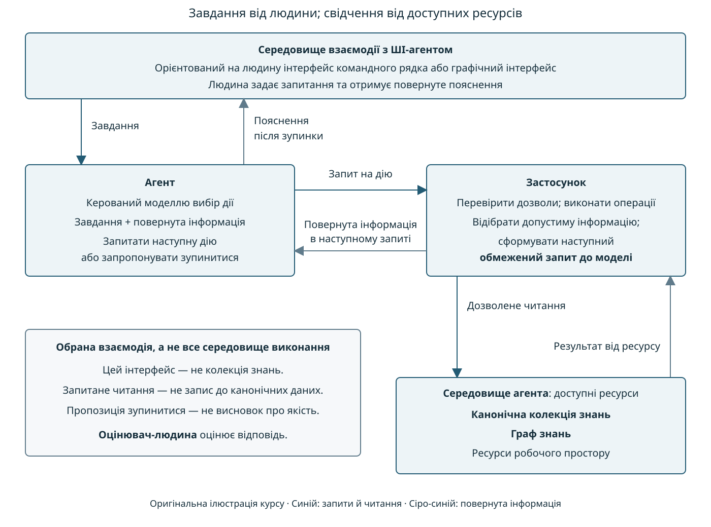
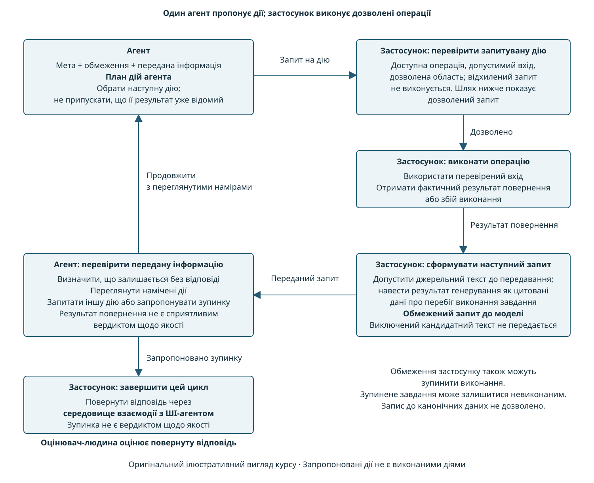
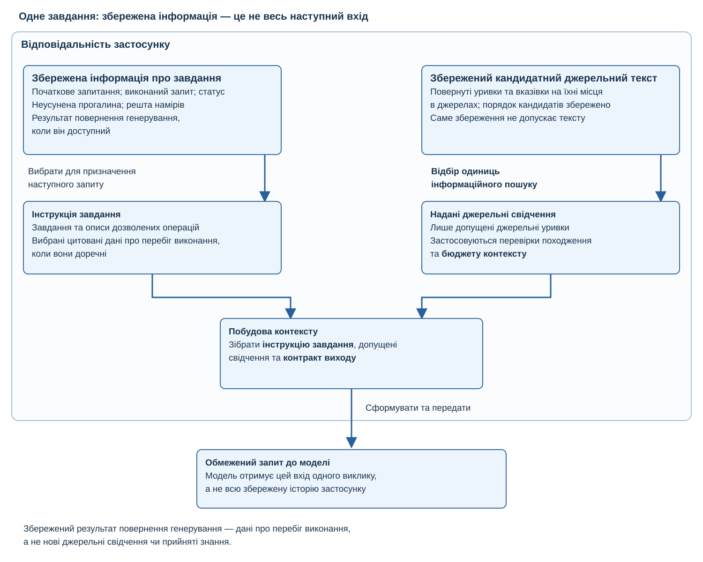
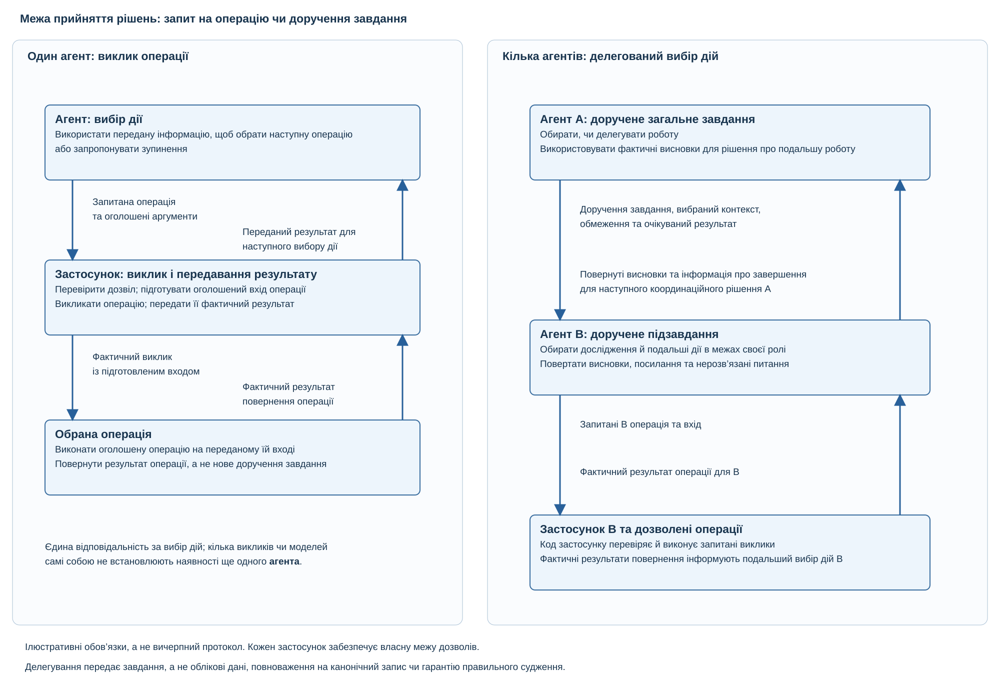
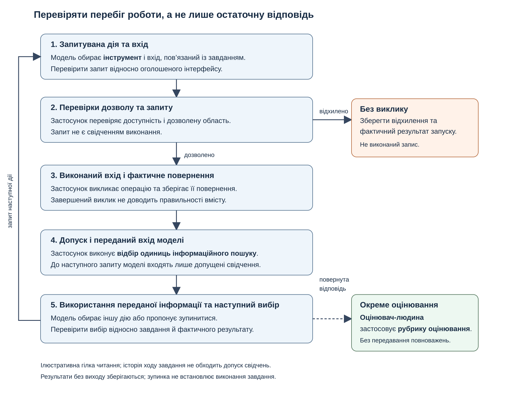

# Модуль 07: Агенти та багатоагентні системи — Теорія

Last updated: 2026-11-19

> **Статус:** Ready for Students — затверджено викладачем для публікації 2026-11-20

## 0. Інженерна проблема та результати навчання

Модуль 06 визначив шлях формування відповідей на запитання про те, які поняття є передумовами розуміння названого цільового поняття та як зв’язки передумов випливають із джерел. Цей фіксований шлях використовує наявну **канонічну колекцію знань** і **граф знань**, щоб сформувати **обмежений запит до моделі**. **Операція пояснення передумов із використанням моделі** повертає **згенероване пояснення передумов** або **відмову**. Модуль 07 розглядає, як модель може використовувати інформацію, повернуту операцією, щоб обрати, яку дозволену операцію запитати наступною.

**Ключові поняття для цього вступу.** Два раніше визначені результати генерування залишаються різними:

- **Згенероване пояснення передумов** — це спроба моделі пояснити зв’язки передумов названого цільового поняття з **цитуваннями тверджень**. Назва виходу не встановлює, що пояснення є правильним або достатньо підкріпленим.
- **Відмова** фіксує, що **операція пояснення передумов із використанням моделі** не надає пояснення, оскільки **надані джерельні свідчення** не дають змоги виконати завдання без вигадування джерельного факту або відібрана **одиниця інформаційного пошуку** містить інструкцію, що суперечить **інструкції завдання**. Збій виконання або відсутність відповіді не є автоматично **відмовою**.

**Оцінювач-людина** оцінює повернуту відповідь за **рубрикою оцінювання** модуля 06. Це судження стосується відповіді, сформованої цим фіксованим шляхом; воно не встановлює, чи забезпечить подальша дія виконання завдання користувача. Модуль 06 навмисно залишив невизначеним, як система має обирати іншу дозволену операцію залежно від того, що повернула попередня операція. Ця межа стосується керування операціями, а не відсутності формування відповідей на запитання.

Можлива ситуація, коли **надані джерельні свідчення** для певного запитання ідентифікують поняття-передумову, але не пояснюють, чому це поняття потрібне для розуміння цільового поняття. Тоді наступне проєктне питання полягає в тому, яка дозволена операція могла б отримати відсутні свідчення. Повторне генерування з незмінним **обмеженим запитом до моделі** саме собою не надає цих відсутніх свідчень.

Підрозділ «Agent Overview» розділу 6 книги *AI Engineering* ілюструє, як виявлена прогалина в інформації може змінити наступний запит на інформацію. Підрозділ «Step 5. Add Agent Patterns» розділу 10 описує використання початкової відповіді разом із новим контекстом, отриманим унаслідок інформаційного пошуку, у подальшому виклику моделі.

Модуль 07 застосовує цей зв’язок до завдання пояснення передумов. Модель запитує дію; застосунок керує її виконанням відповідно до оголошених дозволів. Інформація, повернута моделі, впливає на її наступний вибір або пропозицію зупинитися.

Основний наскрізний приклад розвиває виконання завдання одним учасником, вибором дій якого керує модель. Окреме порівняння розглядає, коли виправдана взаємодія кількох учасників, кожен із яких обирає дії для дорученого завдання. Приклад повторно використовує механізми інформаційного пошуку та формування запиту з модулів 04–06, а не вводить інший алгоритм інформаційного пошуку. Модуль також розрізняє інформацію, збережену між діями, та інформацію, відібрану для кожного **обмеженого запиту до моделі**.

Межа повноважень також залишається незмінною. Повернуте пояснення, запропонована наступна дія або судження про те, що завдання виконано, не уповноважують зміну **канонічної колекції знань**. Прийняті зміни й надалі потребують **уповноваженого рецензента** та **уповноваженого засобу запису**.

### Результати навчання

Після вивчення цього модуля студенти можуть:

1. Пояснювати різні трактування суб’єкта, який сприймає своє оточення та діє на нього; відрізняти прийняте в курсі трактування, у якому модель керує вибором дій, від заздалегідь визначеного процесу виконання операцій, а також одного такого суб’єкта від кількох суб’єктів, що взаємодіють.
2. Пояснювати, які операції може запитувати модель, розрізняти читання й запис та відокремлювати запит на дію від дозволу на її виконання.
3. Пояснювати, як послідовність намічених дій випливає з мети й обмежень завдання та як повернута інформація може зумовити потребу змінити цю послідовність.
4. Розрізняти збереження інформації про завдання для подальших дій і відбір інформації для одного **обмеженого запиту до моделі**.
5. Простежувати вибір дії, виконання застосунком, повернуту інформацію та продовження роботи; обґрунтовувати, коли делегування завдань між кількома учасниками, які обирають дії, виправдовує витрати на координацію за оголошених умов завдання, розгортання та дозволів.
6. Розрізняти помилки вибору дій, відмови в наданні дозволу, неуповноважене виконання, збої виконання та невідповідність відповіді критеріям якості, а також тлумачити показники використання ресурсів за оголошених умов порівняння.

**Висновок розділу.** Цей фіксований шлях залишається засобом відповіді на запитання про передумови. Нова проєктна проблема полягає в тому, як повернута інформація має впливати на наступну дозволену дію та рішення зупинитися. Розділ 1 вводить суб’єктів, які здійснюють ці вибори, та пояснює їхню взаємодію з ресурсами, на які вони діють.

## 1. **Агент**, **середовище агента** та **цикл агента**

Запитання про передумови може залишитися без відповіді після того, як знайдено релевантний уривок: цей уривок може називати передумову, не пояснюючи її ролі. Щоб запитати ще один пошук, потрібно зробити вибір на основі вже повернутої інформації. Цей розділ пояснює, хто здійснює такий вибір і як запитувана дія досягає відповідних ресурсів. Наскрізний приклад розвиває цикл лише для читання, який отримує відсутні свідчення, запитує пояснення та завершується без зміни прийнятих знань.

**Ключові поняття для цього розділу.** Наведені поняття розрізняють учасника, який ухвалює рішення, ресурси, з якими він взаємодіє, та їхню повторювану взаємодію:

- **Агент** — це суб’єкт, який сприймає своє оточення та діє на нього. Це широке формулювання, використане в *AI Engineering*, охоплює програмні та фізичні системи. У наведеному тут прикладі на основі великої мовної моделі **агент** використовує модель для вибору наступної дозволеної дії на основі завдання та повернутої інформації; код застосунку виконує запитувану операцію. Це обране трактування вужче за широке формулювання, а не визначення кожного історичного різновиду **агента**.
- **Середовище агента** охоплює оточення та доступні ресурси, з якими взаємодіє **агент**. Цю роль можуть виконувати гра, дорожня система або колекція файлів. Тут воно охоплює доступні **канонічну колекцію знань**, **граф знань** і ресурси робочого простору. Спостереження — це інформація, отримана від цих ресурсів; дія — операція, спрямована на них. Доступ для читання не означає дозволу змінювати ці ресурси.
- **Цикл агента** — це повторювана взаємодія, у якій **агент** спостерігає доступну інформацію, обирає дію, отримує результат її виконання та вирішує, чи продовжувати роботу. В обраній організації на основі великої мовної моделі модель обирає дію або пропонує зупинитися; застосунок забезпечує дотримання дозволів і обмежень зупинки. Цей цикл пов’язує рішення з повернутими результатами, а не просто повторює виклики моделі.
- **Багатоагентна система** (**MAS**) складається з двох або більше **агентів**, що взаємодіють, кожен із яких обирає дії в межах призначеної ролі та обмежень. **MAS** — утворена від англійської назви абревіатура, використана в цьому курсі. Кілька викликів однієї моделі самі собою не означають наявності кількох **агентів**; кілька **агентів** можуть використовувати ту саму базову модель.

Повторно використане поняття **середовища взаємодії з ШІ-агентом** означає інтерфейс командного рядка або графічний інтерфейс, через який людина взаємодіє з ШІ-помічником, як було введено в модулі 01. Це не інша назва **середовища агента**. Інтерфейс, через який людина задає завдання, та ресурси, на які діє помічник, виконують різні ролі, навіть коли один застосунок надає і те, й інше.

### 1.1 Чому назва не визначає архітектуру

Технічне поняття **агента** виникло раніше за застосунки на основі великих мовних моделей. У підрозділі 1.a статті *Intelligent Agents: Theory and Practice* Wooldridge та Jennings розглядають відсутність загальноприйнятого визначення. Їхнє слабке трактування агентності поєднує автономність, здатність до соціальної взаємодії, реактивність та проактивність: керування діями без безпосереднього втручання, спілкування з іншими, реагування на зміни середовища та ініціативу, спрямовану на досягнення мети. Їхнє сильніше трактування додатково використовує поняття, зазвичай застосовувані до людей, як-от переконання та наміри, для опису або реалізації системи. Жодне із цих трактувань не вимагає великої мовної моделі.

Ці вимоги конкретніші за мінімальне формулювання «сприймати та діяти». Тому різні визначення можуть по-різному класифікувати те саме програмне забезпечення, не описуючи при цьому іншу програму. Порівняння має називати визначальні властивості, а не припускати, що слово **агент** саме їх визначає. Опис через переконання не встановлює наявності свідомості або розуміння, подібного до людського.

Підрозділ «Agent Overview» розділу 6 книги *AI Engineering* використовує широке формулювання та зараховує системи RAG до **агентів** зі здатністю виконувати інформаційний пошук. Підрозділ «What are agents?» матеріалу Anthropic *Building effective agents* явно розрізняє заздалегідь визначені процеси виконання операцій і системи, у яких велика мовна модель динамічно керує процесом та використанням доступних операцій. Саме останнє розрізнення є робочим трактуванням, обраним для прикладу на основі великої мовної моделі в цьому модулі.

За цим трактуванням фіксований шлях модуля 06 залишається заздалегідь визначеною послідовністю. Він може знаходити свідчення та генерувати відповідь, не обираючи іншу наступну операцію на основі виявленої прогалини в інформації. Називання цього шляху **агентом** відповідно до ширшого вживання в книзі не встановлює, що він реалізує досліджуваний тут **цикл агента**, вибором дій у якому керує модель. І навпаки, обране трактування не спростовує вживання в книзі та не перевизначає кожного класичного **агента**.

Практичне питання полягає в тому, хто визначає наступну операцію. У заздалегідь визначеному процесі виконання операцій код застосунку задає послідовність операцій або правила розгалуження. В обраному **циклі агента** модель тлумачить завдання та повернуту інформацію, щоб запитати наступну дозволену операцію. Код і надалі визначає, які операції існують, перевіряє запити та виконує ці операції. Система може поєднувати заздалегідь визначену внутрішню послідовність операції з керованим моделлю вибором цієї операції на зовнішньому рівні.

Тому для тлумачення вибору моделі необхідно враховувати застосунок, що забезпечує її роботу. Згенерований запит не виконує себе сам: застосунок надає доступ до ресурсів, виконує запитувану операцію, коли вона дозволена, та повертає її результат. Вибір дій не обов’язково потребує окремої служби планування. Встановлення програмного каркаса, виклик великої мовної моделі або додавання пошуку не доводять, що відбувається вибір, залежний від зворотного зв’язку.

### 1.2 Ресурси та взаємодія з людиною виконують різні ролі

**Середовище агента** залежить від завдання. **Агент**, який грає в гру, спостерігає стан гри та обирає дозволені ходи. **Агент**, який виконує вебпошук, взаємодіє з доступними вебресурсами. **Агент**, який працює з програмним кодом, взаємодіє з файлами репозиторію та результатами команд. Доступні операції обмежують, які ресурси він може переглядати або змінювати; саме називання середовища не надає доступу до нього.

У прикладі системи знань людина вводить запитання про передумови через **середовище взаємодії з ШІ-агентом**. **Агент** запитує інформаційну операцію над доступними ресурсами знань. Людина задає завдання, тоді як операція над ресурсом повертає свідчення, використані для виконання цього завдання. Кілька **агентів** можуть спільно використовувати ресурси, тому термін **середовище агента** не означає виключної власності.

Рисунок 1.1 розділяє ці обміни та відповідальних за них учасників. Запит на дію досягає ресурсів через виконання застосунком; повернута інформація досягає моделі через формування застосунком наступного запиту.

**Рисунок 1.1 - Обрана взаємодія лише для читання для одного агента.** Оригінальна ілюстрація курсу показує орієнтоване на людину **середовище взаємодії з ШІ-агентом**, керований моделлю вибір, виконання застосунком і ресурси знань у **середовищі агента**. Стрілки розрізняють завдання й відповіді, запити на дії, читання ресурсів і повернуту інформацію. Це ілюстративне зображення, а не вичерпна архітектура середовища виконання; запис до канонічних даних виключено.

Повернута інформація не тотожна самому ресурсу. **Канонічна колекція знань** залишається поза запитом до моделі; застосунок відбирає допустимий текст і формує наступний **обмежений запит до моделі**. **Граф знань** також залишається доступним ресурсом, а не автоматично стає входом моделі. Межі допуску свідчень і формування запиту, визначені в модулях 05–06, продовжують діяти.

У ширших описах програмного забезпечення словом harness можуть називати все середовище виконання. Цей курс зберігає значення **середовища взаємодії з ШІ-агентом** як інтерфейсу для людини, введене в модулі 01. Інтерфейс між агентом і комп’ютером на рисунку 6-8 книги *AI Engineering* стосується того, як програмні операції досягають ресурсів; це не підстава непомітно змінювати прийняту назву інтерфейсу для людини.

### 1.3 Виявлена прогалина змінює наступну дію

Книга *AI Engineering* ілюструє вибір, залежний від зворотного зв’язку, на завданні прогнозування продажів. Запитуваний результат — прогноз для певного товару на наступні три місяці. **Агент** запитує історичні дані про продажі через генерування та виконання SQL-запитів. Після аналізу повернутих чисел він може виявити відсутню інформацію та запитати дані про минулі маркетингові кампанії. Потім він використовує цю додаткову інформацію для формування прогнозу та вирішує, що завдання виконано.

Важливий зв’язок полягає не в тому, що SQL використано двічі. Перший результат дає підставу для вибору другого запиту на інформацію. Заздалегідь визначена програма також могла б запитати обидва набори даних, але в цьому прикладі модель визначає таку потребу на основі повернутої інформації. Це ілюстративна послідовність, а не свідчення того, що кожен отриманий прогноз є надійним.

Наведений далі сконструйований приклад курсу переносить цей зв’язок на пояснення передумов. Це не спостережуваний експеримент і не твердження про вміст прийнятої колекції. Цільове поняття — **пошук на основі ембедингів**. Ілюстративна доступна колекція містить два уривки зі **зв’язками походження**, які успішно розв’язуються:

- Початково повернутий уривок стверджує: «У цьому навчальному маршруті розуміння **пошуку на основі ембедингів** потребує розуміння **ембедингу запиту**». Він ідентифікує передумову, не пояснюючи її ролі.
- Інший доступний уривок стверджує: «**Ембединг запиту** представляє запитання як вектор для порівняння зі збереженими векторами, що представляють **одиниці інформаційного пошуку**. Розуміння цього представлення пояснює, як запитання можна зіставити з кандидатними **одиницями інформаційного пошуку**». Це джерельні свідчення, створені авторами курсу та задані для прикладу, а не цитата з книги.

Ілюстративне завдання запитує лише, чому **ембединг запиту** потрібний для **пошуку на основі ембедингів** у цьому навчальному маршруті. Воно не потребує відтворення кожної передумови цільового поняття. Дозволені операції — **операція інформаційного пошуку** в доступній колекції та успадкована **операція пояснення передумов із використанням моделі**. Застосунок формує кожен **обмежений запит до моделі** за наявними правилами роботи зі свідченнями. Запис до **канонічної колекції знань** не дозволено.

**Цикл агента** відбувається так:

1. Модель отримує завдання та цей початково повернутий уривок. Вона ідентифікує прогалину: уривок стверджує зв’язок передумови, але не пояснює ролі **ембедингу запиту**. Вона запитує **операцію інформаційного пошуку**, щоб знайти джерельний текст, який пояснює цю роль.
2. Застосунок перевіряє запит на відповідність дозволеній області читання, виконує **операцію інформаційного пошуку** та повертає другий уривок разом з указівкою на його місце в джерелі. **Середовище агента** містить ресурс, який читається; спостереженням є повернутий уривок, а не вся колекція.
3. Модель використовує це спостереження, щоб запитати **операцію пояснення передумов із використанням моделі**. Застосунок застосовує правила допуску свідчень, формує **обмежений запит до моделі**, який містить два допущені уривки, та виконує цю операцію. Для прикладу задано, що обидва уривки вкладаються в оголошений **бюджет контексту**, а їхні **зв’язки походження** успішно розв’язуються; сам інформаційний пошук не гарантував би допуску.
4. У цій ілюстрації операція повертає **згенероване пояснення передумов**, у якому сказано, що **ембединг запиту** представляє запитання для порівняння векторів, тому його розуміння пояснює, як запитання бере участь у пошуку кандидатних **одиниць інформаційного пошуку**. **Цитування тверджень** у цьому поясненні вказують на другий допущений уривок як підкріплення цього пояснення та на перший — як підкріплення стверджуваного зв’язку в навчальному маршруті.
5. Модель спостерігає це повернуте пояснення та пропонує зупинитися: для вузького завдання отримано спробу відповіді з цитуваннями джерел, тому вона не запитує наступної операції. Застосунок завершує цей цикл і повертає пояснення через **середовище взаємодії з ШІ-агентом**. **Оцінювач-людина** й надалі оцінює відповідь за застосовною **рубрикою оцінювання**; пропозиція зупинитися не є сприятливим оцінювальним висновком.

Ця послідовність визначає рішення щодо наступної операції, яке модуль 06 залишив невизначеним, не змінюючи внутрішнього методу інформаційного пошуку. Вона розділяє два результати повернення: **операція інформаційного пошуку** повертає кандидатні свідчення, тоді як **операція пояснення передумов із використанням моделі** повертає **згенероване пояснення передумов** або **відмову**. Жоден із цих двох об’єктів не уповноважує зміну прийнятих знань.

Проілюстрована успішна гілка не гарантована. Якщо доступний матеріал не може підкріпити пояснення, ця успадкована операція має повернути **відмову**, а не вигадувати джерельний факт. Її умова щодо суперечливої інструкції також залишається чинною. Збій операції не є автоматично **відмовою**. Обмеження, дотримання яких забезпечує застосунок, мають запобігати нескінченному продовженню роботи; докладні правила зупинки та оцінювання збоїв належать до розділів 5–6. Автономний вибір дій не надає ані необмежених дозволів, ані гарантованої правильності.

### 1.4 Один учасник чи кілька

Наскрізний приклад використовує одного **агента**, щоб обрати інформаційний пошук, запитати пояснення та запропонувати зупинитися. Кілька викликів моделі для цих виборів і для генерування не роблять цю систему **багатоагентною системою**. Операція генерування повертає запитуваний вихід; це саме собою не робить її другим учасником, який самостійно обирає дії.

У контрастній ілюстрації **MAS** перший **агент** готує пояснення та делегує завдання перевірки за джерелами другому **агентові**. Другий отримує пояснення та вказівки на цитовані місця в джерелах, обирає, які дозволені читання джерел потрібні для перевірки тверджень, і повертає свої висновки першому. Його власний вибір дій відповідно до завдання та взаємодія між цими двома **агентами** відрізняють цю організацію від виклику фіксованого засобу перевірки, який завжди виконує заздалегідь визначене порівняння.

Обидва **агенти** могли б використовувати ту саму модель і спільне **середовище агента**. І навпаки, два окремо названі **промпти** або два постачальники моделей не встановлюють наявності двох **агентів**. Розділ 5 розглядає, чи виправдовує делегування витрати на координацію. Це порівняння не потребує другої реалізації та не стверджує, що **MAS** поліпшить відповідь.

> **Додаткове читання.** Попередження безпосередньо перед підрозділом «Agent Overview» розділу 6 книги *AI Engineering* (сторінка 536 робочої PDF-копії) пояснює експериментальний статус викладу **агентів** на основі генеративного ШІ в цій книзі. Варто повернутися до цього попередження під час порівняння новіших програмних каркасів: інженерний виклад не є універсальним стандартом класифікації.
>
> Підрозділ 1.a «What is an Agent?» статті Wooldridge та Jennings *Intelligent Agents: Theory and Practice* (сторінки 4–5 рукопису) розвиває сильніше трактування через ментальні стани та додаткові властивості агентності. Таке поглиблення корисне під час порівняння проєктів на основі переконань і намірів із досліджуваною тут взаємодією, якою керує велика мовна модель. Використані вище розрізнення залишаються самодостатніми; поглиблене вивчення є необов’язковим доповненням, а не вимогою для лабораторної роботи 07 або оцінювання в модулі 07. Пагінація залежить від використаного видання книги та версії рукопису.

**Висновок розділу.** У сконструйованому циклі системи знань один **агент** ідентифікує прогалину в поясненні, запитує дозволене читання, використовує повернутий уривок, щоб запитати пояснення, та пропонує зупинитися після повернення цього пояснення. **Середовище агента** надає доступні ресурси; **середовище взаємодії з ШІ-агентом** підтримує окрему взаємодію з людиною. Цей цикл встановлює вибір дій, залежний від зворотного зв’язку, а не правильність, дозвіл на запис чи перевагу кількох **агентів**. Розділ 2 визначає, як доступні операції надаються у вигляді **інструментів** і як відрізняються їхні дозволи на читання та запис.

## 2. **Інструменти** та **перелік доступних інструментів**

Запит на отримання додаткових свідчень має визначати операцію, яку застосунок справді може виконати. Запит на зміну прийнятих знань потребує інших повноважень, навіть коли обидва запити стосуються тієї самої колекції. Цей розділ пояснює, як операції стають доступними **агентові** та чому доступність не означає дозволу на кожне використання. Наскрізний приклад визначає входи, результати повернення та межі дозволів двох операцій, використаних у розділі 1.

**Ключові поняття для цього розділу.** Два нові поняття описують доступні можливості, а не учасника, який обирає дію:

- **Інструмент** — це можливість, надана **агентові** для виклику. Його опис визначає операцію, вхід, який ця операція приймає, та результат, який вона повертає. Модель запитує використання **інструмента**; код застосунку виконує відповідну операцію, коли запит дозволено. Отже, **інструмент** не є ані **агентом**, який обирає дію, ані повернутою інформацією. Один із прикладів — раніше визначена **операція інформаційного пошуку**, надана для виклику з **текстовим запитом** на вході та **ранжованим кандидатним виходом** як результатом повернення.
- **Перелік доступних інструментів** — це оголошений набір **інструментів**, доступних **агентові**. Він обмежує, які надані для виклику операції може запитувати модель, але не надає кожному запиту дозволу на виконання. Застосунок може надати для виклику операцію читання, водночас обмежуючи ресурси, які ця операція може читати. Обраний тут **перелік доступних інструментів** містить **операцію інформаційного пошуку** та **операцію пояснення передумов із використанням моделі**, але не містить операції зміни **канонічної колекції знань**.

Для тлумачення результату повернення важливі дві раніше визначені межі. **Ранжований кандидатний вихід** містить кандидатні **одиниці інформаційного пошуку**, повернуті **операцією інформаційного пошуку**; повернуті **фрагменти джерел** не є автоматично **наданими джерельними свідченнями**. **Відбір одиниць інформаційного пошуку** перевіряє **розв’язання зв’язку походження** та **вміщення в бюджет контексту**, перш ніж допущені **одиниці інформаційного пошуку** стануть **наданими джерельними свідченнями**. Допуск не встановлює, що допущений текст підкріплює запитуване пояснення.

**Обмежений запит до моделі** містить **інструкцію завдання**, допущені **надані джерельні свідчення** та **контракт виходу**. **Інструкція завдання** визначає запитувану операцію та її обмеження. **Контракт виходу** визначає потрібний результат повернення, а не те, чи буде цей результат правильним.

### 2.1 Що додають різні можливості

Підрозділ «Tools» розділу 6 книги *AI Engineering* групує зовнішні можливості за трьома призначеннями. Наведений огляд пояснює внесок кожного призначення; він не вимагає реалізації кожної категорії:

1. Доповнення знань отримує інформацію для моделі. Засіб пошуку тексту повертає кандидатні уривки; API для читання відомостей про товарні запаси повертає інформацію про товари. Доступ до додаткової інформації може усунути нестачу контексту, але ані доступ, ані **інформаційний пошук** не встановлюють, що повернутий матеріал є надійним або релевантним.
2. Розширення можливостей робить доступною іншу операцію, якої базова модель безпосередньо не надає. Калькулятор обчислює арифметичний результат; інтерпретатор коду виконує програму та повертає її вихід або помилку виконання. Це операції з власними входами та результатами повернення, а не свідчення того, що модель набула такої самої внутрішньої здатності.
3. Дії запису змінюють дані або інший стан у **середовищі агента**. Операція надсилання електронної пошти надсилає повідомлення, а операція оновлення бази даних змінює збережені дані. Такі дії можуть виконувати завдання, що виходять за межі повернення відповіді, але неправильна або неуповноважена дія може мати наслідки поза згенерованим текстом.

Ці категорії призначення та розрізнення читання й запису відповідають на різні запитання. Дія читання отримує інформацію, не змінюючи збережених даних, які читаються. Дія запису змінює відповідний зовнішній стан. Та сама служба може надавати для виклику обидва різновиди: засіб виконання SQL може читати рядки або змінювати їх, а API електронної пошти — отримувати повідомлення або надсилати його. Потрібний дозвіл визначають запитувана операція та її наслідки, а не назва служби.

Тому **інструмент**, який виконує код, не можна вважати призначеним лише для читання тільки тому, що його задумане призначення — обчислення. Застосунок має обмежувати, до чого це виконання може отримати доступ або що воно може змінити. Так само обмеження **інструмента** для **інформаційного пошуку** обраними джерелами стосується області доступу; називання його призначеним лише для читання не дозволяє читати кожне джерело. Ці розрізнення слід застосувати до того, як обирати, яку операцію запитати наступною.

Приклад системи знань обирає доповнення знань через наявну **операцію інформаційного пошуку**. **Операція пояснення передумов із використанням моделі** надає запитувану можливість генерування. Результат її повернення — відповідь, а не збережене виправлення прийнятих знань. Для відповіді на це вузьке запитання про передумови не потрібна можливість оновлення бази даних або іншого запису до канонічних даних.

У цій книзі підтримку постачальником запитів на зовнішні операції названо function calling. Ця назва можливості не означає, що згенерований текст виконує себе сам або що постачальник уповноважує зміну ресурсу. Застосунок і надалі пов’язує запитувану операцію з реалізацією, перевіряє запит і надає повернутий результат. Цей розділ пояснює такий зв’язок, не вимагаючи формату запиту, специфічного для певного постачальника.

### 2.2 Оголошений набір не є універсально найкращим

Те, які операції слід надати для виклику, залежить від завдання, **середовища агента** та здатності моделі використовувати описи й повернуту інформацію. Недоступна операція не може допомогти, навіть якщо модель її називає. І навпаки, надану для виклику операцію з незрозумілим описом входу можна обрати або викликати неправильно. Операція має бути і корисною для завдання, і придатною до використання через інтерфейс, який надає застосунок.

Підрозділ «Tool selection» книги *AI Engineering* пояснює **компроміс**: більша кількість **інструментів** може уможливити більше дій, але також ускладнює вибір і додає описи, які займають контекст моделі. Історичні приклади Toolformer, Chameleon та Gorilla ілюструють різні масштаби — від невеликих обраних наборів операцій до вибору серед багатьох викликів API. Різниця в їхніх масштабах не встановлює одного загалом кращого **переліку доступних інструментів** і не вимагає відтворення цих систем.

Для цього сконструйованого завдання про передумови обрана пара операцій має конкретне обґрунтування. **Операція інформаційного пошуку** може отримати відсутній уривок; **операція пояснення передумов із використанням моделі** може використати допущені свідчення, щоб спробувати надати запитуване пояснення. Надсилання електронної пошти або оновлення прийнятих записів нічого не додає до заявленого результату цього завдання. Вилучення цих можливостей обмежує те, що може запитувати цей **агент**, замість покладання на інструкцію не використовувати непотрібну можливість запису.

Чи забезпечує ця обрана пара належне виконання, усе ще потрібно оцінювати на оголошених завданнях. Більший доступний набір не є автоматично поліпшенням, а рідко запитуваний **інструмент** не є автоматично некорисним. Частота використання та внесок у результати завдання — різні спостереження. Розділ 6 розвиває оцінювання збоїв і використання ресурсів; цей приклад фіксує невеликий набір, щоб можна було перевірити його входи, виходи та межі повноважень.

### 2.3 Надання раніше визначених операцій для виклику

Наведене сконструйоване доповнення продовжує розділ 1, а не становить новий спостережуваний експеримент. Цільовим поняттям залишається **пошук на основі ембедингів**, а вузьким завданням — пояснення того, чому розуміння **ембедингу запиту** потрібне для цього цільового поняття в заданому навчальному маршруті. На початку цієї послідовності застосунок уже допустив перший уривок і передав його як **надані джерельні свідчення** в початковому **обмеженому запиті до моделі**. Цей уривок стверджує зв’язок передумови. Другий доступний уривок пояснює, як **ембединг запиту** представляє запитання для порівняння векторів.

Таблиця 2.1 визначає повний обраний **перелік доступних інструментів** для цього прикладу. Вона відокремлює вхід виконуваної операції та результат її повернення від межі дозволу на цю операцію, щоб повернутий уривок не можна було сплутати з прийнятою зміною.

**Таблиця 2.1 - Обрані інструменти, входи виконуваних операцій, результати повернення та межі дозволів**

| Операція, надана для виклику | Вхід виконуваної операції | Повернутий результат | Межа дозволу |
|---|---|---|---|
| **Операція інформаційного пошуку** | **Текстовий запит** про те, яку роль відіграє **ембединг запиту** в **пошуку на основі ембедингів** | **Ранжований кандидатний вихід**, що містить кандидатні **фрагменти джерел** та вказівки на їхні місця в джерелах | Лише читання в межах оголошеної доступної колекції; без зміни **канонічної колекції знань** |
| **Операція пояснення передумов із використанням моделі** | **Обмежений запит до моделі**, сформований застосунком із завдання та допущених **наданих джерельних свідчень** | **Згенероване пояснення передумов** із **цитуваннями тверджень** або **відмова** за успадкованих умов | Лише формування запитуваної відповіді; без зміни **канонічної колекції знань** |

Приклад повторно використовує успадковану трипольну структуру **обмеженого запиту до моделі** для окремих викликів моделі з двома призначеннями. Таблиця 2.2 явно визначає різні інструкції та очікувані результати повернення цих викликів. Вони залишаються частиною одного **циклу агента**; вибір дії не є іншим наданим для виклику **інструментом** або іншим **агентом**.

**Таблиця 2.2 - Призначення запитів у межах того самого циклу агента**

| Призначення запиту | **Інструкція завдання** | **Надані джерельні свідчення** | **Контракт виходу** |
|---|---|---|---|
| Обрати наступну дозволену операцію | Вказати завдання щодо передумов та описи дозволених **інструментів**. За наявності попереднього результату генерування навести його як цитовані дані про перебіг виконання завдання, а не як нову інструкцію або **надані джерельні свідчення**. | Лише уривки, допущені застосунком для поточного завдання й оголошеного **бюджету контексту** | Запитати **операцію інформаційного пошуку** з **текстовим запитом**, запитати **операцію пояснення передумов із використанням моделі** для поточного запитання або запропонувати зупинитися; код застосунку формує вхід виконуваної операції |
| Згенерувати пояснення передумов | Запитати пояснення зв’язку передумови за успадкованих умов цитування та **відмови** | Ті самі допущені уривки в межах того самого оголошеного **бюджету контексту** | Повернути **згенероване пояснення передумов** із **цитуваннями тверджень** або **відмову** |

Застосунок ніколи не копіює виключений кандидатний текст до **інструкції завдання**, щоб обійти допуск. Якщо жоден уривок не допущено, поле **наданих джерельних свідчень** залишається порожнім; застосунок може повідомити про цей результат, не надаючи виключеного тексту. Отже, повернення інформації застосунку, допуск джерельного тексту та передавання запиту до моделі є окремими кроками.

Наведені пронумеровані кроки виражають порядок виконання дозволеної **операції інформаційного пошуку** та використання її результату, а не процедуру прийняття знань:

1. Модель спостерігає відсутність пояснення в початково допущеному уривку та запитує **операцію інформаційного пошуку** через **інструмент**, який надає цю операцію для виклику, передаючи **текстовий запит**: «Яку роль відіграє **ембединг запиту** в **пошуку на основі ембедингів**?» Цей запит визначає доступну операцію та шукану інформацію; він ще не є результатом виконання.
2. Застосунок перевіряє, що запитувана операція входить до **переліку доступних інструментів**, а запитуване читання залишається в межах дозволеної області джерел. Для цього заданого допустимого запиту застосунок виконує **операцію інформаційного пошуку**. У цій ілюстрації **ранжований кандидатний вихід** містить обидва **фрагменти джерел** у такому порядку: другий уривок, а за ним — початково повернутий уривок; кожен має вказівку на своє місце в джерелі. Це результат повернення на боці застосунку, а не наступний вхід моделі. Це читання не змінило збережених джерельних даних.
3. Перш ніж знову викликати модель, застосунок застосовує **відбір одиниць інформаційного пошуку** до цього **ранжованого кандидатного виходу**. Як задано в розділі 1, обидва **зв’язки походження** успішно розв’язуються, а обидва уривки разом вкладаються в оголошений **бюджет контексту**. У цій гілці застосунок фактично допускає обидва уривки як **надані джерельні свідчення**. Потім він формує та надсилає наступний **обмежений запит до моделі** для вибору наступної дозволеної операції, використовуючи цю допущену пару та перше призначення запиту з таблиці 2.2.
4. Модель спостерігає ці допущені **надані джерельні свідчення**, а не невідфільтрований **ранжований кандидатний вихід**, і запитує **операцію пояснення передумов із використанням моделі** через **інструмент**, який надає цю операцію для виклику. Застосунок перевіряє запитувану операцію та формує окремий **обмежений запит до моделі** для генерування пояснення. Цей запит зберігає ту саму допущену пару в межах того самого бюджету, але використовує **інструкцію завдання** та **контракт виходу** для пояснення з таблиці 2.2. Зміна призначення запиту не допускає автоматично іншого уривка й не надає іншого дозволу.
5. Застосунок виконує **операцію пояснення передумов із використанням моделі** з цим запитом для генерування. У проілюстрованій гілці ця операція повертає те саме **згенероване пояснення передумов**, яке описано в розділі 1. Застосунок передає цей результат повернення через інший запит для вибору дії, у якому результат генерування позначено як дані про перебіг виконання завдання відповідно до таблиці 2.2, а не як додаткові **надані джерельні свідчення**. Модель пропонує зупинитися; **оцінювач-людина** й надалі окремо оцінює пояснення. Успішний виклик **інструмента** не встановлює ані сприятливої оцінки, ані повноважень зберегти відповідь як прийняті знання.

Якщо натомість модель просить зберегти запропоноване виправлення до **канонічної колекції знань**, застосунок не має виконувати цей запит у цьому прикладі. Цей обраний **перелік доступних інструментів** не надає для виклику жодної операції запису до канонічних даних, а оголошене завдання не надає дозволу на такий запис. Згенерована інструкція виконати зміну не додає відсутньої можливості або повноважень. **Канонічна колекція знань** залишається незмінною.

В успадкованому шляху керованої зміни **уповноважений рецензент** вирішує, чи прийняти конкретну запропоновану зміну, а **уповноважений засіб запису** виконує лише прийняту зміну. **Уповноважений засіб запису** — це роль виконання, а не інша назва будь-якої операції, яку модель вирішила запитати. Цей окремий шлях не активується поверненням пояснення або пропозицією моделі зупинитися. Розрізнення читання й запису походить із книги; ця конкретна межа прийняття походить із раніше визначеного в курсі проєкту системи знань.

> **Додаткове читання.** Підрозділ «Tool selection» розділу 6 книги *AI Engineering* (сторінки 572–576 робочої PDF-копії, залежні від видання) розвиває способи дослідження більшого **переліку доступних інструментів**: порівняння альтернативних наборів, вилучення операції для перевірки її внеску, аналіз повторюваних помилок використання та розподілів використання. Figure 6-14, «Different models and tasks express different tool use patterns» (сторінка 573 PDF-копії), ілюструє, чому частота використання залежить від випробуваних моделі та завдання. Це емпіричне порівняння корисне під час вибору можливостей, які слід надати для виклику; його історичні результати не є вимірюваннями прикладу курсу.
>
> Figure 6-15, «A tool transition tree by Lu et al. (2023)» (сторінка 575 PDF-копії; підпис продовжується на сторінці 576), ілюструє переходи між операціями. Супровідне обговорення в «Tool selection» розглядає об’єднання операцій, які часто використовуються послідовно, та збереження новостворених можливостей для подальшого повторного використання. Таке поглиблення стає корисним під час дослідження того, чи містить більший набір операцій повторювані поєднання, які варто надати для спільного виклику. Названі дослідження та поглиблене вивчення композиції можливостей є необов’язковим доповненням, а не вимогою для лабораторної роботи 07 або оцінювання в модулі 07; пояснені вище категорії призначення, **компроміс** під час вибору та розрізнення дозволів залишаються обов’язковими для розуміння.

**Висновок розділу.** Цей сконструйований приклад надає для виклику два **інструменти** з різними входами та результатами повернення: **операція інформаційного пошуку** надає кандидатні уривки, а **операція пояснення передумов із використанням моделі** формує спробу пояснення або **відмову** на основі **обмеженого запиту до моделі**, сформованого застосунком. Цей **перелік доступних інструментів** робить ці можливості доступними, не уповноважуючи запис до канонічних даних і не допускаючи знайдений текст автоматично. Приклад встановлює, що може запитувати **агент** і що може виконувати застосунок, а не те, що повернуте пояснення є правильним. Розділ 3 пояснює, як намічені дії випливають із мети й обмежень завдання та як повернута інформація може змінити ці наміри.

## 3. **Планування дій агента**

Знання про доступні операції ще не встановлює, яка послідовність дасть змогу відповісти на запитання. Початково релевантний уривок може визначати передумову, але залишати її роль непоясненою. Цей розділ пояснює, як мета й обмеження завдання визначають намічені дії та як повернута інформація змінює ці наміри. Наскрізний приклад розвиває намічену послідовність, що лежить в основі циклу лише для читання з розділів 1–2, не додаючи іншої операції.

**Ключові поняття для цього розділу.** Два нові поняття розрізняють процес і його запропонований результат:

- **Планування дій агента** — це визначення дій та їхньої послідовності, за допомогою яких **агент** має намір досягти мети завдання в межах його обмежень, і перегляд цих намірів, коли повернута інформація змінює те, що потрібно зробити. Мета визначає шуканий результат; обмеження звужують прийнятні способи його отримання. Наприклад, пояснення передумови на основі доступного джерельного тексту є метою з обмеженням щодо свідчень. Визначення того, що ще одне читання має передувати поясненню, є **плануванням дій агента**; запит на це читання є вибором наступної дії, а не всім процесом.
- **План дій агента** — це запропоновані дії та їхній намічений порядок для досягнення цієї мети в межах цих обмежень. Він може охоплювати все завдання або лише наступну частину, дії якої наразі можна визначити. У цьому прикладі отримання тексту про роль передумови перед запитом на її пояснення є **планом дій агента**. Він описує наміри, а не доводить, що операції вже виконано, що свідчення існують або що остаточна відповідь буде правильною.

Два раніше визначені розрізнення залишаються необхідними. **Перелік доступних інструментів** оголошує доступні операції, тоді як **план дій агента** обирає намічені способи використання цих операцій. **Цикл агента** пов’язує фактичні вибори й повернуту інформацію в часі; **план дій агента** описує те, що **агент** наразі має намір зробити в межах цієї взаємодії. Ані запропонована послідовність, ані судження про завершення не надають дозволу змінювати **канонічну колекцію знань**.

### 3.1 Від мети до дозволених дій, які можна переглядати

Підрозділ «Planning» розділу 6 книги *AI Engineering* описує завдання через його мету й обмеження, а план — через кроки, намічені для виконання завдання. Підрозділ «Planning overview» розділяє генерування плану, його перевірку, виконання дій та оцінювання їхніх результатів. Правдоподібного вигляду послідовності недостатньо: вона може називати недоступну операцію, використовувати непридатні входи або не отримувати інформацію, потрібну для завдання.

Три запитання виявляють різні проблеми запропонованої послідовності:

1. Чи спрямована послідовність на досягнення мети? Саме лише генерування визначення **пошуку на основі ембедингів** не пояснило б, чому **ембединг запиту** потрібний у заданому навчальному маршруті.
2. Чи доступні й дозволені її дії? Запропонований запис до канонічних даних порушує область лише для читання цього прикладу, навіть якщо модель стверджує, що такий запис допоміг би.
3. Чи мають входи її дій обґрунтовану основу? Наступний **текстовий запит** можна обрати після того, як уривок виявить прогалину в поясненні; модель не має трактувати невідому вказівку на місце в джерелі або припущений результат пошуку як уже повернуті дані.

Ці запитання не потребують окремого учасника, який обирає дії. В обраному маршруті з одним **агентом** модель пропонує дії та використовує допущену інформацію для їх перегляду. Перед виконанням застосунок перевіряє запитувану операцію та її входи на відповідність наданому інтерфейсу й дозволам. Перевірка того, що читання дозволено, не встановлює, що його майбутній результат повернення відповість на запитання. І навпаки, судження моделі про корисність свідчень не може обійти допуск на боці застосунку.

Книга наводить евристики на кшталт відхилення недоступних дій або надмірно довгих планів. Такі перевірки можуть відхилити частину непридатних пропозицій, але послідовність, яка їх пройшла, усе ще може завершитися невдачею. Окрема модель могла б оцінювати пропозицію, а людина — надавати або перевіряти намічені кроки. Це альтернативи, а не свідчення того, що засіб перевірки є безпомилковим або що приклад курсу потребує іншого **агента**. Успадковані **уповноважений рецензент** та **уповноважений засіб запису** зберігають свої різні обов’язки щодо прийнятих змін знань; перевірка **плану дій агента** не активує цей шлях керованої зміни.

Корисне розрізнення стосується того, наскільки далеко наперед **агент** визначає свої наміри. **План дій агента** для всього завдання передбачає маршрут до завершення. Це дає змогу перевіряти залежності, але пізніші входи можуть залежати від ще не отриманих результатів повернення.

Коротший **план дій агента** охоплює підзавдання та розширюється після отримання його результату. Це зменшує потребу вгадувати такі входи, але потребує подальших рішень і не гарантує просування до мети. Наскрізний приклад обирає цей другий підхід, оскільки відсутнє пояснення визначає наступний **текстовий запит**.

Рівень деталізації запропонованих дій також має значення. «Отримати свідчення для пояснення» формулює ціль, але не визначає вхід виконуваної операції. «Запитати **операцію інформаційного пошуку** з цим **текстовим запитом**» є ближчим до виконання, але залежить від оголошеного інтерфейсу операції. Підрозділ «Planning granularity» цієї книги пояснює таке розрізнення: описи вищого рівня потребують перетворення на конкретні операції; описи на рівні операцій тісніше пов’язані з цими операціями. Цей розділ використовує зрозумілі описи намірів разом з уже визначеними входами, а не нову виконувану мову планів.

### 3.2 Залежності, альтернативи та зворотний зв’язок

**План дій агента** не обов’язково складається лише з безумовної послідовності. Таблиця 3.1 порівнює чотири порядки виконання, розглянуті в підрозділі «Complex plans» книги *AI Engineering*. Приклади пояснюють альтернативи; тут потрібний лише розвинений нижче маршрут читання, залежний від зворотного зв’язку. Застосунок із заздалегідь визначеними умовами розгалуження залишається заздалегідь визначеним робочим процесом, якщо модель не здійснює залежного від завдання вибору дії відповідно до домовленості з розділу 1.

**Таблиця 3.1 - Порядки виконання та залежності, які вони виражають**

| Порядок | Зв’язок між діями | Приклад і межа |
|---|---|---|
| Послідовний | Наступна дія починається після завершення попередньої; вона може залежати від результату цієї попередньої дії. | **Текстовий запит** про щойно виявлену прогалину йде після перевірки допущеного уривка. Зміна порядку цих дій потребувала б вгадування прогалини. |
| Паралельний | Незалежні дії можуть виконуватися одночасно, коли їхні входи вже доступні. | Читання з двох дозволених джерел могли б виконуватися разом, якби жодне не потребувало результату повернення іншого. Одночасне виконання не усуває залежності від невідомого входу. |
| Умовний | Наступна дія залежить від явно заданої умови, яку перевіряють за доступною інформацією. | Запитати додаткові свідчення, коли допущений уривок залишає роль передумови непоясненою; інакше розглянути запит на пояснення. Оцінка моделі не гарантує достатності свідчень. |
| Повторюваний | Дію або послідовність можна виконувати знову, доки виконується умова продовження. | Після виявлення іншої прогалини може відбутися ще один пошук у межах обмежень, які примусово забезпечує застосунок. Повторення незміненого пошуку не встановлює, що з’являться нові свідчення. |

Зворотний зв’язок від виконання може змінювати і входи, і решту дій. Релевантний уривок може визначати поняття, роль якого потребує пояснення. Пізніший допущений уривок може надати це пояснення й усунути причину для ще одного пошуку. Натомість порожній або недопустимий результат повернення може залишити цю прогалину неусуненою. У кожному випадку наступне рішення має використовувати інформацію, фактично передану моделі, а не припускати, що модель спостерігала кандидатний текст на боці застосунку.

Рисунок 3.1 відокремлює запропоновані дії від фактичного виконання та показує, де повернута інформація стає доступною для перегляду решти намірів. Він представляє ту саму організацію роботи з одним **агентом**, а не кількох учасників, названих за програмними функціями. Застосунок готує запити, що містять джерельний текст, за правилами допуску з розділу 2; результати генерування передаються як цитовані дані про перебіг виконання завдання, а не як нові **надані джерельні свідчення**.

**Рисунок 3.1 - Намічені дії та зворотний зв’язок від виконання в одному циклі агента.** Оригінальна ілюстрація курсу, що спирається на розрізнення планування й виконання у Figure 6-9 книги *AI Engineering*. Це ілюстративний вигляд, а не вичерпна архітектура середовища виконання. Запропоновану дію можна відхилити до виконання; повернутий результат може залишити завдання невиконаним. Застосунок також примусово забезпечує обмеження зупинки, а пропозиція зупинитися не є вердиктом щодо якості відповіді.

Підрозділ «Reflection and error correction» цієї книги описує перевірку планів або результатів і використання цієї перевірки для визначення виправлень. ReAct ілюструє чергування дій із перевіркою спостережень. Reflexion ілюструє оцінювання результату, з’ясування причин невдачі та використання цієї інформації в іншій спробі. Ці назви позначають дослідницькі підходи, а не додаткові можливості, автоматично надані кожним **циклом агента**. Обраний приклад потребує пояснення зв’язку між спостереженням і дією, а не відтворення будь-якого з цих фреймворків або розкриття приватних міркувань моделі.

Подальші перевірка й перегляд також мають витрати. Вони можуть потребувати додаткових викликів моделі, довших запитів і більшої кількості виконаних операцій. Скоригований намір може допомогти лише тоді, коли запропонована дія здатна отримати інформацію, релевантну меті, якої поки не досягнуто. Розділ 6 відповідає за порівняння завершених результатів і використання ресурсів; сама наявність зворотного зв’язку не встановлює ані кращих відповідей, ані нижчої вартості.

### 3.3 Перегляд наміченого маршруту в наскрізному прикладі

Наведене сконструйоване доповнення пояснює наміри, що лежать в основі тієї самої успішної гілки з розділів 1–2. Дослівне запитання користувача для цього вузького випадку таке: «Чому розуміння **ембедингу запиту** потрібне для **пошуку на основі ембедингів** у цьому навчальному маршруті?» Воно запитує про роль однієї передумови, а не про повний перелік передумов. Мета — пояснення цієї ролі з посиланнями на джерела. Обмеженнями залишаються доступна область джерел, оголошений **бюджет контексту**, успадковані умови цитування та **відмови**, а також заборона запису до канонічних даних.

Два задані уривки, створені авторами курсу, залишаються незмінними:

- Початково допущений уривок стверджує: «У цьому навчальному маршруті розуміння **пошуку на основі ембедингів** потребує розуміння **ембедингу запиту**».
- Інший доступний уривок стверджує: «**Ембединг запиту** представляє запитання як вектор для порівняння зі збереженими векторами, що представляють **одиниці інформаційного пошуку**. Розуміння цього представлення пояснює, як запитання можна зіставити з кандидатними **одиницями інформаційного пошуку**».

На початку застосунок допустив і передав лише перший уривок у початковому **обмеженому запиті до моделі**. Другий уривок доступний **операції інформаційного пошуку**, але його текст ще не доступний моделі, яка обирає дії. Цей перший уривок встановлює названий зв’язок, не пояснюючи, чому представлення має значення. Саме ця конкретна прогалина, а не загальна інструкція спробувати знову, мотивує ще одне читання.

Наведена пронумерована послідовність визначає порядок рішень і виконань у прикладі. Описи намічених дій є пояснювальними представленнями **плану дій агента**, а не доданим записом середовища виконання або четвертим полем запиту:

1. На основі початкового допущеного уривка модель визначає короткий **план дій агента**: отримати джерельний текст про роль **ембедингу запиту**, а потім запитати пояснення, якщо допущений текст підкріплює цю роль. Намічена друга дія є умовною; модель не припускає, що пошук буде успішним. Безпосередній вибір — **операція інформаційного пошуку**, а не генерування пояснення на основі неповного уривка.
2. Модель запитує це читання з **текстовим запитом**: «Яку роль відіграє **ембединг запиту** в **пошуку на основі ембедингів**?» Це проміжний запит на відсутню інформацію, а не заміна завдання користувача щодо пояснення. Застосунок перевіряє запитувану операцію та область читання, а потім виконує дозволену операцію.
3. Як і в розділі 2, застосунок отримує **ранжований кандидатний вихід**, який містить обидва **фрагменти джерел** у порядку: другий уривок, а за ним — перший, з указівками на їхні місця в джерелах. Він застосовує **відбір одиниць інформаційного пошуку**: обидва **зв’язки походження** успішно розв’язуються, а уривки разом вкладаються в заданий **бюджет контексту**. Застосунок допускає обидва уривки як **надані джерельні свідчення**, формує наступний **обмежений запит до моделі** для вибору дії та передає цей запит. Лише після цього модель може перевірити доданий уривок.
4. Цей доданий уривок пояснює векторне представлення та порівняння зі збереженими векторами. Тому модель переглядає решту **плану дій агента**: додаткове читання завершено, ще один пошук щодо тієї самої пояснювальної ролі в цій гілці більше не намічено, а наступною запропонованою дією стає генерування пояснення. Ця зміна ґрунтується на вмісті допущеного уривка, а не лише на статусі успішного пошуку.
5. Модель запитує **операцію пояснення передумов із використанням моделі**. Застосунок перевіряє цей запит і формує **обмежений запит до моделі** для генерування з тією самою допущеною парою та інструкцією пояснення й вимогою до результату повернення з таблиці 2.2. У цій заданій гілці операція повертає **згенероване пояснення передумов**, описане в розділі 1, із **цитуваннями тверджень**, що вказують на ці два уривки. Застосунок передає цей результат повернення в наступному запиті для вибору дії як цитовані дані про перебіг виконання завдання.
6. Модель пропонує зупинитися, оскільки це вузьке завдання вже має спробу відповіді з посиланнями на джерела. Застосунок завершує цикл і повертає це пояснення через **середовище взаємодії з ШІ-агентом**. **Оцінювач-людина** оцінює відповідь за **рубрикою оцінювання**; завершена намічена послідовність не є сприятливим судженням про відповідь і не уповноважує зберігати її як прийняті знання.

Якщо пошук не повертає допустимого тексту, застосунок повідомляє про цей результат, не передаючи виключеного кандидатного тексту. Модель не може вивести відсутній факт із джерела, потрібний для пояснення, з відсутності результату повернення. Вона може запропонувати інше дозволене читання лише за наявності явно вказаної неусуненої прогалини в поясненні та в межах обмежень, які примусово забезпечує застосунок; незмінений запит сам собою не є виправленням.

Якщо спроба пояснення відбувається без свідчень, здатних підкріпити завдання, застосовується успадкована умова **відмови**. Збій виконання залишається відмінним від такої відповіді. Розділи 5–6 розвивають обмеження продовження та результати невдалого виконання, а не припускають успішність кожного переглянутого наміру.

> **Додаткове читання.** Підрозділ «Planning granularity» розділу 6 книги *AI Engineering* (сторінки 562–564 робочої PDF-копії, залежні від видання) розвиває представлення вищого рівня та рівня операцій і перетворення між ними. «Complex plans» (сторінки 564–566, Figure 6-11) розвиває наведений вище огляд порядків виконання. Таке додаткове поглиблення представлення й реалізації стає корисним, коли завдання потребує кількох залежних гілок або одночасних операцій. «Function calling», зокрема Figure 6-10 (сторінка 561), ілюструє оголошення та виклик моделі; реалізація інтерфейсу конкретного постачальника потребує його актуальної документації.
>
> «Foundation models as planners» (сторінки 552–554) представляє дискусію про виконувані плани, пошук і передбачені результати дій, корисну для оцінювання того, що насправді доводить правдоподібна згенерована послідовність. «Reflection and error correction» (сторінки 567–571, Figures 6-12 and 6-13) ілюструє ReAct і Reflexion глибше, ніж наведені вище стислі розрізнення. Ці дослідницькі приклади допомагають порівняти способи перевірки результатів і перегляду наступних спроб; їхні історичні результати не є вимірюваннями прикладу курсу. Назване поглиблення реалізації та досліджень є необов’язковим доповненням, а не вимогою для лабораторної роботи 07 або оцінювання в модулі 07. Розрізнення мети й обмежень, оглядові альтернативи та залежний від зворотного зв’язку перегляд, пояснені в цьому розділі, залишаються обов’язковими для розуміння.

**Висновок розділу.** У цьому сконструйованому завданні щодо передумов початковий допущений уривок визначає конкретну прогалину в поясненні. **План дій агента** розміщує ще одне дозволене читання перед поясненням; повернутий і допущений другий уривок змінює решту намірів з отримання свідчень на запит пояснення. Отже, **планування дій агента**, вибір наступної дії та фактичне виконання пов’язані, але відмінні. Приклад встановлює перегляд намірів на основі джерельної інформації, а не гарантований успіх, сприятливе судження за **рубрикою оцінювання** або повноваження запису до канонічних даних. Розділ 4 пояснює, як інформація про завдання може залишатися доступною для подальших дій без трактування всієї збереженої інформації як свідчень, допущених до наступного **обмеженого запиту до моделі**.

## 4. **Пам’ять агента**

Після ще одного читання наступне рішення все ще стосується початкового запитання, а не лише останнього уривка. Система має зберігати доступними для подальших дій завдання, те, що вже було запитано, та зміни, зумовлені повернутою інформацією. Цей розділ пояснює таке збереження зв’язку між діями та розрізняє інформацію, яку зберігає застосунок, й інформацію, передану конкретному виклику моделі. Наскрізний приклад показує, як те саме завдання зберігається після додаткового пошуку без надання операції генерування пояснення всієї історії виконання.

**Ключові поняття цього розділу.** Одне нове поняття пояснює збереження зв’язку між діями:

- **Пам’ять агента** охоплює механізми збереження інформації, отриманої або створеної під час виконання завдання, щоб **агент** міг використовувати її в подальших діях. Її вміст може включати завдання, виконані запити, повернуті результати та решту намірів. Збереженням керує застосунок, завдяки чому вибрана інформація стає доступною наступним викликам моделі; це не означає, що модель автоматично пам’ятає попередній виклик. Наприклад, збереження початкового запитання щодо передумов та інформації про вже виконаний пошук допомагає під час подальшого рішення відрізнити мету користувача від проміжного запиту на відсутню інформацію. Таке збереження не змінює навчених параметрів моделі й не встановлює істинність збережених тверджень.

Два вже відомі поняття окреслюють те, що фактично отримує модель. **Обмежений запит до моделі** — це сформований вхід для одного виклику, а не запис усього, що зберігає застосунок. **Побудова контексту** збирає вибрану інформацію в такий запит у межах оголошеного **бюджету контексту** й обмежень завдання. Отже, збереження та включення до запиту мають різні призначення; включення джерельного тексту все ще потребує встановленого шляху допуску.

### 4.1 Збережена інформація та поточний вхід моделі

Підрозділ «Memory» розділу 6 книги *AI Engineering* описує механізми збереження та використання інформації. У ньому зазначено, що багатоетапним застосункам можуть бути потрібні інструкції, плани й результати повернення операцій упродовж кількох дій, тоді як накопичена інформація може перевищувати межу контексту моделі. Збереження інформації поза одним викликом і вибір того, що отримає конкретний виклик, розв’язують пов’язані, але різні проблеми.

Книга розрізняє три механізми. Наведений огляд визначає різні місця зберігання інформації та межі її зміни; він не приписує додавання трьох нових компонентів до прикладу курсу:

1. Внутрішні знання — це інформація, представлена в навченій моделі. Зміна цієї навченої інформації потребує оновлення моделі; саме лише збереження нового уривка в даних застосунку такого оновлення не виконує. Внутрішні знання не є збереженою історією виконання поточного завдання.
2. Короткочасна пам’ять у термінології книги — це інформація в поточному контексті моделі. Попередні повідомлення можуть впливати на подальшу відповідь, коли застосунок включає їх до відповідного пізнішого входу. Контекст має обмежену місткість і не дає автоматичної гарантії збереження інформації між викликами.
3. Довготривала пам’ять у термінології книги — це інформація, збережена поза моделлю й доступна через **інформаційний пошук**. Вона може зберігатися після завершення одного завдання та змінюватися без оновлення моделі. Саме лише тривале зовнішнє зберігання не робить увесь її вміст видимим у поточному запиті й не дозволяє автоматично використовувати його як свідчення.

Ці описи з джерела розрізняють місця зберігання інформації, а не стверджують, що кожен **агент** реалізує однаковий спосіб організації сховища. Обраний маршрут використовує **пам’ять агента** для збереження інформації між діями одного завдання. Він не потребує збереження особистих уподобань між сеансами, навчання моделі або додавання ще одного зовнішнього сховища. Наявна **канонічна колекція знань** залишається джерелом прийнятих знань, а не місцем дописування історії виконання лише тому, що ця історія потрібна подальшим діям.

Інженерне питання полягає в тому, яка збережена інформація потрібна наступному виклику. Включення повної історії легко описати, але воно витрачає обмежений контекст і може повторювати застарілі наміри. Включення лише останнього результату повернення може пропустити початкове завдання або причину додаткового пошуку. Обраний маршрут зберігає інформацію про завдання в застосунку та формує кожен запит відповідно до його оголошеного призначення. Завдяки цьому вибір стає явним, але підготовка пізніших входів потребує збереження змісту завдання й статусу повернутої інформації.

Керування пам’яттю — не інша назва **відбору одиниць інформаційного пошуку**. Виконаний запит може бути корисним для уникнення непоясненого повторення, але не є джерельним уривком, що підкріплює відповідь. І навпаки, збережений уривок може бути релевантним, але не пройти перевірки походження або бюджету для наступного виклику. Застосунок не повинен копіювати такий виключений уривок до **інструкції завдання** для обходу межі допуску свідчень.

Рисунок 4.1 відокремлює збереження на боці застосунку від входу, переданого моделі. Верхні шляхи показують різні ролі вибраної інформації про завдання та кандидатного джерельного тексту під час підготовки запиту. Примітка розрізняє збереження результату повернення генерування та допуск джерельних свідчень.

**Рисунок 4.1 - Збережена інформація про завдання та межа поточного запиту.** Оригінальна ілюстрація курсу, створена з урахуванням розрізнення збереження й контексту в підрозділі «Memory» книги *AI Engineering* та успадкованого шляху підготовки свідчень у курсі. Представлення є ілюстративним, а не схемою зберігання чи вичерпною архітектурою середовища виконання. Збереження джерельного уривка не обходить його допуску, а збереження результату повернення генерування не перетворює цей результат на прийняті знання.

### 4.2 Що змінює збережена інформація в прикладі

Це сконструйоване доповнення продовжує ту саму успішну гілку з розділу 3. Запитання користувача залишається таким: «Чому розуміння **ембедингу запиту** потрібне для **пошуку на основі ембедингів** у цьому навчальному маршруті?» Завдання стосується ролі однієї передумови, а не нового запиту на визначення кожного пов’язаного поняття.

Під час початкового рішення допущений уривок стверджує: «У цьому навчальному маршруті розуміння **пошуку на основі ембедингів** потребує розуміння **ембедингу запиту**». Він встановлює зв’язок, але не пояснює ролі представлення. Застосунок зберігає початкове завдання й цей допущений уривок доступними для формування наступного запиту для вибору дії. Модель визначає неусунену прогалину в поясненні на основі переданого уривка, а не недоступного другого уривка.

Подальший **текстовий запит** залишається таким: «Яку роль відіграє **ембединг запиту** в **пошуку на основі ембедингів**?» Застосунок виконує дозволену **операцію інформаційного пошуку** й отримує **ранжований кандидатний вихід** із другим уривком, за яким іде перший, та вказівками на їхні місця в джерелах. Другий уривок стверджує: «**Ембединг запиту** представляє запитання як вектор для порівняння зі збереженими векторами, що представляють **одиниці інформаційного пошуку**. Розуміння цього представлення пояснює, як запитання можна зіставити з кандидатними **одиницями інформаційного пошуку**». Це ті самі задані уривки, створені авторами курсу, а не новий спостережений результат **інформаційного пошуку**.

Таблиця 4.1 показує, яка інформація залишається доступною застосунку та як її використовують наступні дії. Рядки описують зміст інформації та її призначення, а не обов’язковий запис пам’яті чи новий набір полів запиту. Вони розрізняють початкове завдання, інформацію про виконання на боці застосунку й допущений джерельний текст.

**Таблиця 4.1 - Збережена інформація та її використання в продовженні завдання щодо передумов**

| Інформація, яку зберігає застосунок | Внесок у подальшу дію | Межа використання моделлю |
|---|---|---|
| Початкове запитання про те, чому потрібен **ембединг запиту** | Зберігає відмінність між завданням пояснення та проміжним пошуком ролі представлення | Застосунок зберігає це завдання у відповідній **інструкції завдання**; пошукове запитання його не замінює |
| Виконаний подальший **текстовий запит** і факт завершення читання | Дає змогу під час наступного рішення врахувати вже виконаний пошук, а не вважати його невиконаним наміром | Статус виконання не встановлює достатності свідчень; будь-яка вибрана історія позначається як дані про перебіг виконання завдання |
| Початково допущений уривок і виявлена в ньому неусунена прогалина в поясненні | Пояснює, чому шукали джерельний текст про представлення та порівняння | Цей уривок залишається джерельним текстом, що підлягає допуску; прогалина є інтерпретацією того, що не пояснено, а не іншим цитованим уривком |
| Повернута пара **фрагментів джерел**, указівки на їхні місця в джерелах та їхній порядок у **ранжованому кандидатному виході** | Забезпечує доступність конкретних кандидатів для встановленого шляху підготовки свідчень | Лише допущений текст стає **наданими джерельними свідченнями**; збереження в застосунку не є спостереженням моделі |
| **План дій агента**, переглянутий після передавання доданого уривка | Відрізняє завершене читання від тепер наміченої спроби пояснення | Наміри не доводять, що генерування пояснення вже виконано або завершено успішно |
| Повернуте **згенероване пояснення передумов** або **відмова**, коли такий результат доступний | Дає змогу подальшому виклику для вибору дії врахувати спробу відповіді та розглянути зупинення | Цей результат повернення є цитованими даними про перебіг виконання завдання, а не новими **наданими джерельними свідченнями**, прийнятими знаннями чи сприятливим судженням за **рубрикою оцінювання** |

Наведена хронологічна послідовність показує, як збереження підтримує перехід між викликами без зміни входу жодної з двох наданих операцій:

1. Отримавши результат додаткового пошуку, застосунок зберігає виконаний запит і кандидатні уривки з указівками на їхні місця в джерелах. Перед наступним викликом моделі він застосовує **відбір одиниць інформаційного пошуку**. У цій заданій гілці обидва **зв’язки походження** успішно розв’язуються, а обидва уривки разом вкладаються в оголошений **бюджет контексту**. Застосунок допускає цю пару як **надані джерельні свідчення**.
2. Застосунок формує та передає наступний **обмежений запит до моделі** для вибору дії, використовуючи початкове завдання щодо передумов, описи дозволених операцій і допущену пару відповідно до таблиці 2.2. Вибрана історія виконання, якщо її включено для позначення завершеного читання, цитується як дані про перебіг виконання завдання в межах **інструкції завдання**, але ніколи не як додаткове поле чи джерельний уривок. Модель, яка обирає дії, тепер може зіставити зміст доданого уривка з прогалиною в поясненні та переглянути решту **плану дій агента**.
3. Модель запитує **операцію пояснення передумов із використанням моделі**. Застосунок формує для неї **обмежений запит до моделі** для генерування з початковим завданням пояснення, тією самою допущеною парою та успадкованим **контрактом виходу**. Історія виконаного пошуку та відкинуті наміри не є додатковими входами поряд із цим запитом. Операція отримує сформований запит, а не всю збережену історію застосунку.
4. У цій успішній гілці операція повертає описане в розділі 1 **згенероване пояснення передумов** із цитуваннями. Застосунок зберігає фактичний результат повернення й передає його як цитовані дані про перебіг виконання завдання в подальшому запиті для вибору дії. Модель може запропонувати зупинення на основі спроби відповіді; **оцінювач-людина** все ще оцінює цю відповідь за **рубрикою оцінювання**. Збереження доступності результату повернення не змінює **канонічної колекції знань**.

Збережене початкове запитання не дає проміжному пошуку непомітно стати кінцевим завданням. Інформація про завершене читання відрізняє минуле виконання від майбутнього наміру. Доданий і допущений уривок забезпечує пояснення представлення та порівняння, підкріплене джерелом. Ці різні внески пояснюють, чому зберігання всього як одного нерозрізненого блоку приховувало б і перебіг виконання, і статус свідчень.

### 4.3 Межі збереження та вибору

Збереження більшої кількості інформації не гарантує, що наступний вибір використає її правильно. Застосунок може зберігати корисний уривок, але не включити його до наступного запиту; тоді не можна вважати, що модель спостерігала цей уривок. Збережений попередній **план дій агента** також може застаріти після нового результату повернення. Якщо пізніший вхід представляє старий намір як усе ще невиконаний, модель може повторити завершену роботу замість урахування змін.

Книга порівнює вилучення давнішого контексту зі стисканням накопиченої інформації в резюме. Вилучення найранішого матеріалу може призвести до втрати призначення завдання; резюме може пропустити умову або розрізнення, потрібні наступній дії. У цьому прикладі резюме на кшталт «пошук був успішним» втрачає зміст, потрібний для пояснення того, чому ще один пошук більше не намічено. Стислий опис перебігу виконання може зберегти статус виконання, але не замінює допущеного уривка чи вказівки на його місце в джерелі для відповіді з цитуваннями.

Якщо жодного джерельного тексту не допущено, збережений кандидатний текст не повинен знову потрапляти до запиту через описи перебігу виконання. Застосунок повідомляє про результат, не розкриваючи виключеного тексту, як у розділі 2. Якщо генерування не може підкріпити пояснення за успадкованих умов, правило **відмови** залишається застосовним. Збереження збою виконання чи попередньої відповіді не перетворює жодного з них на новий факт із джерела й не розв’язує незавершеного завдання.

> **Додаткове читання.** Підрозділ «Memory» розділу 6 книги *AI Engineering* (сторінки 581–589 робочої PDF-копії, залежні від видання) ширше розглядає системи пам’яті. Figure 6-16, «The hierarchy of information for an agent» (сторінка 584), порівнює контекст, зовнішній **інформаційний пошук** і внутрішні знання та пов’язує розміщення інформації з частотою її використання. Навколишнє обговорення на сторінках 584–586 охоплює персоналізацію між сеансами, узгодженість і структуроване зберігання. Це поглиблення стає корисним, коли продукт має зберігати інформацію після завершення поточного завдання; наведений обов’язковий приклад такого продукту не реалізує.
>
> Сторінки 586–589 розвивають керування пам’яттю та **інформаційний пошук**, розподіл обмеженого контексту, вилучення за принципом «першим надійшов — першим вибув», підсумовування та опрацювання суперечливої інформації. Ці варіанти реалізації стають актуальними, коли накопичена інформація про завдання вже не вміщується в пізніші входи або збережені твердження суперечать одне одному. Конкретні стратегії зберігання, стискання та узгодження є необов’язковим доповненням, а не вимогою для лабораторної роботи 07 або оцінювання в модулі 07. Розрізнення збереженої інформації, вибраної інформації про перебіг виконання та допущених **наданих джерельних свідчень** залишається обов’язковим для розуміння.

**Висновок розділу.** У цьому сконструйованому завданні щодо передумов **пам’ять агента** зберігає початкове запитання, завершений пошук і змінені наміри доступними між діями. Застосунок використовує це збереження зв’язку між діями для підготовки пізніших викликів, тоді як лише допущена пара підкріплює пояснення в **обмеженому запиті до моделі** для генерування. Отже, збереження запиту, уривка чи відповіді відрізняється від передавання їх як поточних свідчень, оцінювання відповіді або надання повноважень на запис до канонічних даних. Розділ 5 пов’язує доступні операції, намічені дії та збережену інформацію з організацією фактичного виконання й подальших рішень.

## 5. **Оркестрація операцій агента** та перехід до **багатоагентної системи**

Завдання щодо передумов уже має доступні операції, підставу шукати ще один уривок та інформацію, збережену між діями. Проте жоден із цих елементів сам собою не виконує наступного виклику й не передає його результату для наступного рішення. Цей розділ пов’язує відповідні обов’язки в наявному прикладі з одним **агентом**, а потім зіставляє виклик операції з дорученням завдання іншому **агенту**. Отримане порівняння пояснює, що має обґрунтовувати делегування; воно не додає ще однієї обов’язкової реалізації.

**Ключові поняття цього розділу**

- **Оркестрація операцій агента** організовує виконання операцій для завдання, дорученого одному **агенту**: вибір дії, передавання входів операції, виклик, використання повернутих результатів і продовження або зупинення. **Агент** обирає дії; код застосунку виконує дозволені виклики та забезпечує доступність результатів для подальших рішень. **Планування дій агента** визначає намічені дії, тоді як **оркестрація операцій агента** пов’язує наміри з фактичним виконанням і зворотним зв’язком. Запит на додатковий пошук і подальше використання повернутих ним уривків належать до тієї самої оркестрації, хоча їх виконують різні компоненти.
- **Оркестрація міжагентної взаємодії** координує делеговані завдання, обмін інформацією, повернуті результати та завершення роботи між **агентами**, що взаємодіють у **багатоагентній системі** (**MAS**). **Агент**, який отримує завдання, обирає дії в межах своєї відповідальності, а не лише виконує одну наперед визначену операцію. Координацію може здійснювати логіка застосунку, наявний **агент** або окремо призначений **агент**, що координує роботу; наявність окремого координатора не є визначальною вимогою.
- **Агент-оркестратор** — це **агент**, якому доручено координувати делеговану роботу: обирати розподіл і порядок завдань, відстежувати повернуті результати та вирішувати, чи потрібна подальша робота. Це можлива роль у межах **оркестрації міжагентної взаємодії**, а не новий рівень дозволів. **Агент**, який проводить дослідження, також може координувати іншого учасника; відокремлення координації корисне лише тоді, коли відповідна робота виправдовує таке відокремлення. Жоден із цих варіантів не надає доступу до облікових даних іншого учасника чи неявних повноважень щодо його операцій.
- **Пам’ять агента** зберігає інформацію про завдання між діями; **обмежений запит до моделі** передає фактичний вхід одного виклику. Ні збережена інформація, ні повідомлені іншим учасником висновки автоматично не стають **наданими джерельними свідченнями**. Установлені обов’язки щодо допуску й формування запиту залишаються чинними всюди, де використовується наявна операція пояснення.

### 5.1 Поєднання вибору дії, виклику та повернення результату

Розділ 10 книги *AI Engineering* описує оркестрацію конвеєра через визначення компонентів і їх поєднання: застосунок визначає свої компоненти та пов’язує їхні виходи з входами, яких очікують наступні компоненти. Несумісний результат повернення або збій компонента може перервати цей зв’язок. Такий загальний розгляд не вимагає кількох **агентів** і не вимагає окремих програмних засобів оркестрації для поєднання викликів компонентів і передавання їхніх результатів. У цьому прикладі застосунок поєднує операції, тоді як одна модель обирає дії в межах **циклу агента**.

Ця відмінність важлива, коли результат повернення змінює наступний вибір. Наперед визначений робочий процес може завжди викликати пошук, а потім генерування. Натомість обраний шлях з **агентом** дає моделі змогу вирішити, чи залишає фактично отриманий уривок підставу для ще одного дозволеного пошуку. Код застосунку все ще відповідає за виклик, забезпечення меж дозволів і підготовку входу. Другий виклик моделі для генерування не встановлює наявності ще одного **агента**, який обирає дії.

Наведена сконструйована послідовність показує ці обов’язки в тій самій успішній гілці, що й у розділах 3–4. Запитання користувача залишається таким: «Чому розуміння **ембедингу запиту** потрібне для **пошуку на основі ембедингів** у цьому навчальному маршруті?» Два уривки та вказівки на їхні місця в джерелах є заданими навчальними входами, а не новими виміряними результатами пошуку.

1. Застосунок передає моделі, яка обирає дії, початкове завдання, описи дозволених операцій і початково допущений уривок: «У цьому навчальному маршруті розуміння **пошуку на основі ембедингів** потребує розуміння **ембедингу запиту**». Відповідно до наявного контракту вибору дії модель запитує **операцію інформаційного пошуку** з **текстовим запитом** «Яку роль відіграє **ембединг запиту** в **пошуку на основі ембедингів**?» Це спостереження виявляє неусунену прогалину в поясненні; проміжний запит не замінює завдання користувача.
2. Код застосунку перевіряє запитану операцію за **переліком доступних інструментів** і межею дозволеного читання, а потім викликає її з цим запитом. Фактичний **ранжований кандидатний вихід** містить пояснювальний уривок, за яким іде початковий уривок, з указівками на їхні місця в джерелах. Доданий уривок стверджує: «**Ембединг запиту** представляє запитання як вектор для порівняння зі збереженими векторами, що представляють **одиниці інформаційного пошуку**. Розуміння цього представлення пояснює, як запитання можна зіставити з кандидатними **одиницями інформаційного пошуку**». Вибір читання та його виконання залишаються різними діями різних відповідальних компонентів.
3. Застосунок зберігає результат повернення та застосовує **відбір одиниць інформаційного пошуку** перед наступним викликом моделі. У цій заданій гілці обидва **зв’язки походження** успішно розв’язуються, а обидва уривки разом вкладаються в оголошений **бюджет контексту**. Застосунок формує та передає наступний **обмежений запит до моделі** для вибору дії з початковим завданням, описами дозволених операцій і допущеною парою. Вибрана історія завершеного читання цитується як інформація про перебіг виконання завдання в **інструкції завдання**, а не як четверте поле чи інший джерельний уривок.
4. Отримавши цей запит, модель може визначити, як зміст доданого уривка усуває прогалину в поясненні, та запитує **операцію пояснення передумов із використанням моделі**. Код застосунку формує для неї **обмежений запит до моделі** для генерування з початкового завдання пояснення, допущеної пари та успадкованого **контракту виходу**, а потім викликає операцію. Входом генерування є цей сформований запит; збережена історія не є недокументованим додатковим аргументом.
5. Операція повертає проілюстроване в розділі 1 **згенероване пояснення передумов** із цитуваннями. Застосунок зберігає фактичну відповідь і передає її як цитовану інформацію про перебіг виконання завдання в подальшому запиті для вибору дії. У цій успішній гілці модель пропонує зупинення, а застосунок завершує цикл і повертає пояснення. **Оцінювач-людина** окремо оцінює відповідь за **рубрикою оцінювання**. Пропозиція зупинення не забезпечує цього оцінювання й не змінює **канонічної колекції знань**.

Саме пояснювальний зміст допущеного другого уривка, а не факт завершення виклику, підкріплює перехід до спроби пояснення. Якщо жодного тексту не допущено, застосунок повідомляє про цей результат, не передаючи виключеного тексту через інформацію про перебіг виконання. Якщо успадкованих умов генерування не виконано, правило **відмови** залишається застосовним. Ці результати не потребують іншого **агента** для виконання наперед обраного шляху виправлення; розділ 6 докладніше розглядає збої та межі зупинення.

### 5.2 Виклик операції та делегування завдання

Архітектурне питання полягає не в тому, скільки названих компонентів зображено на схемі. Воно полягає в тому, чи потрібна іншому учасникові відповідальність за вибір дій під час виконання дорученого завдання. Таблиця 5.1 порівнює три варіанти за цією межею прийняття рішень. Наперед визначений робочий процес є обґрунтованою альтернативою, коли його фіксовані рішення задовольняють вимоги завдання; додавання адаптивності чи делегування потребує визначеної користі.

**Таблиця 5.1 - Межі доручення та прийняття рішень у трьох варіантах організації виконання**

| Варіант організації | Що доручається та хто обирає наступну дію | Інформація, яку передають далі | Прийнята вартість або обмеження |
|---|---|---|---|
| Наперед визначений робочий процес | Код застосунку дотримується оголошених кроків і гілок; виклик моделі може створювати проміжний артефакт, не керуючи процесом | Оголошені входи компонентів і фактичні результати повернення | Передбачуваність залежить від того, чи охоплюють наперед визначені шляхи потрібні ситуації; самі лише паралельні виклики не перетворюють цей варіант на **MAS** |
| **Оркестрація операцій агента** для одного **агента** | **Агент** отримує загальне завдання й обирає дозволені операції або зупинення; код застосунку викликає обрані операції | Входи операцій та результати повернення, із вибраною інформацією про завдання й допущеними свідченнями у відповідних запитах | Єдина відповідальність за вибір дій підтримує зв’язність роботи, але контексту, доступних операцій і повноважень має вистачати для дорученої роботи |
| **Оркестрація міжагентної взаємодії** в **MAS** | **Агенти**, які отримують завдання, одержують підзавдання й обирають дії в межах власної відповідальності; координація організовує доручення та повернуті висновки | Мета завдання, відповідний контекст, обмеження, інформація про перебіг і завершення, результати та посилання на підтвердження | Делегування додає обмін повідомленнями, узгодження результатів і опрацювання завершення роботи; кожен учасник зберігає власні межі дозволів |

Рисунок 5.1 зіставляє межу виклику операції з межею делегування завдання. Стрілки повернення важливі: результат операції стає спостереженням для наступного вибору, тоді як делегований результат може потребувати координації та подальшої роботи. Обидві панелі показують обов’язки, а не вичерпний протокол обміну повідомленнями.

**Рисунок 5.1 - Ілюстративне порівняння виклику операції та делегованих завдань; код застосунку виконує дозволені операції в обох варіантах. Оригінальна схема курсу.**

У першій навчальній ілюстрації один **агент** досліджує передумови названого цільового поняття. Він обирає пошуки, перевіряє передані **фрагменти джерел** і вирішує, чи потрібен ще один пошук. Викликана пошукова операція отримує оголошений запит; вона не вирішує, яке дослідницьке завдання має виконувати система. Така операція може виконуватися віддалено, не стаючи ще одним **агентом**.

У контрастній ілюстрації **агент** A готує пояснення й доручає **агенту** B перевірити його підкріплення джерелами. A передає пояснення, запитання, на яке воно має відповідати, посилання на джерела та критерії перевірки. B обирає твердження й джерела для перевірки та вирішує, чи потрібні додаткові свідчення, використовуючи власні дозволені операції. B повертає висновки із зазначенням перевірених тверджень, посилань на підтвердження та нерозв’язаних питань; A використовує фактичні висновки, щоб вирішити, чи потрібні перегляд або подальше дослідження.

Цей контраст є окремою сконструйованою архітектурною ілюстрацією, а не зміною обов’язкової реалізації завдання щодо передумов. Фіксований виклик, який перевіряє заданий формат, не встановлював би адаптивної відповідальності B. Навіть B, який обирає дії, може зробити хибне судження; спільні моделі, **промпти** чи свідчення можуть породжувати корельовані помилки. B не замінює **оцінювача-людину** курсу, а його висновки не надають дозволу на канонічні зміни. Лише **уповноважений засіб запису** застосовує окремо дозволені зміни до **канонічних записів знань**.

### 5.3 Коли делегування виправдовує вартість координації

Один **агент** є обґрунтованою початковою точкою, коли рішення сильно залежать від попередніх результатів, завдання вкладається в один узгоджений контекст і одну сферу дозволів, а цей варіант задовольняє оголошені вимоги до якості, завершення, **затримки**, вартості та зусиль на перевірку. Кілька **інструментів**, спеціалізовані **промпти** чи паралельні виклики самі собою не показують, що такого варіанта недостатньо. Матеріал Anthropic *Building effective agents* рекомендує найпростіше достатнє рішення та відрізняє наперед визначену паралельну роботу від динамічного доручення роботи; це приписана джерелу інженерна рекомендація, а не доказ того, що один **агент** завжди кращий.

**MAS** варто розглядати, коли завдання має одну або кілька з наведених властивостей. Це підстави дослідити альтернативу, а не достатні правила її прийняття:

- Підзавдання допускають відносно незалежне дослідження, корисне паралельне виконання та поєднання висновків без постійного обміну всією робочою історією.
- Окремі дослідження потребують значних контекстів, тоді як іншим учасникам потрібні вибрані висновки та посилання на підтвердження, а не весь проміжний матеріал.
- Обов’язки потребують різних **переліків доступних інструментів**, сфер дозволів чи критеріїв оцінювання, а кожен обов’язок вимагає адаптивного вибору дій, а не однієї наперед визначеної операції.
- Потрібні ресурси та повноваження належать різним **хостам** або адміністративним доменам. **Агент**, який отримує завдання, може досліджувати й діяти у власному дозволеному середовищі, не передаючи цих прав **агенту**, який ініціював роботу.
- Окреме дослідження може виявити помилки, пропущені першим учасником. Його цінність потрібно перевіряти, а не припускати на основі кількості учасників чи назв їхніх моделей.

Випадок із повноваженнями ілюструє окремий сконструйований операційний приклад. **Агент** A на операційному **хості** виявляє дефект програмного забезпечення, але не може змінювати відповідну реалізацію. Він доручає дослідження й виправлення **агенту** B на дозволеному для цього **хості** розробки, передаючи симптом і діагностичні свідчення. B перевіряє реалізацію, обирає підхід до виправлення, вносить дозволені зміни й повертає зміну та результати перевірки. A отримує ці артефакти, а не облікові дані B.

Дозвіл змінювати вихідний код автоматично не надає дозволу на розгортання чи зміни у виробничому середовищі.

Цей випадок може виправдовувати делегований вибір дій навіть тоді, коли робота послідовна. Він не виправдовує об’єднання привілеїв для штучного створення альтернативи з одним **агентом**. Якщо віддалена робота повністю визначена й не потребує від учасника, який її отримує, досліджувати або обирати дії, може вистачати наперед визначеної віддаленої операції чи робочого процесу між хостами. Більший контекст може усунути обмеження контексту, але не межу доступу чи повноважень.

A може діяти як **агент-оркестратор**, коли має обирати доручення та їхній порядок, узгоджувати повернуті висновки або запитувати подальшу роботу після невдалої перевірки. Окремий **агент**, що координує роботу, стає варіантом проєктування, коли ця відповідальність виправдовує відокремлення; два **хости** не означають обов’язкової наявності третього учасника. Наперед визначена координація, яку виконує код застосунку, залишається відмінною від вибору координаційних дій **агентом**.

Делегування також створює витрати: доручення можуть втрачати умови під час стискання; учасники можуть дублювати роботу чи повертати суперечливі висновки; координація має розрізняти завершену, невдалу та недоступну роботу; обмін повідомленнями й узгодження споживають **токени**, час, гроші та увагу людини. Опис системи Research від Anthropic повідомляє про користь паралельних досліджень з окремими контекстами разом зі значними ресурсними та координаційними витратами. Це конкретна система постачальника та внутрішнє оцінювання, а не контрольований доказ того, що сама кількість **агентів** спричинила заявлені покращення.

Інженерна команда може порівнювати варіанти організації за наведеною обмеженою процедурою, використовуючи наявні підходи курсу до оцінювання:

1. Визначити завдання, потрібний результат, обмеження повноважень і розгортання та критерії якості, завершення, **затримки**, вартості й перевірки людиною. Установити обґрунтований варіант порівняння з одним **агентом**, коли він дозволений і здійсненний.
2. Визначити обґрунтовану делеговану альтернативу й розкрити її моделі, **промпти**, **інструменти**, доступ до свідчень і ресурсні бюджети. Зафіксувати змінені чинники; сильніша модель або більший обсяг обчислень є альтернативним поясненням покращення.
3. Порівняти результати на оголошених завданнях за цих обмежень. Урахувати невдалу й незавершену роботу, а не вимірювати лише успішні результати повернення. Повідомляти повний час виконання завдання від його отримання до оголошеного результату окремо від споживання ресурсів; дослідження, що частково виконуються одночасно, не роблять суму тривалостей викликів рівною фактично минулому часу.
4. Оцінити, чи виправдовує спостережена користь вартість координації. Якщо один **агент** не може правомірно виконати всю потрібну роботу, зазначити цю межу здійсненності й порівняти дозволені альтернативи, зокрема наперед визначений робочий процес між хостами, коли він придатний. Не створювати варіант порівняння шляхом об’єднання дозволів.

Експеримент, описаний у *Towards a Science of Scaling Agent Systems*, також надає центрального значення відповідності архітектури завданню, але його висновки обмежені перевіреними завданнями, моделями, **промптами** й розмірами вибірок. Обговорення обмежень розглядає чутливість до **промпту** та статистичну невизначеність. Звідси не випливають універсальний поріг результативності, розмір команди чи гарантоване покращення для цього навчального прикладу. Реалізація або порівняльне вимірювання **MAS** не є вимогою для лабораторної роботи 07.

### 5.4 Ролі спеціалізованого **інформаційного пошуку** в архітектурі джерела

Підрозділи 5.1–5.2 книги *Essential GraphRAG* пропонують інший погляд на спеціалізацію. Використані в цьому джерелі назви описують такі ролі:

- Агент інформаційного пошуку отримує запит на **інформаційний пошук** і повертає інформацію з джерела даних. Книга зараховує до цієї назви векторний пошук і параметризовані, жорстко задані запити до бази даних. Такий компонент автоматично не є **агентом**, який обирає дії, за домовленістю цього курсу.
- Маршрутизатор засобів інформаційного пошуку отримує запитання користувача й обирає один або кілька засобів інформаційного пошуку. Книга ілюструє видобування аргументу країни із запитання та вибір відповідного наперед визначеного запиту до бази даних. Вибір може використовувати модель, але це не перетворює кожен обраний засіб інформаційного пошуку на ще одного **агента**.
- Критик відповіді перевіряє, чи відповідають відповіді засобів інформаційного пошуку на початкове запитання правильно й повністю. У варіанті організації з джерела він може заблокувати неналежну відповідь і сформулювати ще одне запитання для **інформаційного пошуку**; критерії виходу мають опрацьовувати випадок, коли відповідь недоступна в даних. Ця роль не зводиться до детермінованої перевірки формату.

На рисунку 5.1 у джерелі компонент зворотного зв’язку названо «Context critique»; у супровідному тексті функцію перевірки названо критиком відповіді. Це назви з джерела, а не доповнення до **переліку доступних інструментів** курсу чи заміни його **оцінювача-людини**. Варіант організації з джерела ілюструє вибір, спеціалізований **інформаційний пошук** і зворотний зв’язок, тоді як самі його назви не встановлюють наявності **MAS** за обраною домовленістю щодо вибору дій. Його відповіді не можна непомітно ототожнювати зі **згенерованим поясненням передумов** курсу.

> **Додаткове читання.** Підрозділ «AI Pipeline Orchestration» розділу 10 книги *AI Engineering* (сторінки 890–894 робочої PDF-копії, залежні від видання) розвиває інтеграцію компонентів, підтримку розгалуження та **компроміси** вибору програмних засобів оркестрації. Це поглиблення корисне, коли складність застосунку ускладнює супровід прямого поєднання компонентів; використання таких програмних засобів тут не є обов’язковим. «Step 5. Add Agent Patterns» (сторінки 875–877) і Figure 10-9 (сторінка 876) показують зворотне передавання згенерованої відповіді в ширшій виробничій архітектурі. Її шлюзи, кеші та інші виробничі компоненти не є передумовами цього порівняння.
>
> Розділ 5 книги *Essential GraphRAG*, підрозділи 5.1–5.2 (сторінки 78–80 робочої PDF-копії, залежні від видання; друковані сторінки 57–59) і Figure 5.1 (PDF-сторінка 78) пропонують погляд із боку спеціалізованих засобів інформаційного пошуку. Матеріали Anthropic [*Building effective agents*](https://www.anthropic.com/research/building-effective-agents), «Workflow: Parallelization» і «Workflow: Orchestrator-workers», та [*How we built our multi-agent research system*](https://www.anthropic.com/engineering/multi-agent-research-system), «Benefits of a multi-agent system» і «Architecture overview for Research», додають погляди постачальника на реалізацію декомпозиції та делегованого дослідження.
>
> [*Towards a Science of Scaling Agent Systems*, версія 3](https://arxiv.org/html/2512.08296v3), розділи 5–6, викладає обмеження та висновки дослідження; інтерпретація числових результатів також потребує його методів і результатів. Це поглиблення корисне для проєктування емпіричного порівняння архітектур, а не як готове правило прийняття рішення. Внутрішня будова програмних засобів оркестрації, реалізація делегованого дослідження та кількісний аналіз статті є необов’язковим доповненням, а не вимогою для лабораторної роботи 07 або оцінювання в модулі 07. Розрізнення операції та завдання й порівняння з урахуванням обмежень залишаються обов’язковими для розуміння.

**Висновок розділу.** Приклад щодо передумов усе ще має одного **агента**, який обирає дії: код застосунку викликає обраний ним пошук, допускає повернуті уривки, формує запит для генерування та передає фактичну відповідь для наступного рішення. Порівняння встановлює, що змінюється, коли інший **агент** отримує завдання й обирає власні дії, та чому межі розгортання й повноважень можуть виправдовувати делегування без виграшу від паралельного виконання. Воно не встановлює, що цьому прикладу потрібна **MAS**, що більша кількість учасників покращує відповіді чи що координація передає дозволи. Розділ 6 розглядає збої та ефективність в обраному шляху з одним **агентом** і застосовує ці питання до контрастних ілюстрацій.

## 6. Види збоїв та оцінювання

Дозволений пошук може повернути непридатну інформацію, а за корисним уривком може настати неправильна дія. Навіть повернуте пояснення не встановлює, що початкове запитання отримало відповідь. Цей розділ розвиває діагностику таких збоїв уздовж описаного в розділі 5 завдання щодо передумов. Результатом є спосіб розрізняти помилкові вибори дій, проблеми виконання та результатів, помилкове продовження чи завершення й використання ресурсів, не ототожнюючи жоден із цих аспектів із дозволом змінювати прийняті знання.

**Ключові поняття цього розділу.** Розділ повторно використовує усталені поняття, а не вводить іншу класифікацію збоїв:

- **Планування дій агента** визначає намічені дії з урахуванням мети та обмежень завдання; **план дій агента** є запропонованим перебігом дій. Запит може бути непридатним ще до виконання будь-якої операції. **Перелік доступних інструментів** і оголошений вхід кожного наданого для виклику **інструмента** визначають, чи доступні запитувана можливість і відповідний вхід.
- **Оркестрація операцій агента** пов’язує вибір дії, перевірки дозволів, виклик і повернуту інформацію в межах **циклу агента**. **Пам’ять агента** зберігає інформацію для подальших рішень, але лише фактично переданий моделі вхід встановлює, що вона могла використати під час конкретного рішення.
- **Ранжований кандидатний вихід** є поверненням операції, а не автоматично свідченнями моделі. **Відбір одиниць інформаційного пошуку** допускає придатні **одиниці інформаційного пошуку** як **надані джерельні свідчення**, перш ніж застосунок передасть наступний **обмежений запит до моделі**. Допуск і підкріплення пояснення є різними судженнями.
- **Оцінювач-людина** застосовує усталену **рубрику оцінювання** до **згенерованого пояснення передумов** або **відмови**. Оцінка відповіді, операційний результат завдання та рішення про дозвіл відповідають на різні запитання. **Оркестрація міжагентної взаємодії** поширює перевірку на делеговані завдання й повернуті висновки, а не на передані дозволи.

### 6.1 Що розрізняють категорії збоїв у джерелі

У розділі 6 книги *AI Engineering*, підрозділі “Agent Failure Modes and Evaluation”, відокремлено збої планування, збої **інструментів** та питання ефективності. Вони стосуються різних частин роботи. Класифікація книги надає загальний огляд; установлені в курсі межі дозволів та оцінювання відповідей залишаються додатковими **вимогами**, а не протоколом, який приписує ця книга.

До збоїв **планування дій агента** належать такі випадки:

1. Запитуваного **інструмента** немає в **переліку доступних інструментів**. Називання можливості не робить її доступною для виклику.
2. **Інструмент** існує, але запит не відповідає його оголошеному входу. Запит із неправильною кількістю або неправильним видом аргументів може зазнати невдачі до виконання.
3. Вхід має прийнятну форму, але його значення неправильне для завдання. Інтерфейс може прийняти запитання про неправильне поняття, не виявивши невідповідності.
4. Запропоновані дії не досягають мети або порушують її обмеження. Шлях, який отримує відповідь через читання забороненої колекції, не є успішним розв’язанням за початкових умов.
5. **Агент** помилково вважає завдання завершеним. Звичайна зупинка не встановлює, що всю потрібну роботу виконано.

Розрізнення форми та значення входу застосовується до наявного інтерфейсу без вигадування формату конкретного провайдера. **Операція інформаційного пошуку** приймає **текстовий запит**. Передавання цілого трипольного **обмеженого запиту до моделі** там, де потрібен текст пошукового запиту, дає неправильний вид входу. Передавання тексту запиту на не пов’язану із завданням тему має правильний вид, але неправильне для завдання значення. Сама лише нерозв’язана **інформаційна потреба** не доводить жодної з цих помилок: доречний запит може не знайти інформацію, якої доступні джерела не містять.

Збої **інструментів** потребують перевірки не лише запиту. Книга охоплює отримання неправильного повернення від викликаного **інструмента**, помилку під час перетворення наміченої дії на виконувані команди та відсутність потрібної можливості в доступному наборі. Ці випадки не рівнозначні перехопленню винятку виконання. Пошук може завершитися звичайним чином, але повернути спотворений уривок; операція може бути реалізована правильно, але не мати доступу до джерела, якого потребує завдання.

Місце відповідальності має значення. Запитування недоступної операції є помилкою вибору дії. Установлення того, що жодна дозволена операція не може отримати потрібну інформацію, виявляє обмеження можливостей поточного способу організації роботи, а не обов’язково помилковий вибір **агента**. Інженерна команда не повинна покладати провину на модель лише тому, що завдання неможливо розв’язати доступними їй можливостями. Так само порівняння запитаного моделлю входу з фактично виконаною командою відрізняє неправильний запит від помилки перетворення на боці застосунку.

Ефективність ставить додаткове запитання навіть тоді, коли дії коректні й завдання виконано: які ресурси використав спосіб організації роботи порівняно з оголошеною альтернативою? Книга пропонує перевіряти кроки, вартість і тривалість окремих дій. Низьке споживання ресурсів не компенсує неправильної відповіді або порушеного обмеження; правильна відповідь не встановлює, що шлях уникнув непотрібної роботи. Підрозділ 6.4 пояснює умови спостереження, потрібні для такого порівняння.

### 6.2 Локалізація збою вздовж завдання щодо передумов

Завданням залишається пояснити, чому розуміння **ембедингу запиту** потрібне для **пошуку на основі ембедингів** у заданому навчальному маршруті. Його мета вимагає пояснити цей зв’язок на основі допущених уривків, а не лише дати визначення чи повідомити, що пошук відбувся. Вибрані операції залишаються доступними лише для читання стосовно **канонічної колекції знань**. Безпечна **відмова** може задовольнити успадковане правило утримання від відповіді за відсутності підкріплення, залишаючи запитане користувачем пояснення ненаданим; це різні висновки про один запуск.

Рисунок 6.1 позначає спостереження, потрібні для діагностики наявного виконання. Гілка перевірки дозволу відокремлює відхилений запит від виконаної дії, а шлях зворотного зв’язку показує, чому повернутий результат слід перевіряти разом із наступним рішенням. Рисунок не є новою схемою запиту чи вичерпною процедурою відновлення.

**Рисунок 6.1 - Ілюстративні межі спостереження та повноважень у шляху з одним агентом. Оригінальна схема курсу; відхилений запит не доходить до виконання операції.**

Наведена пронумерована перевірка дотримується порядку виконання. Вона застосовується до сконструйованої гілки розділу 5 та її навчальних варіацій і не повідомляє про виміряні запуски:

1. Перевірити запитувану операцію та вхід відносно оголошених завдання й інтерфейсу. Зберігати те, що запитала модель, окремо від того, що прийняв застосунок. Запит на зміну **канонічної колекції знань** тут непридатний, навіть якщо застосунок відразу його відхиляє. Відхилення запобігає виконанню, але не робить початковий вибір дії правильним.
2. Перевірити рішення застосунку про дозвіл і фактичний виклик. Для дозволеного читання порівняти виконаний **текстовий запит** із запитаним. Для відхиленого запиту встановити, що виклику не відбулося. Сам запис дозволу не доводить ні виконання, ні відсутності несанкціонованого ефекту; твердження про зміну стану потребує свідчень із відповідного стану.
3. Перевірити фактичний **ранжований кандидатний вихід**, зокрема повернуті **фрагменти джерел** та вказівки на місця в джерелах. Порівняти ймовірно змінений фрагмент з ідентифікованим джерелом, перш ніж називати його неправильним поверненням. Уривок, якому бракує запитаного пояснення, може бути повернутий достовірно, але не допомагати цьому завданню. Нездатність отримати потрібний уривок потребує дослідження запиту, вмісту доступних джерел і реалізації, а не висновку лише з кінцевої відповіді.
4. Перевірити допуск і наступний вхід моделі, перш ніж оцінювати використання повернення. Застосунок виконує **відбір одиниць інформаційного пошуку** та формує **обмежений запит до моделі**. Корисний уривок, який застосунок зберіг, але не допустив і не передав, не був спостереженням, доступним моделі. Якщо уривок було передано, перевірити подальший вибір відносно його вмісту. Зберігання уривка в **пам’яті агента** не встановлює ні передавання, ні правильного використання.
5. Перевірити продовження або зупинку відносно початкового завдання та фактичних виходів. Після генерування застосунок передає фактичну відповідь як процитовану інформацію про хід завдання, а не додаткові **надані джерельні свідчення**. Запит на ще один пошук потребує нерозв’язаної мети, пов’язаної із завданням. Пропозиція зупинки потребує потрібного результату, а не лише завершеного виклику. **Оцінювач-людина** все одно оцінює кожне повернуте **згенероване пояснення передумов** або **відмову** за **рубрикою оцінювання** модуля 06.

Таблиця 6.1 застосовує ці межі до варіацій того самого завдання. Кожен рядок задає змінену умову й пояснює, які свідчення знадобилися б для її діагностики в реальному запуску. Рядки є альтернативами, а не подіями, що нібито відбулися в одному виконанні.

**Таблиця 6.1 - Сконструйовані варіації збоїв та свідчення, потрібні для їх розрізнення**

| Задана варіація | Спостереження, потрібне в реальному запуску | Підкріплений діагноз і його межа |
|---|---|---|
| Модель запитує канонічний запис; застосунок відхиляє запит і не виконує запису | Запитувана дія, відхилення та відсутність виклику запису; перевірити відповідний стан, якщо є підозра на зміну | Непридатний вибір дії було заблоковано. Сам запит не встановлює забороненого виконання |
| Модель запитує правильну **операцію інформаційного пошуку**, але застосунок надсилає інший текст запиту | Запитаний вхід і фактичний вхід виклику | Помилка поєднання або перетворення на боці застосунку; без цього порівняння не слід приписувати виконаний запит моделі |
| Повернутий фрагмент відрізняється від вмісту за його розв’язаною вказівкою на місце в джерелі | Точний повернутий текст і текст ідентифікованого джерела | Неправильне повернення в цьому порівнянні; звичайний статус завершення не встановлював би правильності вмісту |
| Пояснювальний уривок повернуто, але виключено до наступного входу моделі | Повернення, рішення про допуск і фактично переданий запит | Модель не могла використати виключений уривок. Слід дослідити допуск і доступність свідчень, а не стверджувати, що модель їх проігнорувала |
| Обидва усталені уривки допущено й передано, але модель знову шукає ту саму пояснювальну роль, не визначивши жодної нерозв’язаної **вимоги** | Передані уривки, вибрана історія ходу завдання та наступний запит | Заявлену причину цього читання вже усунуто. Самого повторення недостатньо для діагностики зайвих витрат; має значення відсутність іншої мети, пов’язаної із завданням |
| Модель зупиняється лише з твердженням першого уривка про передумову, без пояснення ролі представлення | Початкове запитання, передані свідчення, пропозиція зупинки та фактичний результат для користувача | Передчасне твердження про завершення. Повернуте твердження не є потрібним поясненням; якість відповіді все одно потребує усталеного оцінювання |

Успішна гілка дає корисне зіставлення. Початково допущений уривок встановлює зв’язок передумови, але не пояснює його. Додатковий уривок пояснює векторне представлення та порівняння, а передавання цього допущеного уривка підкріплює запит на генерування. Якщо фактична відповідь пояснює цей зв’язок з успадкованими цитуваннями, **агент** має підставу запропонувати завершення. Запропонована зупинка залишається твердженням, яке потрібно перевірити, а не заміною перевірки відповіді. Ні відповідь, ні сприятливе судження за **рубрикою оцінювання** не дозволяють зберегти її як прийняті знання.

Подальший пошук може бути виправданим, якщо переданий уривок виявляє іншу нерозв’язану **вимогу** або потрібне джерело неможливо перевірити. Помилкою є не саме існування ще одного виклику. Натомість продовження після повернення потрібного пояснення, коли не залишається пов’язаної із завданням невизначеності, додає роботу, якої заявлене завдання не потребує. Інженерна команда має порівнювати вибір з інформацією, доступною на той момент, а не з інформацією, виявленою лише пізніше.

Запуски, що не повертають ні **згенерованого пояснення передумов**, ні **відмови**, залишаються частиною спостережуваної роботи. Помилка виконання до генерування або зупинка застосунку до появи будь-якої відповіді не є **відмовою** лише тому, що користувач не отримав пояснення. Слід записувати фактичний результат і причину зупинки або збою. Для повернутої відповіді **оцінювач-людина** застосовує наявну **рубрику оцінювання** без додавання нової передумови проходження перевірки формату. Інженерна команда окремо перевіряє, чи виконано початкове завдання з дотриманням його обмежень, і зберігає спостереження ресурсів як для завершеної, так і для незавершеної роботи.

### 6.3 Застосування розрізнень до делегованої роботи

Ілюстрація перевірки з розділу 5 додає межу призначення завдання, а не новий рівень дозволів. **Агент** A доручає **агенту** B перевірку джерельного підкріплення, передаючи запропоноване пояснення, початкове запитання, посилання та критерії перевірки. Підтвердження від B встановлює отримання завдання, а не завершення. A має перевірити повернуті висновки, перш ніж стверджувати, що перевірку джерельного підкріплення завершено. Навіть повернутий набір висновків може пропускати потрібне твердження або застосовувати інші критерії; слід перевірити призначене завдання й фактичні висновки, перш ніж локалізувати помилку в призначенні, локальному виконанні або використанні повернення учасником A.

Ілюстрація з експлуатацією та розробленням виявляє іншу невідповідність. A просить B дослідити й виправити дефект програмного забезпечення. B може повернути досліджену й перевірену зміну вихідного коду в межах своїх повноважень розроблення. Це повернення може задовольнити локальне завдання B, залишаючи експлуатаційну проблему нерозв’язаною, оскільки дозволене розгортання не відбулося. **Агент-оркестратор**, який ототожнює повернуту зміну з відновленням експлуатаційного стану, робить неправильне судження про загальне завершення. A має визначити решту дозволеної роботи або повідомити про нерозв’язаний стан; жоден з учасників не може отримати права на розгортання лише через оголошення завдання терміновим.

Призначення дії учаснику без потрібних повноважень є помилкою призначення. Відхилення подальшого запиту цього учасника є забезпеченням дотримання дозволів; фактичне несанкціоноване виконання було б іншим, серйознішим фактом, що потребує свідчень. Те саме розрізнення захищає приклад з одним **агентом**. Ці застосування пояснюють базове порівняння **MAS**; вони не є приписаною книзі *AI Engineering* класифікацією збоїв **MAS** і не вимагають реалізації розподіленого відновлення.

### 6.4 Інтерпретація ефективності за оголошених умов

Перш ніж інженерна команда назве спосіб організації роботи ефективнішим, вона має вказати завдання, потрібний результат, порівняння та **межу спостереження**. *AI Engineering* допускає порівняння з іншим **агентом** або людиною, яка виконує завдання, і зазначає, що паралельна робота змінює інтерпретацію використання ресурсів. Обґрунтована **базова конфігурація експерименту** є фактично оголошеним способом організації роботи для порівняння, а не уявним учасником, який об’єднує дозволи всіх інших учасників.

Перед інтерпретацією спостережень застосовуються такі розрізнення вимірювань:

- Кількість дій потребує названої події. Підрахунок викликів **інструментів** відрізняється від підрахунку рішень моделі, оскільки пропозиція зупинки не викликає жодного **інструмента**. Слід указати охоплених учасників та операції, чи враховуються відхилені запити й повторні спроби та які події утворюють повідомлений підсумок. Не слід порівнювати кількість одного учасника із сумою по всій **MAS**, не розкриваючи цієї відмінності.
- Час, що минув для всього завдання, потребує подій початку та кінця. Для цього завдання спостереження може починатися, коли застосунок отримує початкове завдання, і закінчуватися, коли він передає остаточну відповідь або завершується без неї. Натомість тривалість окремого виклику триває від його відправлення до повернення або повідомленого збою. Коли дії виконуються одночасно, сума тривалостей викликів не обов’язково дорівнює часу, що минув для всього завдання. Слід визначити, чи входять черги та координація до вказаної межі.
- Вартість потребує ресурсу та області охоплення. Платежі провайдеру, спожиті **токени** та час перевірки людиною є різними вимірюваннями. Слід указати, які рішення моделі, операції, повторні спроби й учасники охоплені, одиниці та відповідні умови обліку. Низький підсумок, отриманий через пропуск невдалої роботи, не є тим самим спостереженням, що й вартість усієї роботи над оголошеними завданнями.

Слід зберігати невдалі й незавершені запуски з їхніми результатами, спостереженим споживанням і часовою межею. Якщо незавершений виклик іще триває під час закриття спостереження, слід повідомити інтервал спостереження, що минув, і незавершений статус, а не вигадувати тривалість завершеної дії. Звіт, обмежений завершеними завданнями, має визначити це обмеження й розкрити виключені результати; він не може характеризувати всю призначену роботу. Якщо повідомляється середнє, слід оголосити включені запуски й кількість, на яку ділять, та не повідомляти середнього, коли ця кількість дорівнює нулю. Тут не фіксується жодна нова обов’язкова **метрика** чи числовий поріг.

Порівняння також має зберігати здійсненні обмеження повноважень і розгортання. Шлях виконання завдання щодо передумов з одним **агентом** можна порівняти з наперед визначеним робочим процесом читання та генерування за тих самих завдання, джерел і меж дозволів. Окремий сценарій між **хостами** не може використовувати нібито простішого учасника, створеного об’єднанням привілеїв розроблення та експлуатації. Слід порівнювати дозволені альтернативи, такі як адаптивне делегування та, де доречно, наперед визначений робочий процес між **хостами**, і розкривати зміни моделей, доступних операцій, свідчень або бюджетів ресурсів. Різницю ресурсів не можна приписувати лише оркестрації, коли ці чинники також змінюються.

Цей розділ встановлює, які спостереження можуть підкріплювати діагноз чи порівняння, а не виробничу систему моніторингу. Політики відновлення, числові бюджети, кількість експериментальних випадків і виконувані домовленості про вимірювання належать до подальшого інженерного проєктування та обмеженого завдання лабораторної роботи. Сприятливі свідчення ефективності не замінюють **рубрику оцінювання** відповіді й не дозволяють розгортання або канонічну зміну.

> **Подальше читання.** *AI Engineering*, розділ 6, підрозділ “Agent Failure Modes and Evaluation”, “Planning failures” (сторінки 578–579 робочої копії PDF, специфічні для видання), пропонує набір даних із завдань та **переліків доступних інструментів** і перевірку коректності планів та викликів. Це додає проєктування експерименту понад локалізацію помилки в поточній послідовності й стає корисним під час дослідження повторюваних проблем входу або вибору можливостей.
>
> “Tool failures” (сторінки 579–580) розвиває окремі перевірки операцій і перетворення дій на команди, зокрема дослідження відсутніх можливостей; “Efficiency” (сторінки 580–581, до “Memory”) розвиває порівняння з іншим **агентом** або людиною, яка виконує завдання. Ці розширення корисні під час вибору ширшого набору оцінювання або дослідження дорогих дій. Зазначена глибина проєктування експериментів і ширших порівнянь є необов’язковим поглибленням і не потрібна для лабораторної роботи 07 чи оцінювання модуля 07. Розрізнення збоїв, межі повноважень та інтерпретація вимірювань, пояснені в цьому розділі, залишаються обов’язковим розумінням.

**Висновок розділу.** Приклад щодо передумов тепер розрізняє непридатний запит, відхилену дію, неправильне чи некорисне повернення, інформацію, недоступну наступному рішенню, та помилкове продовження чи завершення. Його варіації показують, які фактичні вхід, повернення й подальший вибір потрібно перевірити перед визначенням причини; жодних нових виконаних результатів не заявлено. Виконання завдання, судження за **рубрикою оцінювання** відповіді та використання ресурсів залишаються окремо перевірюваними, зі збереженням обмежень повноважень у базових прикладах делегування. Заключний матеріал узагальнює ці розрізнення для обговорення та лабораторної роботи; він не вводить ще однієї обов’язкової реалізації й не надає дозволу змінювати **канонічну колекцію знань**.

## 7. Питання для обговорення

Питання узагальнюють шість результатів навчання з розділу 0. Кожна група містить два питання щодо одного результату в тому самому порядку, що й у переліку результатів. Відповіді мають визначати відповідні об’єкти, відповідальних учасників і межі висновку. На всі питання можна відповісти на основі розділів 1–6; жодне не потребує необов’язкової глибини реалізації або виконання лабораторної роботи 07.

**Інтерпретація агентів та їхньої взаємодії — результат навчання 1.** Питання 1–2 стосуються визначальних властивостей і того, де здійснюється вибір дій.

1. Чому фіксований шлях із модуля 06 можна вважати **агентом** за широким уживанням у *AI Engineering*, хоча він не реалізує вибраний у цьому модулі **цикл агента**, яким керує модель? Визначте рішення про наступну дію, що відрізняє вибрану домовленість. Які різні ролі на рисунку 1.1 мають **середовище агента** та **середовище взаємодії з ШІ-агентом**?
2. Чому виклики моделі в наскрізному прикладі не засвідчують **багатоагентної системи**? Порівняйте операцію генерування з учасником перевірки джерельної підтримки з підрозділу 1.4: що призначено кожному та хто вибирає подальші дії? Поясніть, чому використання тієї самої моделі обома учасниками саме по собі не виключає **MAS**.

**Визначення доступних операцій і повноважень — результат навчання 2.** Питання 3–4 стосуються інтерфейсів операцій, повернень і меж дозволів.

3. За таблицями 2.1–2.2 розрізніть вхід і повернення **операції інформаційного пошуку** та **операції пояснення передумов із використанням моделі**. Чому вибір дії не є ні ще одним доступним **інструментом**, ні іншим **агентом**? Що має відбутися, перш ніж повернений кандидатний текст стане **наданими джерельними свідченнями**, переданими наступному виклику моделі?
4. У завданні щодо передумов, яке дозволяє лише читання, модель запитує зміну **канонічної колекції знань**, але застосунок відхиляє запит і не виконує запису. Який факт засвідчує непридатний вибір дії та який факт відрізняє його від несанкціонованого виконання? Чому оголошений **перелік доступних інструментів** і сприятливе судження про відповідь не надають повноважень на канонічний запис? Назвіть окремі обов’язки **уповноваженого рецензента** й **уповноваженого засобу запису**.

**Зв’язок намірів зі зворотним зв’язком — результат навчання 3.** Питання 5–6 стосуються значення запропонованої послідовності та причин її зміни.

5. Які мета й обмеження в підрозділі 3.3 визначають **план дій агента**? Поясніть, чому початково допущений уривок мотивує проміжний **текстовий запит**, чому цей запит не замінює питання користувача та як доданий уривок змінює решту намірів. Розрізніть **планування дій агента**, наступну запитувану дію та фактичне виконання.
6. Таблиця 3.1 розрізняє послідовне, паралельне, умовне й повторюване виконання. Чому наступний запит із прикладу не можна вибрати на основі пояснювальної прогалини до передавання відповідного уривка? За якої умови залежності входів два дозволені читання могли б виконуватися одночасно? Чому додавання умовних гілок або повторення виклику моделі саме по собі не засвідчує вибору дій моделлю?

**Розрізнення збереження та поточного входу — результат навчання 4.** Питання 7–8 стосуються того, що подальші рішення можуть фактично використовувати.

7. Таблиця 4.1 розрізняє початкове питання, виконаний пошук, кандидатні уривки, переглянуті наміри й повернення генерування. Який вміст зберігає неперервність завдання, який може підтримувати пояснення після допуску та який є інформацією про перебіг завдання, а не джерельними свідченнями? Чому інформація, збережена застосунком, не тотожна **обмеженому запиту до моделі**?
8. Застосунок зберігає пояснювальний уривок, але виключає його перед побудовою наступного входу моделі. Чи можна діагностувати подальший збій як ігнорування цього уривка моделлю? Визначте спостереження повернення, допуску та передавання, потрібні для відповіді. Чому копіювання виключеного тексту в опис перебігу порушило б ту саму межу, а не розв’язало проблему?

**Організація виконання та делегованої роботи — результат навчання 5.** Питання 9–10 стосуються координації й підстав для порівняння архітектур.

9. Простежте перехід із підрозділу 5.1 від запиту наступного пошуку до подальшої пропозиції зупинки. Які обов’язки належать моделі, а які — коду застосунку? Порівняйте **оркестрацію операцій агента** з **оркестрацією міжагентної взаємодії**: що змінюється, коли інший **агент** отримує завдання перевірки, а не операція отримує наперед визначений вхід?
10. Чому в ілюстрації експлуатації та розроблення делегування може бути виправданим навіть за послідовного виконання? Поясніть, чому доступ до поверненої B зміни вихідного коду не надає A облікових даних B і не засвідчує повноважень на розгортання. Які дозволені альтернативи та спостереження якості, виконання завдання, часу, вартості й зусиль перевірки потрібні інженерній команді, перш ніж віддати перевагу одному способу організації роботи? Чому об’єднання привілеїв обох учасників зробило б запропоноване порівняння з одним **агентом** некоректним?

**Діагностика збоїв та інтерпретація ресурсів — результат навчання 6.** Питання 11–12 стосуються свідчень, потрібних для окремих суджень.

11. За підрозділом 6.1 і таблицею 6.1 розрізніть некоректний запитуваний вхід, зміну цього входу на боці застосунку, пошкоджене повернення та достовірно повернений, але некорисний уривок. Які спостереження локалізують проблему в кожному випадку? Чому пропозиція зупинки, виконання завдання, судження **оцінювача-людини** за **рубрикою оцінювання** та запуск, що завершується без відповіді, є різними фактами? Включіть розрізнення **відмови** та збою виконання.
12. Що має оголосити звіт перед порівнянням кількості дій, часу, що минув, або вартості для наперед визначеного робочого процесу, одного **агента** та **MAS**? Включіть підраховувані події й учасників, повторні спроби та відхилені запити, часові кінцеві точки, одночасну роботу, одиниці ресурсів і невдалі чи незавершені запуски. Чому сума тривалостей викликів може відрізнятися від часу, що минув для всього завдання, та чому середнє не слід наводити, коли оголошена сукупність не містить запусків?

## 8. Зв’язок із лабораторною роботою 07 і модулем 08

Лабораторна робота 07 інтегрує вибір дій на основі зворотного зв’язку в наявну **навчальну систему знань**. Завдання стосується вибору й використання дозволених операцій, а не побудови іншого алгоритму **інформаційного пошуку**. Фіксований шлях із модуля 06 залишається можливою операцією та способом організації роботи для порівняння. Основний шлях має одного **агента**, який вибирає дії; концептуальне порівняння **MAS** не потребує другої реалізації.

Наведений перелік пов’язує шість можливостей із перевірюваними свідченнями. Його порядок відповідає результатам навчання, а не послідовності операційних команд:

1. Визначити **агента**, доступні ресурси в його **середовищі агента**, призначене для людини **середовище взаємодії з ШІ-агентом** і спостереження, що пояснює подальший вибір дії.
2. Оголосити **перелік доступних інструментів**, входи, повернення й межі дозволів операцій; зберегти запитувану дію окремо від рішення щодо дозволу та фактичного виклику.
3. Пов’язати мету й обмеження завдання з наміченими діями, а потім показати, як передана інформація змінює наступний вибір або решту **плану дій агента**.
4. Розрізнити інформацію, збережену через **пам’ять агента**, вибрану інформацію про перебіг завдання та допущені **надані джерельні свідчення** в кожному **обмеженому запиті до моделі**.
5. Простежити фактичні входи операцій, повернення та їх передавання подальшим рішенням. Обґрунтувати вибраний спосіб організації роботи порівняно зі здійсненними альтернативами, не припускаючи, що делегування покращує результати або передає дозволи.
6. Зберегти фактичні результати відповіді та виконання, окремі судження **оцінювача-людини** за **рубрикою оцінювання**, свідчення виконання завдання й спостереження ресурсів за оголошених меж підрахунку та часу.

Лабораторній роботі належать виконувані інтерфейси, команди, схеми записів, політики зупинки й відновлення, числові бюджети, кількість випадків оцінювання, альтернативні конфігурації, варіанти встановлення та файли подання. Ця теорія не фіксує жодної з цих операційних деталей. Свідчення лабораторної роботи мають робити висновки, що захищаються, перевірюваними, а не підміняти свідчення виконання завдання успішним викликом.

Модуль 08 розглядає **системи ШІ в промисловій експлуатації** та підсумковий проєкт. Він розширює інженерні питання до маршрутизації, шлюзів, кешів, **захисних бар’єрів**, приватності, **спостережуваності**, розгортання й постійного вдосконалення. Тут обмежений внесок полягає у способі перевірити, як дозволені дії та повернена інформація приводять до результату завдання. Ці свідчення можуть враховуватися під час подальшого проєктування системи для промислової експлуатації; вони ще не є рішенням про розгортання або свідченням, що розгорнута система відповідає своїм операційним **вимогам**.

Для завдання щодо передумов слід розрізняти **згенероване пояснення передумов** або **відмову** операції, результат завдання, отриманий навколишнім **циклом агента**, і будь-який подальший результат розгорнутої системи. Сприятливе судження про відповідь не засвідчує успішної подальшої дії; виконання завдання на оголошеній роботі не засвідчує готовності до промислової експлуатації. Жоден із цих висновків не дозволяє змінювати **канонічну колекцію знань**. Прийнята зміна знань і надалі потребує **уповноваженого рецензента** та виконання **уповноваженим засобом запису**.

## 9. Відповідність розділів і джерел

Таблиця 9.1 визначає джерельну основу й авторський внесок курсу для кожного структурного елемента. Ця відповідність фіксує походження матеріалу, а не завдання із зовнішнього читання. Обов’язкові пояснення містяться в розділах 0–6; відповідні блоки подальшого читання зберігають точні місця необов’язкового поглиблення та пагінацію, специфічну для видання.

**Таблиця 9.1 - Джерельна основа й авторський внесок курсу для кожного структурного елемента**

| Структурний елемент | Джерельна основа | Авторський внесок курсу та межі |
|---|---|---|
| Вступ — розділ 0 | *AI Engineering*, розділ 6, “Agent Overview”, і розділ 10, “Step 5. Add Agent Patterns”; прийняті модулі 05–06 | Перехід від фіксованої підготовки свідчень до вибору дій на основі зворотного зв’язку; шість результатів навчання й успадковані межі повноважень |
| Розділ 1 | *AI Engineering*, розділ 6, “Agent Overview”; Wooldridge і Jennings, підрозділ 1.a, “What is an Agent?”; Anthropic, *Building effective agents*, “What are agents?” та “Agents” | Вибрана домовленість про керування моделлю, розрізнення ресурсів і встановленого значення **середовища взаємодії з ШІ-агентом** як інтерфейсу людини, сконструйований цикл щодо передумов і порівняння одного учасника з делегуванням; без твердження про універсальне визначення |
| Розділ 2 | *AI Engineering*, розділ 6, “Tools” і “Tool selection”; прийняті модулі 01–02 і 05–06 | **Перелік доступних інструментів** із двох операцій, порівняння призначень запитів, допуск кандидатів до спостереження моделлю та окремі повноваження на канонічний запис; без приписаного інтерфейсу конкретного провайдера |
| Розділ 3 | *AI Engineering*, розділ 6, “Planning”, зокрема “Planning overview”, “Planning granularity”, “Complex plans” і “Reflection and error correction” | Перегляд намічених дій на основі переданих уривків щодо передумов, чотири альтернативи порядку виконання та незмінні входи виконуваних операцій; без нової виконуваної мови плану чи обов’язкової реалізації дослідницького фреймворку |
| Розділ 4 | *AI Engineering*, розділ 6, “Memory”; прийняті модулі 05–06 щодо допуску свідчень і побудови запитів | Неперервність завдання та порівняння збереження й використання в межах наявного циклу; вибрана інформація про перебіг залишається відмінною від допущених свідчень, без обов’язкового продукту міжсесійного зберігання |
| Розділ 5 | *AI Engineering*, розділ 10, “AI Pipeline Orchestration” і “Step 5. Add Agent Patterns”, та розділ 6, “Agent Overview”; *Essential GraphRAG*, підрозділи 5.1–5.2; дві процитовані статті Anthropic; *Towards a Science of Scaling Agent Systems*, версія 3, розділи 5–6 щодо заявлених обмежень і висновків | Виклик операції порівняно з делегуванням завдання, сконструйовані ілюстрації перевірки та експлуатації й розроблення, порівняння за обмежень завдання, розгортання та повноважень; висновки провайдера й експериментальні висновки не є універсальними правилами впровадження, жодного кількісного результату статті не викладають |
| Розділ 6 | *AI Engineering*, розділ 6, “Agent Failure Modes and Evaluation”; прийнята дисципліна оцінювання з модуля 03 і **рубрика оцінювання** відповіді з модуля 06 | Сконструйовані діагностичні варіації, спостереження входу, повернення й передавання, окремі судження про завдання та відповідь, розрізнення завершення делегованої роботи й межі вимірювань; без виміряного експерименту, нового числового порога чи реалізації відновлення |
| Розділ 7 | Авторське узагальнення результатів навчання з розділу 0 і розділів 1–6 | Дванадцять питань для обговорення встановлених можливостей; без нових обов’язкових понять або передумов із необов’язкової реалізації |
| Розділ 8 | Авторське узагальнення розділів 1–6 і послідовності курсу | Зв’язок можливостей зі свідченнями, межа проєктування лабораторної роботи та перехід до питань промислової експлуатації; без твердження про готовність до розгортання або повноваження на канонічний запис |
| Розділ 9 | Наведені джерельні основи та посилання на походження матеріалу в прийнятих навчальних розділах | Одна зведена відповідність, що розрізняє джерельні механізми, контракти курсу та сконструйовані навчальні входи |
| Розділ 10 | Бібліографічні записи й фактичний перелік ілюстрацій модуля | Джерела, вказівники легального доступу та походження оригінальних ілюстрацій курсу |

## 10. Джерела та походження ілюстрацій

Наведені джерела підтримують пояснення модуля та необов’язкові напрями поглиблення. Посилання на книги ведуть до варіантів легального доступу в переліку літератури курсу. Для відповіді на питання для обговорення або розуміння обов’язкової теорії приватна робоча копія не потрібна.

1. Chip Huyen. *AI Engineering: Building Applications with Foundation Models*. Перше видання. O'Reilly Media, 2025. ISBN друкованого видання `9781098166304`. Розділ 6, підрозділи про агентів і пам’ять, та розділ 10, підрозділи про агентні патерни й оркестрацію конвеєра. [Варіанти легального доступу та офіційні супровідні матеріали](../../references/READING_LIST.md).
2. Tomaž Bratanič і Oskar Hane. *Essential GraphRAG: Knowledge Graph-Enhanced RAG*. Manning, 2025. ISBN `9781633436268`. Розділ 5, підрозділи 5.1–5.2, щодо архітектури спеціалізованого пошуку. [Варіанти легального доступу та офіційні супровідні матеріали](../../references/READING_LIST.md).
3. Michael Wooldridge і Nicholas R. Jennings. [*Intelligent Agents: Theory and Practice*](https://www.cs.ox.ac.uk/people/michael.wooldridge/pubs/ker95.pdf). *The Knowledge Engineering Review*, 1995. Підрозділ 1.a, “What is an Agent?”, щодо приписаних авторам визначень і сильнішого трактування агентності.
4. Anthropic. [*Building effective agents*](https://www.anthropic.com/research/building-effective-agents). “What are agents?” та “Agents” підтримують приписане джерелу операційне розрізнення; “Workflow: Parallelization” і “Workflow: Orchestrator-workers” додають перспективи реалізації, зазначені в розділі 5. Ця стаття є інженерною рекомендацією, а не універсальним визначенням чи контрольованим оцінюванням прикладу курсу.
5. Anthropic. [*How we built our multi-agent research system*](https://www.anthropic.com/engineering/multi-agent-research-system). “Benefits of a multi-agent system” і “Architecture overview for Research” надають приклад провайдера, розглянутий у розділі 5. Повідомлені результати стосуються тієї системи та її внутрішнього оцінювання, а не ізольованого ефекту кількості учасників.
6. [*Towards a Science of Scaling Agent Systems*, версія 3](https://arxiv.org/html/2512.08296v3). arXiv:2512.08296v3. Розділи 5–6 надають обмеження й висновки, процитовані в розділі 5; інтерпретація кількісних результатів потребує методів і результатів статті. Жоден числовий результат не використовується як поріг упровадження в курсі.

Модуль містить наведені п’ять оригінальних ілюстрацій курсу. Кожен пункт визначає рисунок і його пояснювальну роль:

- **Рисунок 1.1**, `images/agent-resource-loop_uk.svg`: взаємодія з людиною, вибір дії моделлю, виконання застосунком і взаємодія з ресурсами знань лише для читання.
- **Рисунок 3.1**, `images/agent-action-planning_uk.svg`: запропоновані дії, зворотний зв’язок від виконання та перегляд у межах одного **циклу агента** з опорою на розрізнення планування й виконання в *AI Engineering*, Figure 6-9.
- **Рисунок 4.1**, `images/agent-memory-request-boundary_uk.svg`: збережена інформація про завдання, допуск джерел і межа входу одного **обмеженого запиту до моделі**.
- **Рисунок 5.1**, `images/agent-operation-vs-task-delegation_uk.svg`: виклик операції в межах одного завдання порівняно з делегуванням іншому **агенту**, який вибирає дії.
- **Рисунок 6.1**, `images/agent-failure-observation-boundaries_uk.svg`: спостереження, потрібні для розрізнення запитуваної дії, дозволу, виконання, поверненої інформації та подальшого вибору.

Жодного рисунка або таблиці джерел не скопійовано до цього модуля. Обов’язкові пояснення розглядають *AI Engineering* Figures 6-8 і 6-9 та *Essential GraphRAG* Figure 5.1 там, де важливі їхні концептуальні ролі. Подальше читання також указує на *AI Engineering* Figures 6-10–6-16 і 10-9 у перевірених місцях джерела. Ці посилання не перетворюють композиції джерел на ілюстрації курсу. Таблиці модуля є авторськими порівняннями курсу та сконструйованими навчальними варіаціями, а не відтвореними таблицями джерел.
