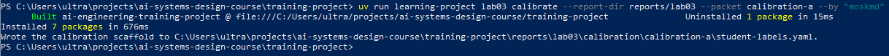

# Лабораторна робота 03

Заповнити кожен розділ українською мовою. Не вилучати заголовки. Відокремлювати спостережені результати від інженерних висновків і рішень. Для статусу `complete` залишити всі наведені відносні шляхи до знімків екрана. Для статусу `honest-partial` вилучити лише посилання на знімки контрольних точок, яких робота не досягла, але залишити посилання на кожний наявний знімок і на `07-final-verification.png`. Не створювати зображення-заповнювачі. На кожному наявному знімку мають бути видимі обліковий запис операційної системи або GitHub і системна дата.

## Ідентифікація подання

- URL форку: https://github.com/MoskMD/ai-systems-design-course
- Назва особистої гілки: lab03/moskmd
- Статус завершення: TBD

## Мета роботи

Отримати свідчення, потрібні команді інженерів, щоб вирішити, чи має кандидатна конфігурація варіант B - замінити базову конфігурацію експерименту - варіант A для оцінюваного використання операції пропозиції поняття з використанням моделі.

## Початковий стан і межа лабораторної роботи 02

Описати синхронізацію форку, результат вхідної перевірки лабораторної роботи 02 та підтвердити, що лабораторна робота 03 не змінила прийняте поняття `Structured Output` або його аудиторський ланцюг.

## Калібрування оцінювача

Виконано калібрування на авторських фікстурах пакету calibration-a для закріплення рубрики оцінювання. Зафіксовано незмінні мітки суджень оцінювача-людини.

Рисунок — `01-calibration.png`

## Розробницькі випадки

У межах лабораторної роботи використано два розробницькі випадки:
1. `dev-source-baseline-definition` — випадок, у якому надані джерельні свідчення є достатніми для формулювання точного зв'язку базового стану джерела з матеріалом для розгляду.
2. `dev-approval-authority-absent` — випадок, у якому наданий текст не містить суб'єкта з повноваженнями затверджувати зміни, через що будь-яке ствердне судження щодо наявності таких повноважень є фактично непідкріпленим джерелом.

## Розробницькі запуски й діагноз варіанта A

Під час виконання запланованих запусків варіанта A на двох розробницьких випадках зафіксовано такі результати:
Позиція `pos-dev-source-baseline-definition-a-1`: зафіксовано результат відмови `failed`. У файлі `error.json` зафіксовано помилку: `openrouter request failed with HTTP 400: Bad Request`.
Позиція `pos-dev-approval-authority-absent-a-1`: зафіксовано результат відмови `failed`. У файлі `error.json` зафіксовано помилку: `openrouter request failed with HTTP 400: Bad Request`.

Обидва живі виклики завершилися помилкою на стороні обробки HTTP-запиту маршрутизатором API ще до етапу генерації відповіді моделлю. Через завершення обох спроб варіанта A термінальними відмовами заплановані позиції варіанта B не запускалися відповідно до регламентного правила обов'язкової зупинки.

## Єдина зміна у варіанті B

У зв'язку з термінальною відмовою обох спроб варіанта A на розробницьких випадках та обов'язковою зупинкою на Кроці 3, формування файлів `student/lab03/variant-b.txt` та `student/lab03/change-declaration.yaml` не виконувалося. 

## Заморожений протокол

Протокол експерименту не заморожувався. Відповідно до протоколу процедури `honest-partial`, за відсутності живих відповідей варіанта A на етапі розробки операція `lab03 freeze` була пропущена для запобігання відкриттю та псуванню відкладених даних.

## Вибір відкладеної родини та виконання

Вибір відкладеної родини та шістнадцять запланованих позицій на відкладених випадках не виконувалися. Доступ до закритих сценаріїв не здійснювався.

## Сліпе семантичне оцінювання

Анонімізоване оцінювання кандидатних відповідей за рубрикою `S`, `I`, `U`, `Q`, `R`, `X` у межах відкладеного порівняння не проводилося через відсутність згенерованих відповідей моделі на етапі відкладеного виконання.

## Агрегати, зрізи й операційні свідчення

## Агрегати, зрізи й операційні свідчення

Послідовні підрахунки робочого процесу для конфігурацій варіанта A і варіанта B на відкладених випадках:
- `attempted`: 0
- `returned`: 0
- `structurally_valid`: 0
- `assessable`: 0
- `rubric_acceptable`: 0

Метрики затримки генерації та вартості використання токенів залишилися невизначеними через відсутність успішного виклику.

## Обмежене рішення щодо конфігурації

Зафіксовано відсутність повноважень на розгортання або запис будь-яких даних до стану знань.

## Регресійний запис

Створення нового регресійного запису пропущено через зупинку процесу до етапу аналізу відхилень моделі від очікуваної поведінки.

## Обмеження й статус завершення

Роботу завершено за регламентною гілкою `honest-partial` із фіксацією параметра `stopped_at_step: "Step 3"`. 

## Остаточна перевірка

Фінальний коміт фіксує всі згенеровані під час роботи свідчення, включно з калібруванням і файлами помилок відмов. Відповідно до протоколу перевірки, точний хеш коміту передається утиліті верифікації, яка формує фінальний результат `passed-partial` у файлі `verification-report.json`. Закомічені файли свідчень після перевірки залишаються незмінними.

Рисунок — `07-final-verification.png`

## Висновки

У межах лабораторної роботи було виконано налаштування робочого середовища, пройдено вхідний контроль Лабораторної роботи 02, здійснено калібрування оцінювача за авторськими фікстурами та проведено регламентні розробницькі запуски базової конфігурації. 

Мету роботи досягнуто частково відповідно до процедури `honest-partial`. Свідчення для ухвалення рішення щодо заміни варіанта A на варіант B не отримано через збій у роботі зовнішнього API маршруту, що унеможливило отримання кандидатних відповідей для формування задуму зміни та проведення сліпого відкладеного тестування.