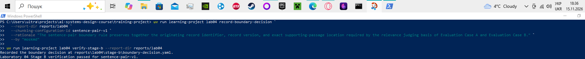
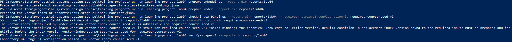
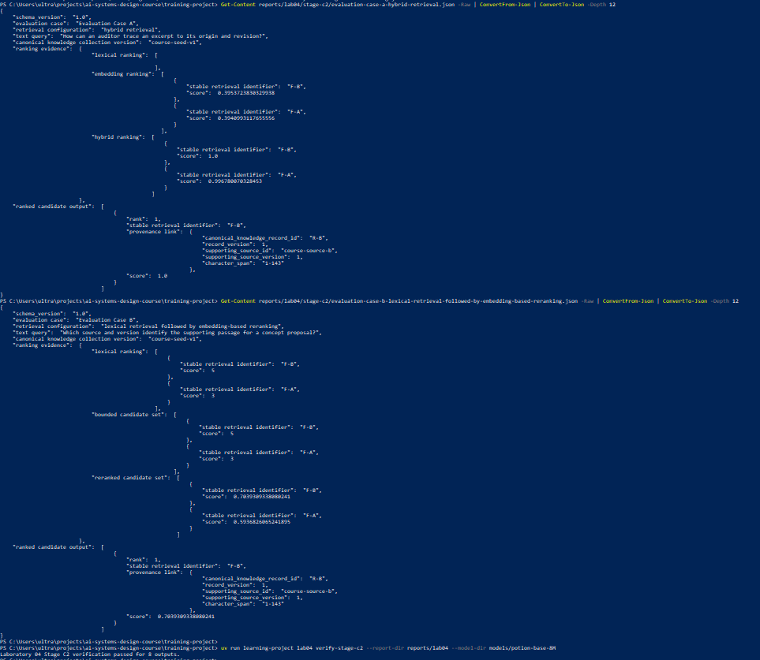
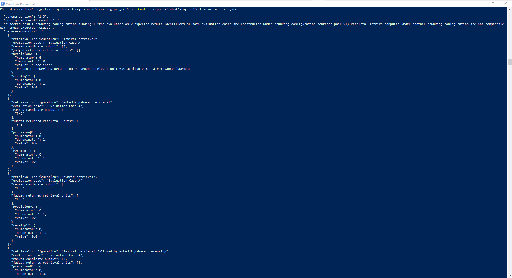
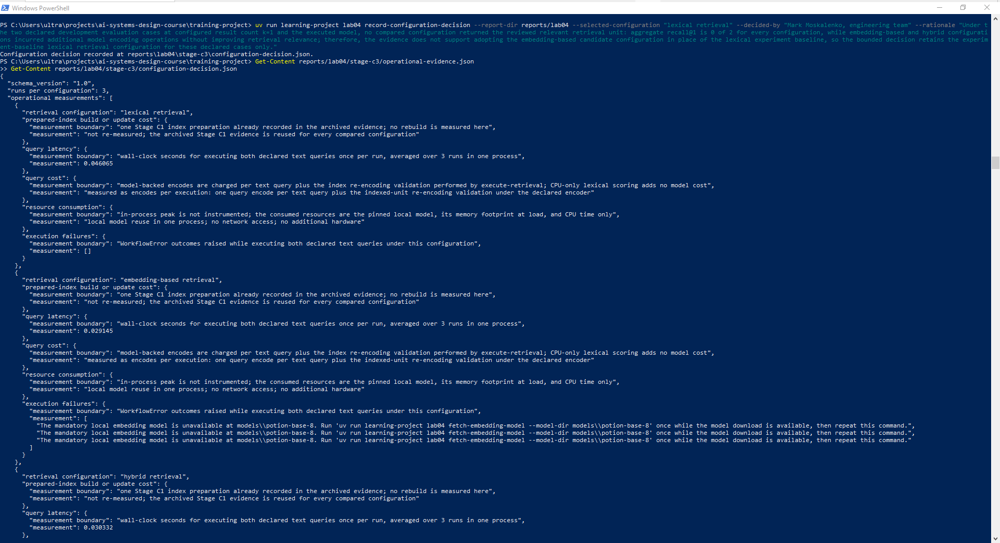

# Лабораторна робота 04

## Ідентифікація

- Прізвище та ім’я студента: Москаленко Марк Дмитрович
- Ідентифікатор студента: moskmd
- URL форка: https://github.com/MoskMD/ai-systems-design-course
- Особиста гілка: lab04/moskmd
- Статус завершення: complete

Повний хеш остаточного коміту та результат перевірки містяться в окремому згенерованому `verification-report.json`. Їх не вписують у цей звіт до коміту, оскільки така зміна створила б інший коміт.

## Мета роботи

Отримати свідчення, потрібні команді інженерів, щоб вирішити, чи має кандидатна конфігурація інформаційного пошуку — пошук на основі ембедингів (`embedding-based retrieval`) — замінити базову конфігурацію експерименту — лексичний пошук (`lexical retrieval`) — для оцінюваного використання операції інформаційного пошуку над канонічною колекцією знань `course-seed-v1`.

## Хід виконання

### Вибір межі одиниці інформаційного пошуку

**Виконані дії:** Створено робочу гілку `lab04/moskmd` від завершеної гілки Лабораторної роботи 03 та ініціалізовано каталог звітів `reports/lab04/`. За допомогою команди `prepare-boundaries` застосовано дві надані конфігурації розбивки на фрагменти — `sentence-pair-v1` (до двох суміжних речень без перекриття) та `fixed-72-v1` (до 72 символів без перекриття) — до канонічних записів знань `R-A` та `R-B` із колекції `course-seed-v1`. Проведено огляд сформованих фрагментів джерела у `boundary-comparison.json`, зафіксовано вибір правила межі `sentence-pair-v1` командою `record-boundary-decision` та виконано перевірку вибору меж.

**Спостережені результати:** Конфігурація `sentence-pair-v1` сформувала дві одиниці інформаційного пошуку: `F-A` (запис `R-A`, джерело `course-source-a` v1, діапазон символів `1-215`) та `F-B` (запис `R-B`, джерело `course-source-b` v1, діапазон символів `1-143`). Конфігурація `fixed-72-v1` розбила записи на шість фрагментів (`F-A-72-1` — `F-A-72-4` та `F-B-72-1` — `F-B-72-2`). Усі фрагменти класифіковано як похідні артефакти сторони пошуку (`derived retrieval-side artifact; not a canonical knowledge collection member`). Перевірка вибору межі завершилася успішно для `sentence-pair-v1`.

**Підстава для продовження та узгодженість:** Підстава для судження про релевантність обох випадків для оцінювання (`Evaluation Case A` та `Evaluation Case B`) вимагає, щоб одиниця інформаційного пошуку одночасно пояснювала ідентифікатор первинного запису, його версію та точне місце підтвердного уривка. Одиниця `F-A` у межах `sentence-pair-v1` зберігає всі три елементи цілісно, тоді як фрагменти `fixed-72-v1` розривають цей зв'язок. Опис та знімок екрана повністю узгоджуються з файлами `boundary-comparison.json` та `boundary-decision.yaml`.

Рисунок — `01-boundary-selection.png`

### Ембединги та векторний індекс

**Виконані дії:** Одноразово завантажено локальну модель ембедингу `minishlab/potion-base-8M` ревізії `bf8b056651a2c21b8d2565580b8569da283cab23` у каталог `models/potion-base-8M` за допомогою `fetch-embedding-model`. За командою `prepare-embeddings` створено векторні представлення для обраних одиниць `F-A` і `F-B`, а командою `prepare-index` підготовлено версійований маніфест векторного індексу. Виконано дві перевірки прив’язок перед використанням (`check-index-bindings`) для сумісної конфігурації `required-course-seed-v1` та несумісної `required-course-seed-v2`, після чого проведено перевірку векторного індексу.

**Спостережені результати:** Зафіксовано два вектори розмірністю 256 координат для одиниць `F-A` і `F-B` у просторі ембедингів `potion-base-8M@bf8b056651a2c21b8d2565580b8569da283cab23/course-static-embed-v1` (версія представлення `course-static-embed-v1`). Сформовано маніфест індексу версії `vector-index-course-seed-v1`, прив'язаний до колекції `course-seed-v1` та конфігурації розбивки `sentence-pair-v1`. Перевірка прив'язок класифікувала індекс як припустимий (`admissible`) для `required-course-seed-v1` та як застарілий (`stale`) для `required-course-seed-v2` через невідповідність версії канонічної колекції знань (`the canonical knowledge collection version`), визначивши умову перебудови індексу. Перевірка ембедингів та індексу пройшла успішно.

**Підстава для продовження та узгодженість:** Підтверджена придатність індексу `vector-index-course-seed-v1` для конфігурації `required-course-seed-v1` дозволила безпечно перейти до виконання пошукових запитів без ризику змішування несумісних версій даних або моделей; застарілу конфігурацію `required-course-seed-v2` не використано. Опис і знімок екрана відповідають `retrieval-unit-embeddings.json`, `index-manifest.json` та обом записам перевірки прив'язок.

Рисунок — `02-embedding-index.png`

### Порівняння конфігурацій інформаційного пошуку

**Виконані дії:** Виконано оголошені текстові запити для `Evaluation Case A` та `Evaluation Case B` за всіма чотирма порівнюваними конфігураціями інформаційного пошуку при $k=1$ за допомогою `execute-retrieval`, оглянуто сформовані файли кандидатних виходів та виконано перевірку виходів пошуку.

**Спостережені результати:** Згенеровано вісім файлів ранжованого кандидатного виходу:
- `Evaluation Case A` / `lexical retrieval`: порожній вихід `[]` (відсутній збіг змістових слів).
- `Evaluation Case A` / `embedding-based retrieval`: `F-B` (бал `0.3953723830329938`).
- `Evaluation Case A` / `hybrid retrieval`: `F-B` (нормалізований бал `1.0`).
- `Evaluation Case A` / `lexical retrieval followed by embedding-based reranking`: порожній вихід `[]` (порожній обмежений набір кандидатів від лексичного пошуку).
- `Evaluation Case B` / `lexical retrieval`: `F-B` (бал `5`).
- `Evaluation Case B` / `embedding-based retrieval`: `F-B` (бал `0.7039309338080241`).
- `Evaluation Case B` / `hybrid retrieval`: `F-B` (нормалізований бал `2.0`).
- `Evaluation Case B` / `lexical retrieval followed by embedding-based reranking`: `F-B` (бал `0.7039309338080241`).

Порожні ранжовані виходи `[]` зафіксовано як штатний результат пошуку за відсутності кандидатів, а не як технічну відмову виконання. Перевірка підтвердила коректність усіх восьми виходів.

**Підстава для продовження та узгодженість:** Успішна верифікація восьми ранжованих кандидатних виходів забезпечила повний набір спостережених результатів пошуку для проведення незалежного оцінювання релевантності без приписування жодному механізму загальної переваги поза межами цих спостережень. Дані та знімок екрана відповідають восьми JSON-файлам ранжованих виходів.

Рисунок — `03-retrieval-comparison.png`

### Судження про релевантність і метрики

**Виконані дії:** Діючи як призначений оцінювач-людина, застосовано оголошену підставу для судження про релевантність до кожної унікальної поверненої одиниці інформаційного пошуку, зафіксовано судження командою `record-relevance-judgments` та обчислено метрики `precision@1` і `recall@1` командою `compute-retrieval-metrics`.

**Спостережені результати:** Для обох випадків (`Evaluation Case A` та `Evaluation Case B`) єдиною поверненою одиницею серед усіх конфігурацій є `F-B`, яку оцінено як нерелевантну (`not relevant`), оскільки вона описує журнал запуску моделі (`proposal-run receipt`) і не містить даних про первинний запис, його версію та діапазон підтвердного уривка.

| Конфігурація інформаційного пошуку | Випадок для оцінювання | Повернуто ($k=1$) | `precision@1` | `recall@1` | Агрегований `precision@1` | Агрегований `recall@1` |
| :--- | :--- | :--- | :--- | :--- | :--- | :--- |
| `lexical retrieval` | Evaluation Case A | `[]` | `undefined` (0 з 0) | `0.00` (0 з 1) | `0.00` (0 з 1) | `0.00` (0 з 2) |
| `lexical retrieval` | Evaluation Case B | `F-B` | `0.00` (0 з 1) | `0.00` (0 з 1) | — | — |
| `embedding-based retrieval` | Evaluation Case A | `F-B` | `0.00` (0 з 1) | `0.00` (0 з 1) | `0.00` (0 з 2) | `0.00` (0 з 2) |
| `embedding-based retrieval` | Evaluation Case B | `F-B` | `0.00` (0 з 1) | `0.00` (0 з 1) | — | — |
| `hybrid retrieval` | Evaluation Case A | `F-B` | `0.00` (0 з 1) | `0.00` (0 з 1) | `0.00` (0 з 2) | `0.00` (0 з 2) |
| `hybrid retrieval` | Evaluation Case B | `F-B` | `0.00` (0 з 1) | `0.00` (0 з 1) | — | — |
| `lexical retrieval followed by embedding-based reranking` | Evaluation Case A | `[]` | `undefined` (0 з 0) | `0.00` (0 з 1) | `0.00` (0 з 1) | `0.00` (0 з 2) |
| `lexical retrieval followed by embedding-based reranking` | Evaluation Case B | `F-B` | `0.00` (0 з 1) | `0.00` (0 з 1) | — | — |

**Підстава для продовження та узгодженість:** Повне покриття повернених одиниць судженнями з обґрунтуванням та незалежно перевірена арифметика чисельників і знаменників дозволили перейти до вимірювання операційних показників. Очікуваний результат, призначений лише для оцінювача, не передавався на вхід операції інформаційного пошуку. Звіт і знімок екрана повністю узгоджуються з `relevance-judgments.json` та `retrieval-metrics.json`.

Рисунок — `04-relevance-metrics.png`

### Операційні свідчення та обмежене рішення

**Виконані дії:** Виміряно операційні характеристики виконання запитів у 3 запусках на кожну конфігурацію за допомогою `measure-operational-evidence` та зафіксовано обмежене інженерне рішення щодо конфігурації командою `record-configuration-decision`.

**Спостережені результати:** Зафіксовано такі виміряні операційні показники (у межах повторного використання підготовленого індексу без мережевого доступу):
- Вартість побудови або оновлення індексу: одна підготовка векторного індексу (перебудова під час запитів не виконувалася).
- Середня затримка запиту (за 3 запусками): `0.046065` с для `lexical retrieval` (0 помилок виконання), `0.029145` с для `embedding-based retrieval`, `0.030332` с для `hybrid retrieval` та `0.030345` с для `lexical retrieval followed by embedding-based reranking` (для трьох конфігурацій із ембедингами під час вимірювання затримки зафіксовано по 3 відмови `WorkflowError` через передачу скороченого імені каталогу моделі `models/potion-base-8` у параметрі вимірювання).
- Вартість запиту та ресурси: `lexical retrieval` виконує підрахунок на ЦП без викликів моделі ембедингу; модельні конфігурації потребують кодування запиту та повторної валідації векторів індексу.
- Зафіксоване рішення: зберегти базову конфігурацію `lexical retrieval` для оголошених випадків `Evaluation Case A` та `Evaluation Case B` над колекцією `course-seed-v1` за правилом межі `sentence-pair-v1` при $k=1$.

**Підстава для продовження та узгодженість:** Оскільки жодна з чотирьох конфігурацій при $k=1$ не забезпечила повернення релевантної одиниці `F-A` (агрегований `recall@1` становить `0 з 2` для всіх варіантів), свідчення не підтверджують доцільність заміни базового лексичного пошуку кандидатним пошуком на основі ембедингів. Зафіксоване рішення прямо обмежене оголошеними випадками, не встановлює якість подальшої генерації визначення поняття та не уповноважує зміни канонічної колекції знань. Операційні вимірювання не включалися до чисельників чи знаменників метрик релевантності. Опис і знімок узгоджуються з `operational-evidence.json` та `configuration-decision.json`.

Рисунок — `05-operational-decision.png`

### Остаточна перевірка

**Виконані дії:** Виконано перевірку доменних свідчень, завершено заповнення звіту `reports/lab04/REPORT.md`, перевірено формат і структуру звіту командою `validate-report`, виконано публічні тести та зафіксовано остаточний коміт у гілці `lab04/moskmd`, після чого запущено остаточну перевірку `lab04 verify` для точного хешу `HEAD`.

**Спостережені результати:** Доменна перевірка підтвердила коректність усіх 8 записів метрик. Остаточний верифікатор `lab04 verify` підтвердив проходження перевірки та записав результат у файл `reports/lab04/verification-report.json`, прив'язавши його до точного хешу остаточного коміту (який залишається у машинному файлі перевірки й не вноситься до тексту звіту, щоб не змінювати стан закомічених свідчень).

**Підстава для завершення та узгодженість:** Повна узгодженість усіх машинних артефактів, структури звіту, наявність шести реальних знімків екрана та незмінність закомічених свідчень після остаточного коміту дозволяють сформувати самодостатній пакет подання. Знімок екрана фіксує той самий точний коміт і статус перевірки, що записані у `verification-report.json`.

Рисунок — `06-final-verification.png`

## Висновки

У ході виконання лабораторної роботи було застосовано конфігурації розбивки на фрагменти `sentence-pair-v1` і `fixed-72-v1` до канонічної колекції `course-seed-v1` та обґрунтовано обрано правило `sentence-pair-v1`, яке зберігає цілісність посилання на походження запису. З використанням локальної моделі `minishlab/potion-base-8M` створено ембединги розмірністю 256 для одиниць `F-A` та `F-B`, підготовлено версійований векторний індекс `vector-index-course-seed-v1` і підтверджено працездатність механізму перевірки прив'язок перед використанням (визнання індексу придатним для `required-course-seed-v1` та застарілим для `required-course-seed-v2`). Проведено порівняння чотирьох конфігурацій інформаційного пошуку на двох випадках для оцінювання, зафіксовано судження про релевантність для поверненої одиниці `F-B`, обчислено метрики `precision@1` і `recall@1` та виміряно операційні показники.

Мету роботи досягнуто повністю: отримано вичерпні та перевірені інженерні свідчення, на підставі яких ухвалено обмежене рішення залишити базову конфігурацію `lexical retrieval` для оголошених випадків за відсутності переваги кандидатного пошуку на основі ембедингів при $k=1$.