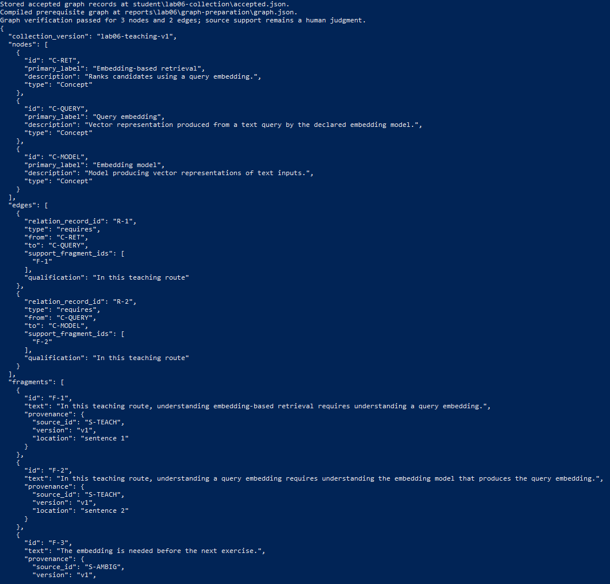
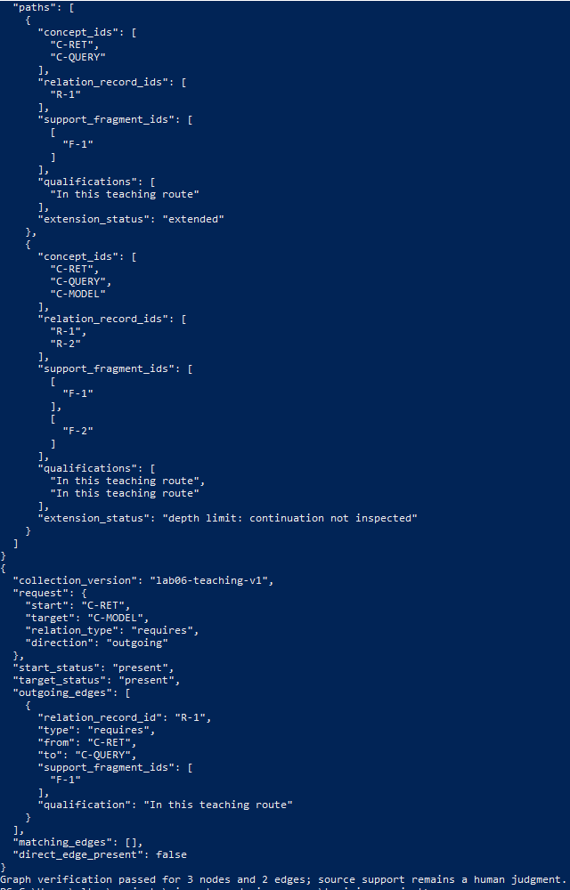
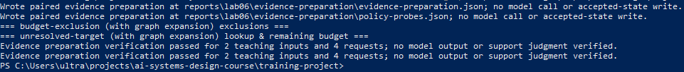
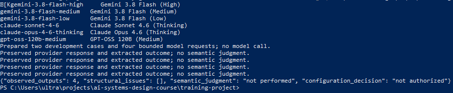
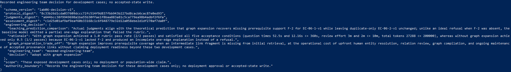
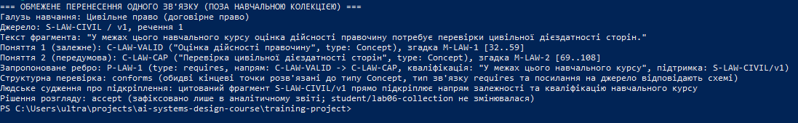

# Лабораторна робота 06

## Ідентифікація

- Прізвище та ім'я: Москаленко Марк Дмитрович
- Ідентифікатор студента: moskmd
- URL форка: https://github.com/MoskMD/ai-systems-design-course
- Особиста гілка: lab06/moskmd
- Статус завершення: complete

## Мета роботи

Закрити розрив після ранжування інформаційним пошуком на шляху передумов завдяки побудові перевіреного графа понять,
виконанню обмежених запитів до графа без ототожнення обходу з логічним виведенням, підготовці парних джерельних 
свідчень та обмежених запитів до моделі з розширенням вибірки вузлів графа і без нього, виконанню операції пояснення
передумов із використанням моделі за обома конфігураціями та незалежному оцінюванню покриття свідченнями і якості 
відповідей із ухваленням обмеженого рішення щодо конфігурації на відкритих випадках для розроблення.

## Хід виконання

### Підготовка прийнятого графа

Сформовано файл розгляду пропозицій командою `prepare-graph-review`, проведено ручне розв'язання шести згадок понять
(`M-1`–`M-6`) та семантичний розгляд чотирьох запропонованих зв'язків (`P-1`–`P-4`) із зазначенням ідентифікатора \
рецензента `moskmd` та уповноваження `authorize: true`, після чого збережено прийняту колекцію, скомпільовано граф 
та виконано його структурну перевірку.

Згадки `M-1` (`C-RET`), `M-2`, `M-3`, `M-5` (`C-QUERY`) та `M-4` (`C-MODEL`) зіставлено з прийнятими поняттями 
(`match`), тоді як неоднозначну згадку `M-6` (`"embedding"` у `F-3`) зафіксовано як нерозв'язану (`unresolved`). 
Пропозиції `P-1` (`C-RET` requires `C-QUERY`, підкріплено `F-1`) та `P-2` (`C-QUERY` requires `C-MODEL`, підкріплено
`F-2`) прийнято (`accept`) як зв'язки `R-1` та `R-2`; обернену пропозицію `P-3` відхилено (`reject`), а пропозицію 
`P-4` з нерозв'язаною кінцевою точкою `M-6` заблоковано. Скомпільований граф містить 3 вузли (`C-RET`, `C-QUERY`, 
`C-MODEL`) та 2 спрямовані ребра (`R-1`, `R-2`) без прямого ребра від `C-RET` до `C-MODEL`. Верифікатор повідомив 
`Graph verification passed for 3 nodes and 2 edges; source support remains a human judgment.`

Структурна перевірка контролює лише відповідність типів кінцевих точок, напряму та наявність посилання на джерело 
згідно зі схемою графа, але не підтверджує змістове підкріплення (наприклад, інвертована пропозиція `P-3` пройшла 
структурну перевірку як `conforms`, проте була відхилена людиною після зіставлення з текстом `F-1`). Підтверджена 
узгодженість прийнятого стану дозволила перейти до запитів до графа. Опис і знімок екрана повністю узгоджуються з 
файлами `reports/lab06/graph-preparation/review.json`, `student/lab06-collection/accepted.json` та 
`reports/lab06/graph-preparation/graph.json`.

### Обмежені запити до графа

Виконано обмежені вихідні запити `requires` від початкового поняття `C-RET` на глибину одного та двох ребер 
(`query-paths` з `--max-edges 1` і `--max-edges 2`), проведено окрему перевірку наявності прямого ребра між `C-RET` 
та `C-MODEL` (`inspect-direct-edge`) та повторно підтверджено цілісність графа (`verify-graph`).

Запит на 1 ребро повернув шлях `C-RET -> C-QUERY` (`R-1`, підкріплення `F-1`,кваліфікація `"In this teaching route"`) 
зі статусом `depth limit: continuation not inspected`. Запит на 2 ребра повернув два шляхи: однореберний `C-RET -> 
C-QUERY` (зі статусом `extended`) та двореберний `C-RET -> C-QUERY -> C-MODEL` із послідовністю записів відношень 
`["R-1", "R-2"]`, списком підкріплень `[["F-1"], ["F-2"]]` та збереженням проміжного поняття `C-QUERY`. Інспекція 
прямого ребра підтвердила присутність обох кінцевих точок (`present`), наявність лише одного вихідного ребра `R-1` 
(`C-RET -> C-QUERY`) та відсутність прямого ребра (`matching_edges: []`, `direct_edge_present: false`).

Виконані запити точно відповідають шаблону Cypher `MATCH p = (start:Concept {id: 'C-RET'})-[:requires*1..2]->
(prerequisite:Concept)` із фільтрацією повторюваних вузлів у межах одного шляху та поверненням проміжних вузлів і 
записів відношень. Межа глибини на одне ребро залишає подальше продовження неоглянутим, інспекція прямого ребра 
встановлює лише відсутність збереженого прямого ребра в графі, але жодне з цих спостережень не доводить відсутність 
залежності в предметній області й не створює виведеного ребра без логічного виведення. Опис і знімок екрана 
повністю узгоджуються з файлами `reports/lab06/graph-query/paths-1.json`, `paths-2.json` та `direct-edge.json`.

### Підготовка джерельних свідчень

Виконано парну підготовку джерельних свідчень і обмежених запитів до моделі без розширення вибірки вузлів графа та 
з розширенням графа (`prepare-evidence`) для основних навчальних входів (`support-addition`, `budget-exclusion`) і 
політичних зондів (`duplicate-only`, `unresolved-target`) у межах бюджету контексту 250 символів, після чого 
проведено перевірку обох записів (`verify-evidence`).

Для входу `support-addition` конфігурація без розширення графа допустила лише `F-1` (105 символів, залишок бюджету 
145), тоді як конфігурація з розширенням графа однозначно розв'язала `C-RET`, виявила `F-2` (133 символи) через 
шлях `R-1 -> R-2` і допустила `[F-1, F-2]` (залишок 12 символів). Для входу `budget-exclusion` розширення графа 
виявило `F-2`, але вилучило його за критерієм відповідності бюджету контексту (`context-budget fit`), оскільки 
після допуску `[F-1, F-3]` (154 символи) залишок у 96 символів був меншим за 133 символи `F-2`. Для зонда 
`duplicate-only` виявлений фрагмент `F-2` уже був серед початкових кандидатів `[F-1, F-2]`, тому 
`added_fragment_ids` залишився порожнім, а парні запити до моделі залишилися ідентичними. Для зонда 
`unresolved-target` (початковий кандидат `[F-2]`) пошук вхідного вузла `C-RET` завершився статусом `unresolved`, 
розширення не виконувалося, а запит побудовано за запасним шляхом із початкового `[F-2]`. Обидві перевірки вивели 
`Evidence preparation verification passed for 2 teaching inputs and 4 requests; no model output or support judgment 
verified.`

Виявлення фрагмента через обхід графа не гарантує його допуску до запиту, якщо перевищено бюджет контексту 
(`budget-exclusion`), а виявлення дублікатів не змінює множину допущених одиниць (`duplicate-only`). Кожен обмежений
запит до моделі містить виключно три обов'язкові поля (`task instruction`, `supplied source evidence`, `output 
contract`), залишаючи шляхи в графі та п'ять оцінювальних полів поза межами запиту. Опис і знімок екрана повністю 
узгоджуються з файлами `reports/lab06/evidence-preparation/evidence-preparation.json` та `policy-probes.json`.

### Спостережені виходи операції

Перевірено доступність моделі `gemini-3.8-flash-low` та коректність глобального файлу правил, заморожено спільний 
протокол експерименту (`prepare-generation`) і виконано чотири живі запуски операції пояснення передумов 
(`run-generation`) для двох випадків (`EC-06-1-v1`, `EC-06-2-v1`) та обох конфігурацій підготовки свідчень, після 
чого проведено структурну перевірку виходів (`verify-generation`).

Усі чотири запуски завершилися без технічних переривань або офлайн-імпорту:
- `EC-06-1-v1` / `without graph expansion`: сформовано `generated prerequisite explanation` з одним твердженням про 
залежність `Embedding-based retrieval -> Query embedding` (цитування `["F-1"]`, час запитання `11.55` с, `13322` 
токени).
- `EC-06-1-v1` / `with graph expansion`: сформовано `generated prerequisite explanation` із двома твердженнями, що 
розкривають двореберний ланцюг через `Query embedding` до `Embedding model` (цитування `["F-1"]` та `["F-1", "F-2"]`,
час запитання `52.50` с, `13637` токенів).
- `EC-06-2-v1` / `without graph expansion`: сформовано `generated prerequisite explanation` із двома твердженнями, 
що розкривають обидва зв'язки з кваліфікацією навчального маршруту (цитування `["F-1"]` та `["F-2"]`, час запитання 
`12.30` с, `15954` токенів).
- `EC-06-2-v1` / `with graph expansion`: сформовано `generated prerequisite explanation` із двома твердженнями, що 
розкривають повний двореберний шлях (цитування `["F-1"]` та `["F-1", "F-2"]`, час запитання `12.16` с, `13651` токен).

Верифікатор повідомив `{"observed_outputs": 4, "structural_issues": [], "semantic_judgment": "not performed", 
"configuration_decision": "not authorized"}`.

Структурна перевірка підтвердила коректність JSON-схеми та наявність ідентифікаторів цитованих фрагментів у кожному 
твердженні, але зафіксувала, що семантичне судження про підкріплення джерелом ще не виконувалося. Опис і знімок 
екрана повністю узгоджуються з файлами `reports/lab06/generation/protocol.json` та чотирма каталогами запусків під 
`reports/lab06/generation/runs/`.

### Незалежні судження та обмежене рішення

Діючи окремо як оцінювач-людина (`moskmd-evaluator`), підготовлено (`prepare-judgments`) та заповнено незалежні 
судження про покриття свідченнями і якість відповідей у `judgments.json`, обчислено локальні частки проходження 
рубрики оцінювання та перевірено заморожені умови прийняття (`assess-comparison`), після чого як команда інженерів 
(`moskmd-engineering-team`) зафіксовано обмежене рішення (`record-decision`).

- Для конфігурації `without graph expansion`: на `EC-06-1-v1` покриття свідченнями становило `[true, false]` 
(відсутній `F-2`), а відповідь отримала `fail` (чисельник 1, знаменник 2, частка проходження рубрики `0.5`, 
невиконаних суджень `0`), оскільки модель замість відмови сформувала неповне однореберне пояснення без зв'язку до 
`Embedding model`; на `EC-06-2-v1` покриття становило `[true, true]`, відповідь отримала `pass`. Мінімальна умова 
проходження рубрики `1.0` не виконана (`minimum_rubric_pass_rate: false`, `qualifies: false`), операційні умови 
виконані (час `11.55` с і `12.30` с ≤ 360 с, зусилля `3` і `2` хв ≤ 10 хв, сума токенів `29276` ≤ 200 000).
- Для конфігурації `with graph expansion`: на обох випадках `EC-06-1-v1` та `EC-06-2-v1` покриття свідченнями 
становило `[true, true]`, обидві відповіді отримали `pass` (чисельник 2, знаменник 2, частка проходження рубрики 
`1.0`, невиконаних суджень `0`). Усі п'ять умов прийняття виконано (час `52.50` с і `12.16` с ≤ 360 с, зусилля `3` 
і `2` хв ≤ 10 хв, сума токенів `27288` ≤ 200 000, `qualifies: true`).
- Зафіксовано дозволене обмежене рішення: `adopt with graph expansion`.

Фактичні результати підтвердили навчальний прогноз щодо переваги розширення графа при неповному початковому наборі 
кандидатів (`EC-06-1-v1`) та незмінності при дублікатах (`EC-06-2-v1`), виявивши водночас схильність базової моделі 
формувати неповне пояснення замість відмови. Основний компроміс підготовки графа полягає у тому, що підвищення 
повноти свідчень досягається ціною попередніх витрат на людське розв'язання згадок, перевірку зв'язків, компіляцію 
та супровід графа. Опис і знімок екрана повністю узгоджуються з файлами `reports/lab06/judgments.json`, 
`comparison.json` та `decision.json`.

### Перенесення одного зв’язку

### Остаточна перевірка

Завершено оформлення звіту `reports/lab06/REPORT.md`, перевірено його структуру й посилання командою 
`validate-report`, зафіксовано остаточний коміт у гілці `lab06/moskmd` та виконано остаточну перевірку 
`lab06 verify` для точного хешу `HEAD`.

Валідатор підтвердив проходження всіх структурних перевірок звіту (`passed`). Остаточна перевірка `lab06 verify` 
підтвердила належність усіх свідчень і прийнятої колекції до точного остаточного коміту та відтворення 
детермінованих перевірок, записавши статус `passed` у файл `reports/lab06/verification-report.json`.

### Межа зупинки

Не застосовується.

## Висновки

У ході виконання лабораторної роботи побудовано та перевірено прийнятий граф передумов із 3 вузлами 
(`C-RET`, `C-QUERY`, `C-MODEL`) і 2 спрямованими ребрами (`R-1`, `R-2`), виконано обмежені запити до графа на 1 і 2 
ребра та перевірено відсутність прямого ребра `C-RET -> C-MODEL`, підготовлено парні джерельні свідчення та 
обмежені запити до моделі з розширенням вибірки вузлів графа і без нього, проведено чотири запуски операції 
пояснення передумов моделлю `gemini-3.8-flash-low`, виконано незалежне оцінювання покриття свідченнями і якості 
відповідей, зафіксовано обмежене рішення `adopt with graph expansion` та виконано перенесення межі розгляду на один 
синтетичний зв'язок із галузі цивільного права.